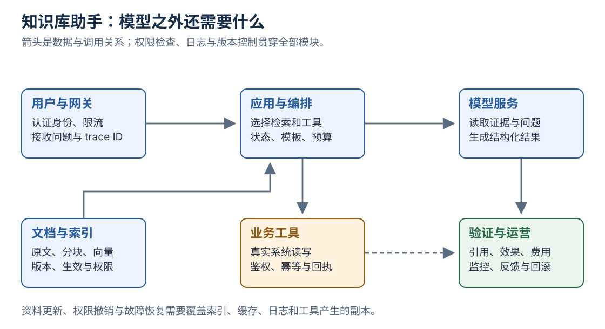

[返回系列导读](/notes/ai-handbook-roadmap/)

## 1. 先写需求，暂时不选框架

目标：员工查询现行公司制度，回答应给出处；资料不足时追问或拒答；只允许读取本人可访问的内容。

第一版不提交申请、不修改制度，也不尝试自动处理所有企业业务。把成功标准缩小，才容易确认系统是否真的有用。

本篇设备借用规则为虚构教学材料，与任何真实公司制度无关。

## 2. 输入、输出与验收

输入不只是用户文字，还包括认证身份、部门、时间与允许使用的数据范围。

输出应包含结论、证据、资料版本，以及需要确认的信息。验收题要覆盖有答案、无答案、版本冲突、权限、错误工具结果和长文干扰。

不要直接写“准确率达到 95%”而没有说明题集、评分与失败类型。先建立共同认可的题目和评分规则，再确定目标。

## 3. 系统架构与责任

图中要注意：权限和观测不是生成后的装饰，它们贯穿检索、工具和结果。

| 模块 | 责任 | 可观察产物 |
|---|---|---|
| 身份与网关 | 认证、租户、限流 | 请求身份与 trace ID |
| 文档处理 | 解析、分块、版本与权限 | 可回查的文本块 |
| 检索重排 | 找到足够证据 | 候选 ID、分数与过滤原因 |
| 模型编排 | 组织任务与上下文 | 模板版本与请求配置 |
| 输出检查 | 引用、格式与业务边界 | 验证结果 |
| 运营 | 反馈、成本、知识更新、回滚 | 监控与回归记录 |

模型服务可以是外部 API 或自建，前面模块的责任并不会因此消失。

## 4. 文档上线前的处理

为每个文档指定负责人，记录生效时间、适用对象、替代版本、访问组和出处。解析后抽查数字、表格、否定和例外条件。

更新时把新增、替换、删除传播到索引与缓存。文件上传成功，只说明传输完成，不能替代整条数据链的验证。

## 5. 一次问答如何执行

用户问“设备借用上限是多少”：

1. 从会话取得身份，不接受用户随意自报管理员。
2. 限定当前用户可访问且当前生效的制度。
3. 检索并重排候选。
4. 判断是否有足够证据。
5. 把条款、日期与来源 ID 送给模型。
6. 要求依据条款回答，缺条件时指出缺口。
7. 检查引用与权限，返回结论。
8. 记录必要耗时、版本、费用和反馈。

如果问题要求“帮我申请”，转入另一条明确授权的写操作流程，不把知识问答工具偷偷升级为提交工具。

## 6. 本地实验：权限与版本如何改变检索范围

下面可直接用 Python 标准库运行。它使用人工关键词和模板回答，**没有调用 Embedding 或 LLM，不是完整生产 RAG**。先用确定性程序理解数据与证据约束。

~~~python
from datetime import date

documents = [
    {
        "id": "equipment-old", "title": "设备借用制度旧版",
        "words": {"设备", "借用", "上限"}, "answer": "最多 2 台",
        "valid_from": "2025-01-01", "valid_to": "2025-12-31",
        "groups": {"employees"},
    },
    {
        "id": "equipment-current", "title": "设备借用制度现行版",
        "words": {"设备", "借用", "上限"}, "answer": "最多 3 台",
        "valid_from": "2026-01-01", "valid_to": "2026-12-31",
        "groups": {"employees"},
    },
    {
        "id": "executive-private", "title": "特定岗位设备制度",
        "words": {"设备", "借用", "上限"}, "answer": "特定岗位规则",
        "valid_from": "2026-01-01", "valid_to": "2026-12-31",
        "groups": {"executives"},
    },
]

today = date(2026, 10, 20)
session_groups = {"employees"}  # 教学中固定，真实系统来自认证会话
query_words = {"设备", "借用", "上限"}

visible = [
    d for d in documents
    if d["groups"] & session_groups
    and date.fromisoformat(d["valid_from"]) <= today
    <= date.fromisoformat(d["valid_to"])
]
ranked = sorted(
    visible,
    key=lambda d: len(query_words & d["words"]),
    reverse=True,
)
if not ranked or not (query_words & ranked[0]["words"]):
    print("没有足够资料，请补充问题或联系制度负责人。")
else:
    evidence = ranked[0]
    print(f"依据《{evidence['title']}》：{evidence['answer']}。")
    print(f"来源：{evidence['id']}；已按当前日期与会话权限筛选。")
~~~

预期选中现行版并输出“最多 3 台”。旧版被日期过滤，特定岗位制度被权限过滤；不是靠模型最后决定“这些别说”。

改实验时可以观察：删除现行文档、改变会话组、改变查询关键词。真正系统要把这个逻辑与文档更新、细粒度权限、可靠检索和生成结合。

## 7. 如果扩展为销售助手

销售助手可能读取 CRM、客户会议记录、产品库并生成跟进草稿。

先保持只读与草稿流程，再明确设计“写回 CRM”“发送邮件”等操作：参数、身份、审批、幂等、回执与失败恢复各自可查。

多来源客户信息也要标时间与出处。过去报价、客户推测和已经确认的合同，不应混成同一类事实。

## 8. 分阶段落地与评估

先完成有权限的文档检索，验证正确证据能找到。再加入生成，检查忠实性、引用和拒答。之后才增加有明确价值的工具与动态决策。

每阶段保留基线，测同一组题，记录质量、成本与延迟。新组件必须证明收益，不能只因为架构图更复杂就保留。

## 9. 从故障倒查

回答旧规则：查版本过滤与缓存。

答了用户无权内容：查检索、摘要、缓存和日志的权限链。

找对条款却漏条件：查上下文与生成验证。

工具声称成功但后台无记录：查回执、状态与执行日志。

上线变慢：拆排队、检索、重排、模型、工具与网络耗时。

## 复习卡片与自测

- 第一步是需求、数据和验收，不是框架。
- 证据需要来源、版本和权限。
- 检索可以先独立验证，再接生成。
- 写操作必须有独立的授权和执行闭环。

**1. 上面本地代码已经证明 LLM 能正确回答了吗？**

参考答案
没有。它只证明教学数据上的筛选与模板输出流程，真实检索和模型生成仍需要接入与评估。

**2. 为什么旧制度不能只从网页列表隐藏？**

参考答案
它可能仍留在向量、缓存和摘要中，需要在各副本实现版本与撤销管理。

**3. 用户从问规则改为要求提交申请，系统发生了什么变化？**

参考答案
从信息查询进入有副作用的业务操作，需要重新检查授权、参数、幂等与执行回执。

## 原文定位

依据：[原资料](https://essential1220.github.io/presales-tech-guide/) 15.1—15.4、14.5、19.3、19.7。案例为自主构造的教学示例，不是项目实测报告。
