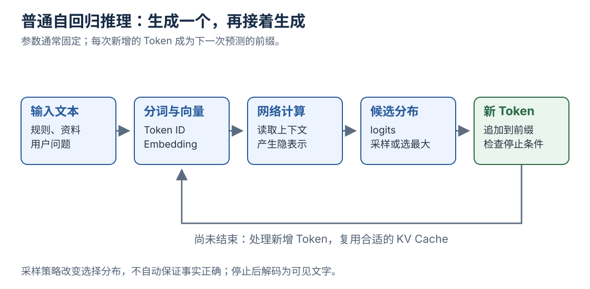

[返回系列导读](/notes/ai-handbook-roadmap/) · 先修：[Token 与 Embedding](/notes/ai-handbook-token-and-embedding/)

## 1. 模型训练与使用是两个阶段

训练会根据数据和损失修改参数；推理是在已有参数上计算输出，通常不会因为你发了一条消息，就立即更新整个模型权重。

聊天中“它记住了我前面说的话”，常常是应用把对话历史再次放进输入。参数记忆、当前上下文和应用保存的长期资料，是三个不同位置。

## 2. 预训练：从数据构造学习目标

自回归语言模型常用“根据前面的 Token 预测后一个”的目标：

$$
P(x_1,\ldots,x_T)=\prod_{t=1}^{T}P(x_t\mid x_{<t})
$$

$x_t$ 是第 $t$ 个 Token，$x_{<t}$ 表示它之前的前缀。乘法来自把整段文本的联合概率拆成条件概率。

训练时对真实下一 Token 的概率计算负对数损失：

$$
L=-\frac1T\sum_{t=1}^{T}\log P_\theta(x_t\mid x_{<t})
$$

$\theta$ 表示模型参数。正确 Token 的概率越低，损失越大。这里是模型学习的一种目标，不是事实正确性的直接评分器。

例如训练文本“我 喜欢 学习 AI”，输入可以是“我 喜欢 学习”，目标向后错一位为“喜欢 学习 AI”。因果掩码阻止每个位置偷看它要预测的后文。

## 3. 为什么训练能并行，而生成通常逐步进行

训练时答案文本已经给定，模型可同时计算多个位置的预测损失。这叫常见的 teacher forcing 方式：前缀使用训练数据里的真实 Token。

推理时后文未知，必须先选出一个 Token，把它接到前缀后，再计算下一个。模型生成了错误内容，后面还可能沿错误前缀继续，因此训练与生成面对的输入分布并不完全相同。

一次训练样本通常还包含结束与角色标记。指令微调时，某些位置如用户输入可能不计入回答损失，具体取决于训练配置。

## 4. 数据质量与规模为什么都重要

收集很多文本后，还要考虑授权、清洗、去重、质量筛选、语言与任务配比、个人信息处理，以及评测集污染。

“更多数据”不能单独保证提升：大量重复、错误或偏狭内容可能浪费计算并影响模型行为。训练集包含测试答案，还会让评测失真。

常见稠密 Transformer 的粗略训练量级写法是 $C\approx6ND$：$N$ 为参数量，$D$ 为训练 Token 数，$C$ 以浮点操作数计。它有架构与计算口径假设，不包含所有系统开销，也不能直接用于任何 MoE 或特殊结构。

只知道参数量还不够估计训练时长：还要看有效硬件吞吐、并行效率、数据管道与训练策略。

**MoE，Mixture of Experts，混合专家**，会通过路由让部分 Token 使用部分专家模块。总参数量与每个 Token 实际激活的参数量可能不同。它可能减少相应计算，但仍要考虑权重存储、路由与专家间通信，不能把所有总参数直接代入稠密模型口诀。

## 5. SFT 与偏好对齐各解决什么

**预训练**主要学习大量数据中的规律。**SFT，监督微调**用任务输入与期望输出教模型怎样响应指令。**偏好对齐**利用不同回答之间的偏好，进一步塑造行为。

例如同一个问题：

- 预训练模型可能继续补写一段类似网页文本。
- 指令模型更可能直接回答问题。
- 加入合适偏好与安全训练后，可能更重视格式、证据、边界与拒答。

这只是机制上的区分，实际训练流程可以交错组合。对齐不保证永远诚实、永远安全，也不能弥补所有知识缺失。

相关公式与数据组织见[SFT、RLHF 与 DPO](/notes/ai-handbook-alignment-and-training-data/)。

## 6. 一次生成的完整路径

看图时留意回路：新 Token 被追加到前缀，才进入下一次预测；普通推理过程中没有画出权重更新。

假设提示是“公司的年假规则是”：

1. 应用组织系统说明、历史对话、用户问题和可能的检索资料。
2. Tokenizer 把文本转换成 ID。
3. 网络计算各位置表示。
4. 输出投影得到词表中每个候选的 logits。
5. 根据采样策略选一个新 Token。
6. 追加到序列，重复计算，直到结束标记、长度上限或停止条件。
7. Tokenizer 解码成用户看到的文本。

一个 Token 可能只对应半个词或字符片段，因此屏幕上“一个字一个字冒出来”只是近似观感。

## 7. Greedy、Temperature、Top-K 与 Top-P

**Greedy**每次选当前最高分的候选。它追求当前一步最优，不保证整段文本是全局最优。

Temperature（温度）常通过 $z_i/\tau$ 调整分布，再做 Softmax。$\tau>0$ 时，较低温度使分布更集中，较高温度使分布更平。产品里的“温度为 0”通常表示某种确定性选择分支，并非真的做除以零。

**Top-K**只保留分数最高的 K 个候选。**Top-P**保留按概率降序累加、达到阈值 P 的最小候选集合，再重新归一化采样。参数组合的具体应用顺序需看实现。

低温不等于事实正确，高温不等于有创意；它们改变的是选择分布。多个候选都错误时，降低随机性只会更稳定地选错。

~~~python
import math

def distribution(logits, temperature):
    scaled = [z / temperature for z in logits]
    m = max(scaled)
    e = [math.exp(z - m) for z in scaled]
    return [round(v / sum(e), 3) for v in e]

for t in [0.5, 1.0, 2.0]:
    print(t, distribution([2.0, 1.0, 0.0], t))
# 0.5 [0.867, 0.117, 0.016]
# 1.0 [0.665, 0.245, 0.09]
# 2.0 [0.506, 0.307, 0.186]
~~~

这个例子演示分布变平，不调用真实语言模型。即使三个数字不变，实际采样也会带来不同结果。

## 8. 推理模型与“多想一会儿”

有些模型经过专门训练，利用更多中间计算、搜索、验证或生成步骤处理复杂任务。增加推理时计算可能帮助某些题，但效果依赖训练方式、任务和验证机制。

给普通模型写一句“请认真思考”，不等于完成了这类训练。可见的解释文本也不一定忠实反映全部内部计算过程。

学习时可以要求“给关键步骤、说明依据、检查结果”，然后用可验证的计算与资料检查。不要仅凭解释长、语气确定就相信结论。

## 9. 能力与局限要一起理解

语言模型能综合语言模式、知识与训练中形成的能力，但它不天然连接实时数据库，也不天然拥有可靠计算器、永久记忆和事实核验器。

能否完成任务由模型与外围系统共同决定。例如最新制度需要检索，精确计算可交给程序，实际提交申请需要授权工具。

## 复习卡片与自测

- 预训练学规律，SFT 学响应方式，偏好训练塑造选择倾向。
- 训练更新参数；普通推理主要读取参数。
- 自回归生成：计算分布、选 Token、追加、重复。
- 采样参数控制选择，不提供真实性保证。

**1. 语言模型的损失很低，为什么还会编造公司制度？**

参考答案
训练目标主要约束文本预测，不自动提供公司的最新资料，也没有让每句话都经过外部事实核验。

**2. Greedy 为什么不等于整段最优？**

参考答案
它每步只选当前最大概率，不比较所有可能后续路径的整体结果。

**3. 发消息告诉模型一个新日期，就改变了基础模型参数吗？**

参考答案
普通对话推理通常没有这一步。信息可能保存在上下文或应用记忆中，是否用于后续训练是另外的数据流程。

## 原文定位

依据：[原资料](https://essential1220.github.io/presales-tech-guide/) 3.13—3.14、4.1—4.3、4.11—4.12、10.2。进一步看[语言模型采样](/notes/deep-learning-lm-sampling/)。
