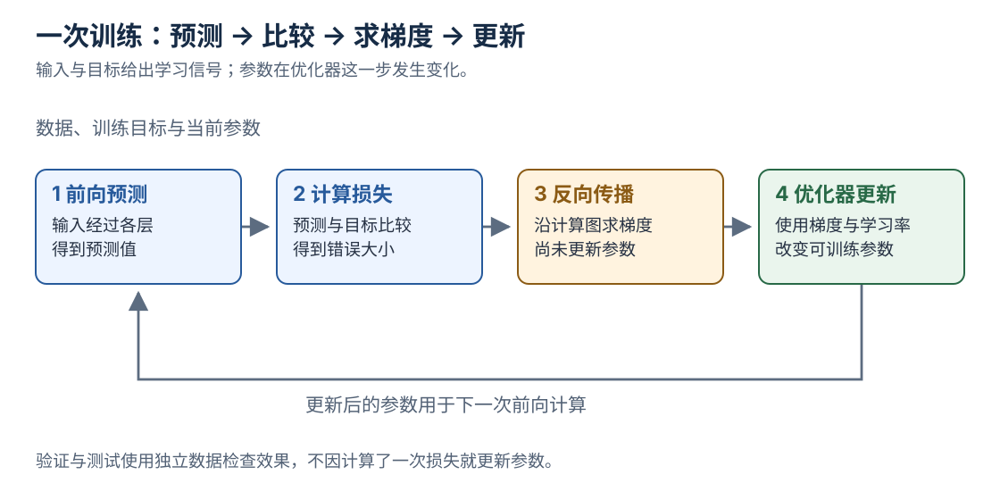

[返回系列导读](/notes/ai-handbook-roadmap/) · 先修：[最小数学](/notes/ai-handbook-math-and-vocabulary/)

## 1. 一个神经元在做什么

一个常见的神经元先加权求和，再经过激活函数：

$$
z=w^\top x+b,\qquad a=\sigma(z)
$$

$x$ 是输入，$w,b$ 是参数，$z$ 是加权分数，$a$ 是输出。这里 $\sigma$ 泛指激活函数，不一定是 sigmoid。

如果所有层都只是线性变换，把它们连起来仍可合成一个线性变换。**非线性激活**让多层组合可以表达更复杂的关系。

ReLU 的规则很简单：$\max(0,z)$。负数输出 0，正数原样通过。但输入长期落在负区间时，某些神经元可能没有有效梯度，不能把它理解为没有缺点的万能函数。

## 2. 前向、损失、反向与更新

图中把“求出梯度”与“更新参数”分开：反向传播给出方向信息，优化器才执行更新。

一次训练迭代可以拆成四件事：

1. **前向传播**：把输入依次送过各层，得到预测。
2. **计算损失**：把预测与训练目标比较。
3. **反向传播**：按链式法则，计算损失对各参数的梯度。
4. **优化器更新**：使用梯度调整参数。

链式法则可以想成串联影响：参数变化先影响中间值，中间值再影响损失，把沿途影响相乘。计算图里一处有多条路径，贡献还需要相加。

模型并不是看到错误后直接知道正确权重。它只拿到当前参数附近的局部方向信息，再通过很多次更新逐步改善。

进一步阅读：[反向传播](/notes/deep-learning-backpropagation/)和[PyTorch 自动求导](/notes/pytorch-autograd/)。

## 3. Batch、Step 与 Epoch

有 1000 条样本，每批 100 条：

- 一个 batch 是一次处理的 100 条。
- 一个 optimizer step 通常是更新一次参数。
- 一个 epoch 是完整看过训练集一轮，简单情况下有 10 个 step。

若做梯度累积，多个小 batch 计算的梯度累积后才更新一次，因此 batch 数不再等于更新次数。梯度累积能减轻单次激活内存需求，但不等于所有条件下都和大 batch 完全一致。

学习率控制步子大小：太大可能震荡或发散，太小可能进展缓慢。训练更多轮也不一定更好，应结合验证曲线判断。

## 4. 优化器为什么越来越多

SGD 根据当前批次的梯度更新。Momentum 额外累积方向，减少来回摆动。RMSProp 跟踪平方梯度的尺度，给不同参数调整步幅。Adam 结合一阶与二阶统计，并包含相应偏差修正。

这些名字不是“旧的一定被新的一定淘汰”。优化器、学习率、数据规模和任务相互影响。AdamW 将权重衰减与自适应梯度更新分开，不能在所有自适应优化器里把“L2 正则化”与“权重衰减”视为完全同一操作。

详细计算见[Momentum](/notes/deep-learning-momentum-gradient-descent/)、[RMSProp](/notes/deep-learning-rmsprop/)、[Adam](/notes/deep-learning-adam-optimizer/)和[权重衰减](/notes/deep-learning-weight-decay/)。

## 5. 初始化、归一化与正则化

**初始化**设置参数的起点。如果深层网络一开始就不断把数放大或缩小，训练可能很难进行。

**归一化层**帮助控制表示尺度，例如 BatchNorm 使用批次相关统计，LayerNorm 常在单个样本的特征维上归一化；具体维度必须结合实现看。两者不能只因都叫 Norm 就任意替换。

**正则化**限制过度拟合。例如 L2 惩罚大权重，Dropout 在训练时随机屏蔽部分激活。推理时 Dropout 通常关闭，BatchNorm 使用维护的统计量，因此训练与推理模式影响行为。

**残差连接**令输出形如 $x+F(x)$，为信息与梯度保留直接路径，帮助深层网络优化。它不意味着其他分支不需要训练，也不保证任意深度都没有问题。

## 6. CNN 为什么适合图像

图像中的相邻像素常有局部关系。同一个边缘检测模式可能出现在图像不同位置。CNN 用小卷积核扫描局部区域，并在位置间共享权重，比把所有像素全部连接起来更符合这类结构。

卷积不自动带来对任意变换的完全不变性。池化、数据增强、结构和训练共同影响平移、尺度等性质。

进一步阅读：[卷积运算](/notes/deep-learning-convolution-operation/)、[池化](/notes/deep-learning-pooling-layer/)、[ResNet](/notes/deep-learning-resnet/)。

## 7. RNN、LSTM 与注意力

RNN 读到第 $t$ 个词时，根据当前输入与上一步隐状态更新记忆：

$$
h_t=f(x_t,h_{t-1})
$$

它适合表达顺序，但当前状态依赖上一步，序列内部难以完全并行；跨很多步传播信息与梯度也可能困难。

LSTM 用门控决定保留、写入与输出哪些信息，缓解长期依赖问题，但仍存在时间步依赖。

Attention 换了一个问题：当前需要信息时，能否直接查看其他位置，再按相关性加权汇总？它可以先作为 Encoder-Decoder 的补充，也可以成为主要架构。

进一步看[RNN](/notes/deep-learning-rnn/)、[LSTM](/notes/deep-learning-lstm/)。

## 8. Transformer 的几个部件

自注意力常写成：

$$
\operatorname{Attention}(Q,K,V)
=\operatorname{softmax}\left(\frac{QK^\top}{\sqrt{d_k}}+M\right)V
$$

初读先抓住四个动作：生成查询 Q、用 Q 与键 K 比较、把分数归一化成权重、加权汇总值 V。$M$ 是掩码，限制哪些位置可以互相读取。

例如单头输入 $X$ 为 $[B,T,D]$，投影后 Q、K 为 $[B,T,d_k]$，两两匹配得到 $[B,T,T]$；与 V 汇总后恢复每个位置的一份表示。多头是让多个子空间分别做类似计算，再组合结果。

位置编码提供顺序信息；前馈网络 FFN 对每个位置的特征做变换；残差和归一化帮助层与层连接。

**训练时所有目标位置可以在因果掩码下并行算分数，生成时下一个 Token 仍依赖前一个已生成 Token。** 这两个结论同时成立。

详细模块见[Transformer 专题导读](/notes/transformer-overview/)。

## 9. 三类架构与两种训练起点

| 架构 | 常见信息读取方式 | 常见任务 |
|---|---|---|
| Encoder-only | 读取输入的双向上下文 | 分类、表示与检索 |
| Decoder-only | 因果读取前文 | 自回归文本生成 |
| Encoder-Decoder | 编码输入，再条件生成输出 | 翻译、摘要等 |

这只是理解结构的起点，不代表任务只能由表内一种架构完成。

从零训练是从初始化参数开始学习；预训练后再训练，是先获得已有能力，再针对目标适配。选择哪种取决于数据、预算、授权和目标，而不是“从零一定更纯粹”。

## 复习卡片与自测

- 反向传播求梯度，优化器更新参数。
- 结构是对数据关系的假设：CNN 看局部，RNN 递推，Attention 按相关性汇总。
- 训练并行与生成串行描述的是不同阶段。
- 预训练权重提供起点，不保证在任何业务上都有效。

**1. 为什么连续叠很多没有激活的线性层，仍然不够？**

参考答案
它们的复合仍是一个线性映射，无法仅靠增加层数获得所需的非线性表达能力。

**2. 第一个 batch 的损失下降了，能说模型泛化更好吗？**

参考答案
不能。它只表明在当前批次和状态下有变化，泛化要用独立的验证与测试检查。

**3. Transformer 能并行训练，为什么不能把整段新回答同时确定下来？**

参考答案
常规自回归生成中，每一步需要已经生成的前缀；训练时目标文本已知，可以用掩码一次计算各位置的预测损失。

## 原文定位

依据：[原资料](https://essential1220.github.io/presales-tech-guide/) 第三篇。架构公式的原始来源为 [Attention Is All You Need](https://arxiv.org/abs/1706.03762)。
