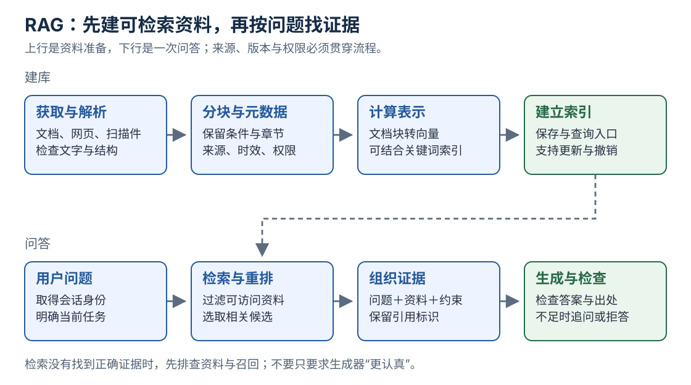

[返回系列导读](/notes/ai-handbook-roadmap/) · 先修：[Embedding](/notes/ai-handbook-token-and-embedding/)、[Prompt](/notes/ai-handbook-prompt-and-context-engineering/)

## 1. 为什么模型还需要查资料

公司昨天修改了报销制度，模型训练时未见过。把模型换得更大，不能自动保证它知道昨天的内部变化。

RAG，Retrieval-Augmented Generation，即检索增强生成：在回答前查找相关材料，把证据送给生成模型。

可以类比开卷考试：先找到书中的相关页，再根据题目组织答案。开卷并不保证满分，找错页、看错条件、抄错结论仍会失败。

原始研究结合参数知识与外部检索记忆；如今工程上常把多种“检索后生成”流程统称 RAG，具体实现不必与原论文完全相同。见 [RAG 原始论文](https://arxiv.org/abs/2005.11401)。

## 2. 把离线建库与在线回答分开

上图要看两条线：文档先变成可检索资料，用户问题到来后再去找资料；每次提问并不需要把整个知识库重新处理一遍。

**建库阶段**：获取文档 → 解析清洗 → 分块 → 保存元数据 → 计算向量 → 建索引。

**问答阶段**：识别用户与问题 → 检索候选 → 重排筛选 → 组织证据 → 生成 → 检查引用与权限 → 返回。

建库还包括更新和删除。原文件撤销后，如果向量库旧块仍在，系统仍可能回答过时内容。

## 3. 文档解析与清洗

PDF、网页、Word 和扫描图片的读取方式不同。扫描件需要 OCR；复杂表格还要保留行列关系。

清洗要处理页眉页脚、重复导航、乱码和断行，但不能把“除外”“不适用”“截至某日”等条件误删。删除一行否定词，可能把制度意思反过来。

保存来源位置，例如文档 ID、页码、章节、原始链接和生效时间。来源信息丢失后，生成器即使找到正确文字，也很难给出可核验出处。

## 4. 为什么要分块

整本文档太长，检索向量可能不能突出某条具体规则；整本塞进上下文也昂贵。太小的块又可能丢掉主语、标题或适用条件。

比如：

~~~text
标题：外地出差住宿标准
条件：本规定适用于正式员工
内容：……
例外：特殊地区需单独审批
~~~

只保留“特殊地区需单独审批”，读者不知道它说的是什么。分块时尽量保留语义边界，并把父级标题作为上下文。

常见方式包括按固定长度、段落、标题层级或语义切分。重叠能避免边界丢信息，但会增加存储与重复召回，比例要通过评测决定。

## 5. 元数据与权限为什么必须早考虑

一个文档块可以带：

~~~json
{
  "chunk_id": "leave-2026-sec3-01",
  "document_id": "leave-2026",
  "section": "第三条",
  "effective_date": "2026-01-01",
  "version": "v2",
  "access_group": "employees",
  "text": "教学用制度片段"
}
~~~

元数据让系统按版本、部门、时间与权限缩小范围。应在检索及后续处理全程执行权限，不要先把机密原文送给模型，再希望它“不说出来”。

向量、摘要、缓存和日志也可能携带敏感信息，需要跟随原始数据的访问与删除规则。

## 6. 向量化、索引与召回

为文档块计算向量并保存后，提问时用兼容模型计算问题向量，找相似候选。

**索引**是帮助查找的数据结构。小数据可以逐条比较，大数据常用近似搜索。向量库还可能保存文本和过滤字段，但不能把“向量数据库”理解为会自动清洗、理解、授权所有资料的完整系统。

**召回 Top-K**表示先取 K 个候选，不是保证其中 K 个都有答案。K 太小可能漏，太大可能把噪声带给生成器。

## 7. 重排、证据组织与生成

第一轮检索追求“尽量不要漏”。重排用更细致的模型比较问题与候选，提高前几名质量；通常成本更高，所以先在小候选集上做。

然后把问题与证据片段放进 Prompt，要求区分“资料明确说了”“基于资料推断”“资料没有提供”。

生成后检查引用 ID 是否存在、是否支持对应句子、版本是否正确。引用真实文档仍可能引用错结论，检查不能只验证链接能打开。

## 8. 亲手运行一个最小检索器

下面用空格切词和集合重叠做教学检索，**没有语义 Embedding，也没有真实大模型生成**。目的是看到“先检索，再组装证据”的骨架。

~~~python
docs = [
    {"id": "leave", "text": "年假 申请 员工 满一年 需要 主管 审批"},
    {"id": "expense", "text": "报销 申请 发票 需要 财务 审核"},
    {"id": "wifi", "text": "网络 密码 请 咨询 行政"},
]
query = "年假 怎么 申请"

def score(q, text):
    q_words, d_words = set(q.split()), set(text.split())
    return len(q_words & d_words) / len(q_words | d_words)

ranked = sorted(docs, key=lambda d: score(query, d["text"]), reverse=True)
best = ranked[0]
print(best["id"], round(score(query, best["text"]), 3))
# leave 0.25

prompt = f"问题：{query}\n资料[{best['id']}]：{best['text']}\n只根据资料作答；不足则说明。"
print(prompt)
~~~

`&` 求交集，`|` 求并集。这个分数是词集合 Jaccard 相似度，不是语义概率。把问题改为“带薪休假如何办理”，它可能找不到同义资料，这正是进一步引入语义检索的动机。

这段只打印待发送的 Prompt。若接入真实模型，还需要模型服务、权限、费用和输出验证，不能把打印模板当作已经完成了生成问答。

## 9. 按环节排查错误

没有答案时，依次检查：源文档是否存在 → 解析是否保留条款 → 分块是否完整 → 权限过滤是否正确 → 检索是否召回 → 重排是否保留 → 模型是否忠实使用 → 引用是否匹配。

如果正确条款根本没进候选，直接换生成模型通常不是最有效的第一步。

## 复习卡片与自测

- RAG 是检索与生成协作，通常不修改生成模型参数。
- 分块保留意思，元数据保留来源、时效与权限。
- 召回防漏，重排提升前列质量，生成负责组织回答。
- 每个环节都需要单独可观察。

**1. 制度更新了，重新上传文件就一定完成更新吗？**

参考答案
还要检查解析、切块、向量、索引、缓存和旧版本撤销；不能仅看上传成功。

**2. 为什么不能等回答出来后才做权限过滤？**

参考答案
机密可能已进入模型、日志或缓存，甚至影响其他结论。应尽早过滤，并在各环节持续检查。

**3. RAG 为什么不能保证消除幻觉？**

参考答案
检索可能出错，资料可能过期或矛盾，模型也可能误读或自行补充。仍需证据约束与评估。

## 原文定位

依据：[原资料](https://essential1220.github.io/presales-tech-guide/) 6.1—6.4、15.1。下一篇：[召回与重排优化](/notes/ai-handbook-rag-optimization/)。
