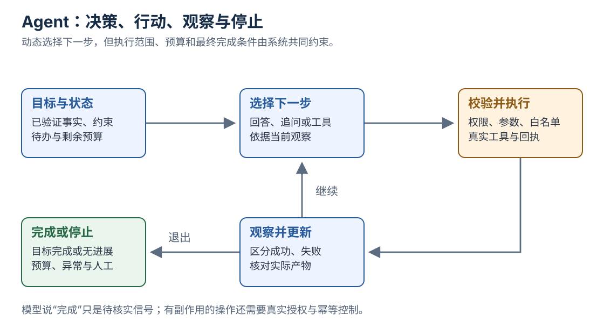

[返回系列导读](/notes/ai-handbook-roadmap/) · 先修：[工具与 MCP](/notes/ai-handbook-tools-mcp-and-skills/)

## 1. 工具调用不自动等于 Agent

如果程序固定“先查制度，再查余额，再生成草稿”，即使其中使用大模型，也可以是一个预定义 Workflow。

若系统接到目标后，需要根据发现决定下一步，例如先查客户背景、发现信息缺口后再补查、根据工具失败调整路径，它表现出更强的 Agent 特征。

区别在于**谁决定流程路径，以及路径能否依据中间结果动态调整**，不是界面里是否出现一个叫 Agent 的角色。

## 2. Workflow 也可以有分支与循环

固定流程并不代表只能直线执行。Workflow 可以按明确规则分支、并行、重试和等待人工审批：

~~~text
读取申请
→ 检查必填字段
→ 若缺信息，退回补充
→ 若完整，检查制度与余额
→ 生成草稿
→ 用户确认
→ 提交并保存回执
~~~

路径规则由开发者明确设计，测试和审计相对容易。适合步骤已知、风险边界明确的任务。

规则也会增加维护成本；如果业务变化很快、例外多，需要重新评估哪些部分该保持确定性，哪些交给模型判断。

## 3. Agent 的基本闭环

图中最重要的是“观察结果后重新决策”和“存在停止出口”，不是无限循环。

一次常见闭环：

1. 读取目标、约束与当前状态。
2. 选择下一步：回答、调用工具、追问或停止。
3. 宿主校验并执行允许的操作。
4. 接收结果，更新可验证状态。
5. 检查目标是否完成、预算是否耗尽、是否需要人工。

ReAct 常用来描述推理与行动交替的思路。可见的思考文字不是安全控制器，真正的执行限制仍需代码实现。

## 4. 用年假助手比较

“给我查询剩余年假”是一项单次工具查询，不一定需要 Agent。

“按固定规则核验资格并生成申请草稿”适合 Workflow。

“结合部门排班、个人日历、项目交付期，给出可行休假方案；若信息不足就补查”更可能需要动态决策，但仍要限制可访问数据与操作范围。

任务越开放，测试难度、成本和错误路径越多。Agent 的价值应来自它处理不确定路径的收益，而不是为了省掉明确业务规则。

## 5. 一个有限循环的教学骨架

下面没有连接语言模型。它用预先给定的动作演示：控制器怎样设置步数、工具白名单和完成条件。

~~~python
scripted_actions = iter([
    {"type": "tool", "name": "read_policy"},
    {"type": "finish", "answer": "已取得教学制度，下一步需核实工作年限。"},
])
tools = {"read_policy": lambda: {"source": "policy-1", "status": "ok"}}
state = {"observations": []}

for step in range(1, 4):
    action = next(scripted_actions, {"type": "stop"})
    if action["type"] == "tool":
        name = action["name"]
        if name not in tools:
            raise ValueError("工具不在允许范围")
        state["observations"].append(tools[name]())
    elif action["type"] == "finish":
        print(action["answer"])
        break
    else:
        print("停止：需要人工检查")
        break
else:
    print("停止：已达步数上限")
~~~

真实 Agent 会把动作选择替换为模型决策，还需要参数校验、鉴权、超时、操作回执和结果验证。控制器不能只判断模型说“完成了”，应检查任务要求的实际产物。

## 6. 常见组合模式

| 模式 | 怎么组织 | 常见价值与代价 |
|---|---|---|
| Prompt chaining | 上一步输出交下一步 | 容易逐段检查，错误会向后传递 |
| Routing | 先分类，再走不同分支 | 专门化处理，路由错会选错流程 |
| Parallelization | 独立子任务并行 | 缩短等待，增加调用量与合并工作 |
| Evaluator-optimizer | 生成后评价，再有限修正 | 需明确评分标准，防止自我认可 |
| Orchestrator-workers | 动态拆任务并分派 | 适应复杂目标，但协调成本高 |

这些模式可以由确定性程序、模型或混合方式实现。相关区分与模式可参考 [Anthropic 的 Agent 工程说明](https://www.anthropic.com/engineering/building-effective-agents)。

## 7. 单 Agent 与多 Agent

单 Agent 可以使用多个工具，并不意味着能力只限一种。多 Agent 把不同上下文、专长或权限分开，适合真正可以分工且需要隔离的任务。

代价包括重复阅读、通信、上下文丢失、冲突合并、追踪与更多 Token。多个模型投票也不保证独立，因为它们可能共享同样的训练偏差。

先问任务能不能由一个控制循环完成，再问并行与隔离是否产生可测收益。若只是把“查资料”和“写答案”强行包装成两个角色，未必比清晰的两步流程更好。

## 8. 可靠性为什么会累积

教学假设：每一步独立、成功率均为 0.9、十步必须全部成功，则总成功率为 $0.9^{10}\approx34.9\%$。

真实系统中各步不一定独立，也可能重试、校验与纠错，所以这不是通用实测成功率。它只是说明：多步系统需要检查中间结果，不能只看单次调用效果。

增加工具或 Agent 可能提高能力，也可能扩大失败面。应记录整任务完成率、重试次数、人工介入、成本和延迟。

## 复习卡片与自测

- Workflow 按预设规则组织路径，也能有分支。
- Agent 根据目标与观察动态决定路径。
- 工具能做什么，由真实权限和执行器约束。
- 多 Agent 的收益要超过通信与协调成本。

**1. 系统使用了十次 LLM 调用，就一定是 Agent 吗？**

参考答案
不一定。十次调用可以全部处在开发者规定的固定流程中。

**2. 最重要的停止条件只有最大步数吗？**

参考答案
还应有实际目标完成、预算、无进展、工具异常、权限边界和需要用户补充等条件。

**3. 为什么十步成功率的乘法例子不能当实际承诺？**

参考答案
它依赖独立、同成功率且全部必须成功等假设；实际任务可能存在相关性、重试与恢复。

## 原文定位

依据：[原资料](https://essential1220.github.io/presales-tech-guide/) 8.1—8.3、8.5—8.8、8.10、18.1。
