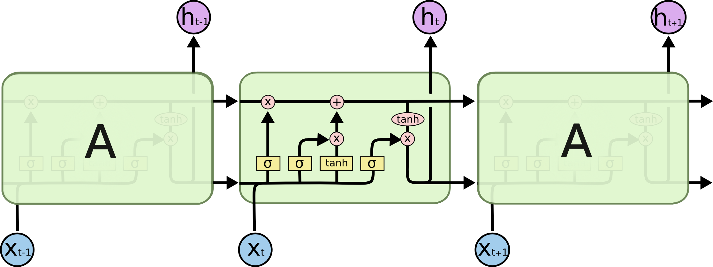
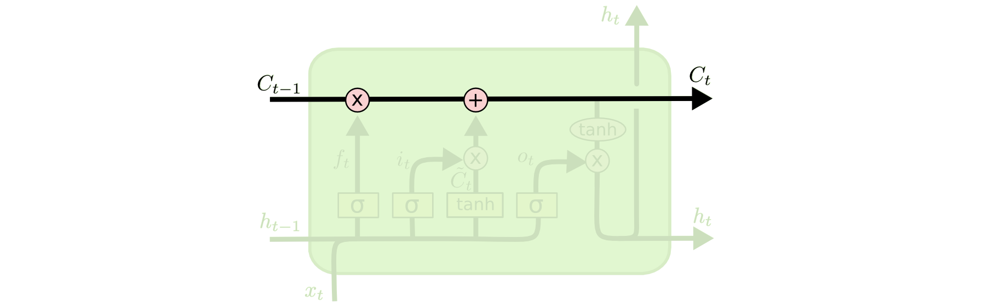
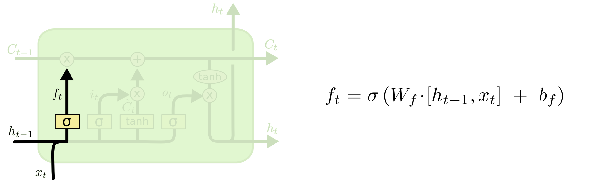
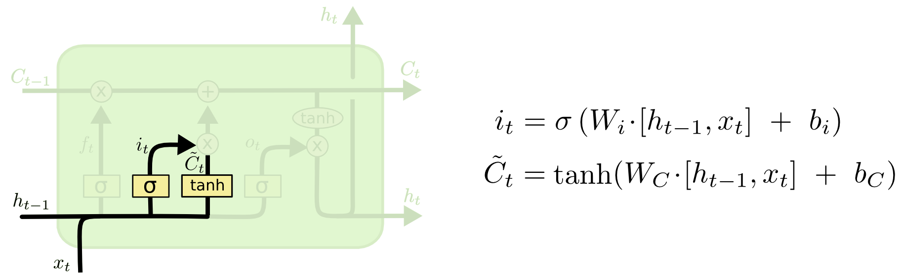
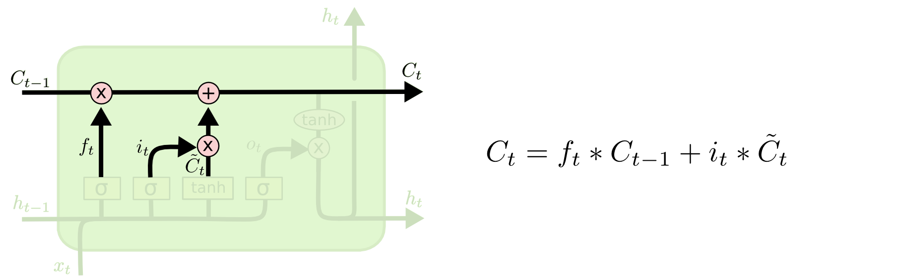
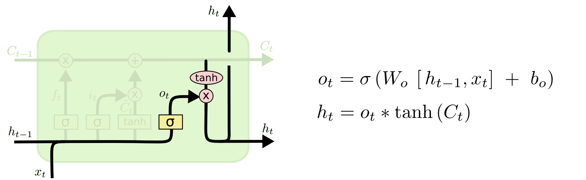

## 学习目标

学完这篇笔记后，需要能回答：

1. 普通 RNN 为什么容易忘掉很早以前的信息？
2. LSTM 为什么要额外引入细胞状态 $c_t$？
3. 遗忘门、输入门、输出门分别控制什么？
4. PyTorch 中 `nn.LSTM` 的 `output`、`h_n`、`c_n` 分别是什么 shape？

一句话概括：**LSTM 是带门控机制的 RNN，它用细胞状态 $c_t$ 提供一条更稳定的长期记忆通道，再用三个门控制“忘什么、写什么、输出什么”。**

---

## 先修知识

阅读本文前，建议先理解：

- [RNN 循环神经网络](/notes/deep-learning-rnn/)：理解隐状态 $h_t$、时间展开和 BPTT。
- [梯度消失与梯度爆炸](/notes/deep-learning-vanishing-exploding-gradients/)：理解长链式反向传播为什么会导致训练困难。
- [反向传播](/notes/deep-learning-backpropagation/)：理解参数如何通过损失函数更新。
- [PyTorch 自动求导](/notes/pytorch-autograd/)：理解框架如何自动构建计算图。

---

## 1. 为什么需要 LSTM

普通 RNN 的隐状态更新是：

$$
h_t = \tanh([h_{t-1} \mid x_t]W_h + b_h)
$$

它只有一条状态流：$h_t$。

这带来一个问题：每一步都要把旧信息和新输入混在一起重新计算，时间步一长，早期信息很容易被不断覆盖。

例如语言模型中：

```text
我小时候在法国长大，后来去了很多国家旅行，现在我能说一口流利的 ______
```

要预测“法语”，模型需要记住很早之前的“法国”。普通 RNN 理论上可以传递这个信息，但实践中常常会因为长距离依赖和梯度消失而学不好。

LSTM 的目标就是让模型更容易保留长期信息。

---

## 2. 核心直觉：给 RNN 加一条长期记忆通道

LSTM 相比普通 RNN，最重要的变化是多了一个状态：

```text
h_t：隐状态，偏向当前输出
c_t：细胞状态，偏向长期记忆
```

可以把 $c_t$ 理解成一条“记忆传送带”。信息沿着时间方向传递，只有在门控机制允许时才被删除或写入。



这张图里，最重要的是上方的 $c_{t-1} \to c_t$。它让记忆可以更平滑地跨时间传播，而不是每一步都完全重算。



---

## 3. LSTM 的五个核心量

一个 LSTM 时间步主要计算五个量：

| 符号 | 名称 | 作用 |
|---|---|---|
| $f_t$ | 遗忘门 forget gate | 决定旧记忆 $c_{t-1}$ 保留多少 |
| $i_t$ | 输入门 input gate | 决定候选记忆写入多少 |
| $\tilde{c}_t$ | 候选记忆 candidate cell | 根据当前输入和历史状态生成的新内容 |
| $c_t$ | 细胞状态 cell state | 更新后的长期记忆 |
| $o_t$ | 输出门 output gate | 决定从细胞状态中输出多少为 $h_t$ |

门的输出通常经过 sigmoid，所以每个维度的值都在 $0$ 到 $1$ 之间：

```text
接近 0：基本不让信息通过
接近 1：大部分信息通过
```

如果只想先抓住整体直觉，可以先记住：

```text
遗忘门：旧信息留下多少
输入门：新信息写入多少
输出门：内部记忆暴露多少
```

---

## 4. 数学公式

设：

- $x_t$：当前输入。
- $h_{t-1}$：上一时刻隐状态。
- $c_{t-1}$：上一时刻细胞状态。
- $h_t$：当前隐状态。
- $c_t$：当前细胞状态。
- $\sigma$：sigmoid 激活函数。
- $\odot$：逐元素乘法。

LSTM 的计算公式为：

$$
f_t = \sigma(x_t W_{xf} + h_{t-1}W_{hf} + b_f)
$$




$$
i_t = \sigma(x_t W_{xi} + h_{t-1}W_{hi} + b_i)
$$

$$
\tilde{c}_t = \tanh(x_t W_{xc} + h_{t-1}W_{hc} + b_c)
$$



$$
c_t = f_t \odot c_{t-1} + i_t \odot \tilde{c}_t
$$



$$
o_t = \sigma(x_t W_{xo} + h_{t-1}W_{ho} + b_o)
$$

$$
h_t = o_t \odot \tanh(c_t)
$$



这几行公式可以按顺序理解：

```text
1. f_t：先决定旧记忆保留多少
2. i_t：再决定新信息写入多少
3. c̃_t：生成候选新记忆
4. c_t：旧记忆 × 保留比例 + 新记忆 × 写入比例
5. o_t：决定要暴露多少记忆
6. h_t：得到当前隐状态
```

---

## 5. Shape 检查

假设：

- batch size 为 $B$。
- 输入维度为 $d$。
- 隐藏单元数为 $h$。

则：

| 符号 | shape | 说明 |
|---|---:|---|
| $x_t$ | $B \times d$ | 当前时间步输入 |
| $h_{t-1}$ | $B \times h$ | 上一时刻隐状态 |
| $c_{t-1}$ | $B \times h$ | 上一时刻细胞状态 |
| $f_t,i_t,o_t$ | $B \times h$ | 三个门 |
| $\tilde{c}_t$ | $B \times h$ | 候选记忆 |
| $c_t$ | $B \times h$ | 当前细胞状态 |
| $h_t$ | $B \times h$ | 当前隐状态 |
| $W_{xf},W_{xi},W_{xo},W_{xc}$ | $d \times h$ | 输入到各门的权重 |
| $W_{hf},W_{hi},W_{ho},W_{hc}$ | $h \times h$ | 隐状态到各门的权重 |

如果你用拼接写法，也可以把公式统一看成：

$$
[h_{t-1} \mid x_t] \to f_t, i_t, o_t, \tilde{c}_t
$$

核心不变：所有门都同时依赖当前输入和上一时刻隐状态。

---

## 6. 和普通 RNN 的区别

| 对比项 | 普通 RNN | LSTM |
|---|---|---|
| 状态数量 | 只有 $h_t$ | 有 $h_t$ 和 $c_t$ |
| 记忆更新 | 每步直接重算隐状态 | 通过门控选择性遗忘和写入 |
| 长距离依赖 | 容易困难 | 更容易保留长期信息 |
| 参数量 | 较少 | 更多，约等于多套门控权重 |
| 计算复杂度 | 较低 | 较高 |

普通 RNN 像是每一步都重写一页摘要；LSTM 更像是维护一本笔记本：有些内容保留，有些内容擦掉，有些新内容写进去。

---

## 7. PyTorch 中的 `nn.LSTM`

PyTorch API：

```python
torch.nn.LSTM(
    input_size,
    hidden_size,
    num_layers=1,
    bias=True,
    batch_first=False,
    dropout=0.0,
    bidirectional=False,
    proj_size=0,
)
```

常用参数：

| 参数 | 含义 |
|---|---|
| `input_size` | 每个时间步输入特征维度 |
| `hidden_size` | 隐状态 / 细胞状态维度 |
| `num_layers` | 堆叠几层 LSTM |
| `batch_first` | 是否使用 `(batch, seq, feature)` |
| `dropout` | 多层 LSTM 中层与层之间的 dropout |
| `bidirectional` | 是否使用双向 LSTM |

我建议实际写代码时设置：

```python
batch_first=True
```

这样输入 shape 更符合直觉：

```text
x: [batch_size, seq_len, input_size]
```

---

## 8. PyTorch 输入输出 shape

当 `batch_first=True` 且不是双向 LSTM 时：

```python
lstm = nn.LSTM(
    input_size=128,
    hidden_size=256,
    num_layers=2,
    batch_first=True,
)

x = torch.randn(32, 20, 128)
output, (h_n, c_n) = lstm(x)
```

对应 shape：

| 变量 | shape | 含义 |
|---|---:|---|
| `x` | `[32, 20, 128]` | 32 个样本，每个样本 20 个时间步，每步 128 维 |
| `output` | `[32, 20, 256]` | 最后一层每个时间步的隐状态 |
| `h_n` | `[2, 32, 256]` | 每一层最后一个时间步的隐状态 |
| `c_n` | `[2, 32, 256]` | 每一层最后一个时间步的细胞状态 |

注意：`batch_first=True` 只影响 `input` 和 `output`，不影响 `h_n` 和 `c_n`。

也就是说：

```text
input/output: [batch, seq, feature]
h_n/c_n:      [num_layers, batch, hidden_size]
```

如果 `bidirectional=True`，第一维会乘以方向数 $D=2$：

```text
h_n: [num_layers * 2, batch, hidden_size]
c_n: [num_layers * 2, batch, hidden_size]
output: [batch, seq, hidden_size * 2]
```

---

## 9. 最小代码例子

```python
import torch
import torch.nn as nn

class LSTMClassifier(nn.Module):
    def __init__(self, input_size, hidden_size, num_classes):
        super().__init__()
        self.lstm = nn.LSTM(
            input_size=input_size,
            hidden_size=hidden_size,
            num_layers=1,
            batch_first=True,
        )
        self.fc = nn.Linear(hidden_size, num_classes)

    def forward(self, x):
        # x: [batch, seq_len, input_size]
        output, (h_n, c_n) = self.lstm(x)

        # 取最后一个时间步的输出做分类
        last_hidden = output[:, -1, :]
        logits = self.fc(last_hidden)
        return logits

model = LSTMClassifier(input_size=128, hidden_size=256, num_classes=2)
x = torch.randn(32, 20, 128)
logits = model(x)

print(logits.shape)  # [32, 2]
```

如果是文本分类、股价预测这类“多对一”任务，常用最后一个时间步的 hidden state。

如果是 NER 这类“等长多对多”任务，则通常对 `output` 的每个时间步都接分类层。

---

## 10. 实践经验

### 10.1 什么时候用 LSTM

LSTM 适合：

- 中短长度序列建模。
- 时间序列预测。
- 小规模 NLP 序列任务。
- 数据量不大、不想上 Transformer 的任务。
- 需要在线逐步处理序列的任务。

现代大规模 NLP 中，Transformer 更常用；但在时间序列、传感器数据、金融数据、边缘设备等场景，LSTM 仍然经常出现。

### 10.2 训练注意事项

- 长序列训练仍然可能梯度不稳定，必要时使用梯度裁剪。
- `hidden_size` 太小，记忆容量不足；太大，容易过拟合且训练慢。
- 多层 LSTM 的 `dropout` 只作用在层与层之间，不作用在最后一层输出之后。
- 变长序列可以配合 `pack_padded_sequence` 使用，避免 padding 参与无效计算。
- 做时间序列预测时，归一化要只用训练集统计量，避免数据泄漏。

---

## 11. 常见误区

### 误区一：LSTM 完全解决了梯度消失

不完全。LSTM 缓解了长距离依赖问题，但不是万能。序列极长、数据噪声大或任务依赖复杂时，仍然可能学不好。

### 误区二：$h_t$ 和 $c_t$ 是同一个东西

不是。

- $c_t$ 更像长期记忆。
- $h_t$ 更像当前对外输出的状态。

### 误区三：`output[:, -1, :]` 永远等于 `h_n[-1]`

在单层、单向、无特殊 packing 的常见情况下，它们通常可以对应。但多层、双向、变长 packed sequence 时要格外小心。

### 误区四：`batch_first=True` 会改变所有张量 shape

不会。它只改变 `input` 和 `output` 的维度顺序，不改变 `h_n` 和 `c_n`。

---

## 12. 一句话总结

LSTM 的本质是：在 RNN 的时间递归结构中加入细胞状态 $c_t$ 和门控机制，让模型能够选择性遗忘、写入和输出信息，从而更好地处理长距离依赖。

---

## 13. 复习卡片

```text
LSTM 解决什么？
  普通 RNN 长距离依赖困难、容易遗忘早期信息。

核心新增状态？
  细胞状态 c_t。

三个门？
  遗忘门 f_t：旧记忆保留多少
  输入门 i_t：新信息写入多少
  输出门 o_t：记忆暴露多少为 h_t

核心公式？
  c_t = f_t ⊙ c_{t-1} + i_t ⊙ c̃_t
  h_t = o_t ⊙ tanh(c_t)

PyTorch 常用输入？
  batch_first=True 时：x = [batch, seq, input_size]

PyTorch 输出？
  output = 每个时间步最后一层隐状态
  h_n = 最后时间步每层隐状态
  c_n = 最后时间步每层细胞状态
```

---

## 14. 自测问题

1. 为什么普通 RNN 在长序列上容易忘掉早期信息？
2. LSTM 中 $c_t$ 和 $h_t$ 的区别是什么？
3. 遗忘门、输入门、输出门分别控制什么？
4. 为什么门通常使用 sigmoid？
5. 写出 LSTM 更新 $c_t$ 的核心公式。
6. `batch_first=True` 时，`input`、`output`、`h_n`、`c_n` 的 shape 分别是什么？
7. 双向 LSTM 会让哪些维度发生变化？

---

## 参考与推荐阅读

- [LSTM · PyTorch 2.13 documentation](https://docs.pytorch.org/docs/2.13/generated/torch.nn.LSTM.html)：重点看 API 参数、输入输出 shape、`batch_first`、双向 LSTM。
- [长短期记忆网络（LSTM） · 动手学深度学习](https://zh.d2l.ai/chapter_recurrent-modern/lstm.html)：重点看门控公式、从零实现和简洁实现。
- [LSTM · Rethink](https://www.rethink.fun/chapter13/LSTM.html)：适合中文直觉入门。
- [What is Long Short-term Memory (LSTM)? · IBM](https://www.ibm.com/think/topics/lstm)：适合了解 LSTM 的应用场景和高层解释。
- [Long Short-Term Memory (LSTM) · NVIDIA Developer](https://developer.nvidia.com/discover/lstm)：适合理解工程和加速视角。
- [Understanding LSTM Networks · colah's blog](https://colah.github.io/posts/2015-08-Understanding-LSTMs/)：图解经典，适合反复看。
