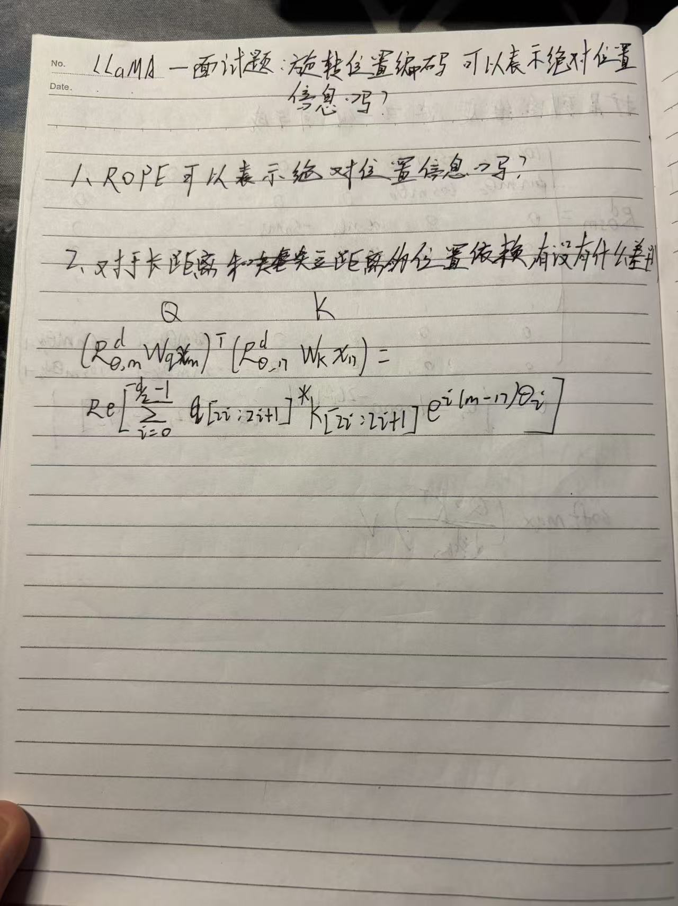
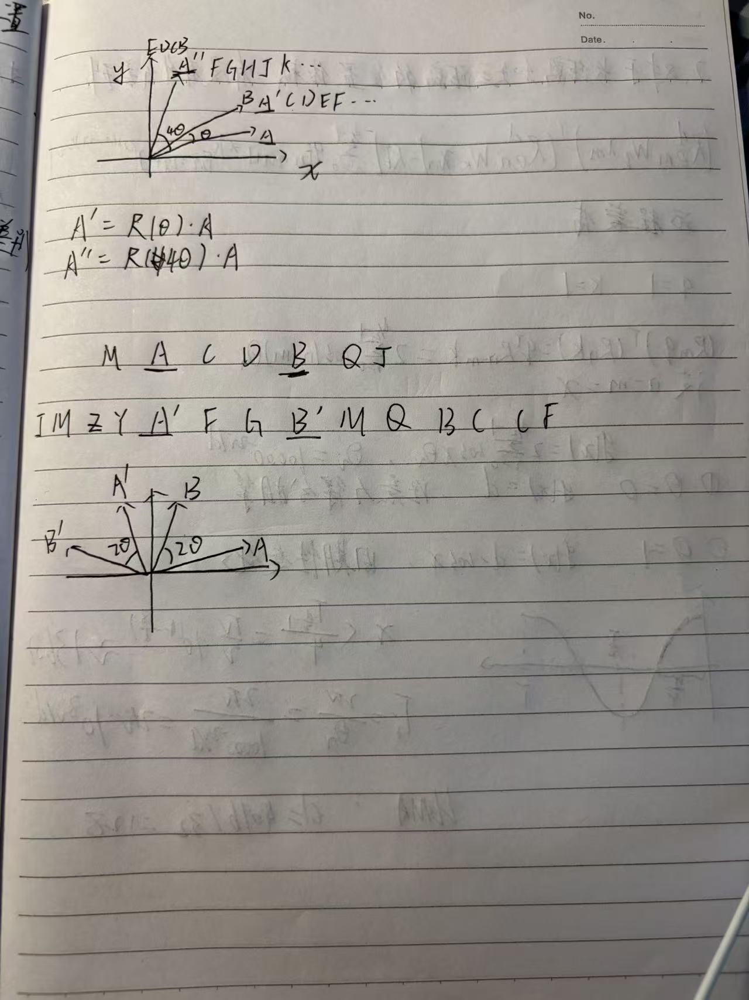

## 学习目标

本文回答一个常见面试题：RoPE 到底是绝对位置编码还是相对位置编码？学完后应能从“单个向量”和“QK 点积”两个层面给出不矛盾的回答。

## 先修知识

- [LLaMA（7）：RoPE 如何捕获向量之间的相对位置](/notes/llama-rope-relative-position/)

## 1. 先给结论

RoPE 使用绝对位置 $m$ 决定单个 Query 或 Key 的旋转角，因此旋转后的向量携带绝对相位；但两个旋转向量的注意力点积会消去共同的绝对偏移，只显式依赖相对距离 $n-m$。

所以更准确的说法是：

> RoPE 以绝对位置执行旋转，在自注意力点积中实现相对位置依赖。

## 2. 单个向量确实依赖绝对位置

同一个内容向量 $q$ 放在不同位置会得到不同结果：

$$
q_m'=R_mq
$$

$$
q_{m+1}'=R_{m+1}q
$$

只看旋转后的坐标方向，位置 $m$ 已经参与计算，因此它包含绝对相位信息。

## 3. 注意力分数消除了共同平移

把 Query、Key 同时向后平移 $c$ 个位置：

$$
\begin{aligned}
(R_{m+c}q)^\top(R_{n+c}k)
&=q^\top R_{m+c}^\top R_{n+c}k\\
&=q^\top R_{n-m}k
\end{aligned}
$$

共同偏移 $c$ 被抵消了。因此在内容相同的理想条件下，位置对 $(2,5)$ 和 $(102,105)$ 具有相同的 RoPE 相对旋转关系。

## 4. 几何直觉

设两个向量原始夹角为 $\alpha$。位置 $m$、$n$ 分别让它们旋转 $m\theta$、$n\theta$，旋转后的夹角变为：

$$
\alpha+(n-m)\theta
$$

点积取决于夹角余弦，因此只看见两次旋转的差。

## 5. 为什么真实模型仍可能出现绝对位置偏置

“RoPE 注意力核具有相对位置形式”不代表整个 Transformer 对绝对位置完全不敏感。真实模型还有：

- 序列开头和结尾的边界；
- 因果 Mask，使每个位置可见的历史数量不同；
- 多层残差传播与非线性变换；
- BOS、特殊 token 和训练数据中的固定格式；
- 不同位置在训练中出现频率不同。

因此模型整体仍可能学到首因效应、近因效应或特定位置偏好。

## 6. 面试回答模板

可以这样回答：

> RoPE 的旋转角由绝对位置决定，所以单个旋转后的 Q、K 带有绝对相位；但注意力分数满足 $R_m^\top R_n=R_{n-m}$，共同的绝对平移会抵消，因此 RoPE 在 QK 点积中显式表达的是相对位置。整个模型还受到因果 Mask、边界和训练分布影响，不能据此说模型完全没有绝对位置偏置。

## 常见误区

### 误区一：RoPE 只能表示绝对位置

它输入绝对位置，但注意力内积显式得到相对位移。

### 误区二：RoPE 只能表示相对位置

单个旋转向量的相位由绝对位置决定。应说明讨论的是哪个层次。

### 误区三：平移不变意味着模型输出完全不变

推导只针对 RoPE 的 QK 内积核，不包括因果 Mask、序列边界和整个深层网络。

## 一句话总结

RoPE 的精确表述是“用绝对位置产生旋转，用旋转差在注意力分数中表达相对位置”。

## 复习卡片

- 单向量：$R_mq$ 含绝对相位；
- 双向量点积：只依赖 $n-m$；
- 共同平移：$(m,n)\to(m+c,n+c)$ 不改变 RoPE 核；
- 整个模型仍可能具有绝对位置偏置。

## 自测问题

1. 为什么“绝对相位”和“相对注意力”不矛盾？
2. 如何证明共同平移不改变 RoPE 点积？
3. 哪些模型组件会重新引入绝对位置偏置？

## 下一篇

[LLaMA（9）：RoPE 对长距离和短距离依赖有什么区别？](/notes/llama-rope-long-range-decay/)

## 参考与推荐阅读

- [RoFormer 原论文](https://arxiv.org/abs/2104.09864)：摘要明确区分“绝对位置旋转”和“相对位置依赖”。
- [LLaMA 1 论文](https://arxiv.org/abs/2302.13971)

