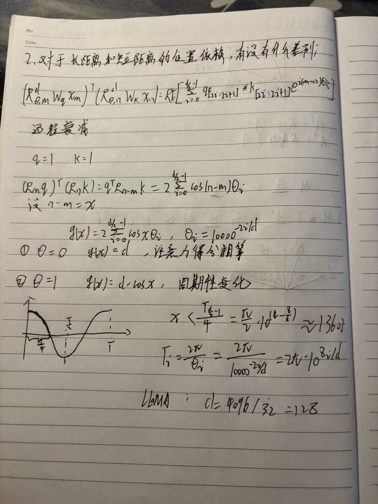

## 学习目标

本文解释 RoPE 对近距离和远距离位置依赖的影响。重点是准确理解“远程衰减”：它是一种多频率项相互抵消后的整体趋势，不是注意力分数随距离严格单调下降。

## 先修知识

- [LLaMA（7）：RoPE 如何捕获向量之间的相对位置](/notes/llama-rope-relative-position/)
- [LLaMA（8）：RoPE 可以表示绝对位置信息吗？](/notes/llama-rope-absolute-position/)

## 1. 从单个二维通道看

设某一二维特征对的 Query、Key 内容相同且方向固定，距离为 $\Delta=m-n$，该通道的相关性会包含：

$$
\cos(\Delta\theta_i)
$$

当 $\Delta$ 增大时，余弦函数会周期振荡，并不会严格越来越小。因此不能说“RoPE 的每一个频率都会单调衰减”。

## 2. 从全部维度看

RoPE 使用多个几何递减的频率：

$$
\theta_i=10000^{-2i/d},\qquad i=0,1,\ldots,d/2-1
$$

完整点积是各二维通道贡献之和，可写成类似形式：

$$
s(\Delta)=\sum_i a_i\cos(\Delta\theta_i)+b_i\sin(\Delta\theta_i)
$$

其中 $a_i,b_i$ 由 Q、K 的内容决定。

距离较小时，多数低频项的相位差仍小，方向更容易保持一致；距离增大后，不同频率的相位逐渐错开，正负贡献更容易相互抵消。因此整体相关性的上界或平均幅度呈下降倾向，这就是 RoFormer 论文讨论的远程衰减性质。

## 3. 高频与低频分别负责什么

| 通道 | $\theta_i$ | 位置变化 | 更敏感的关系 |
|---|---:|---|---|
| 前部通道 | 较大 | 旋转快 | 短距离、细粒度位置差 |
| 后部通道 | 较小 | 旋转慢 | 长距离、粗粒度位置差 |

这种多尺度设计类似同时使用快慢不同的时钟：快时钟能精细区分附近位置，慢时钟在更远距离上仍不会迅速转完一圈。

## 4. 一个可解释的距离尺度

最慢频率为：

$$
\theta_{\min}=10000^{-2(d/2-1)/d}
$$

若用“最慢通道旋转四分之一圈”作为一个粗略尺度：

$$
L_{1/4}=\frac{\pi}{2\theta_{\min}}
$$

它只能帮助理解频率尺度，不能把它当成模型的最大上下文长度。模型能使用多长上下文还取决于训练长度、数据分布、注意力层数以及是否使用 RoPE 缩放。

## 5. 远程衰减不等于长度外推

需要分清三个概念：

- **相对位置编码**：分数能够感知 $m-n$；
- **远程衰减倾向**：多频率贡献在远距离更容易抵消；
- **长度外推**：超过训练窗口后仍能完成任务。

RoPE 具备前两种结构性质，但原始 RoPE 并不能自动保证第三种能力。超长上下文模型常需要位置插值、频率缩放或 YaRN 等额外方法，并配合长序列训练。

## 6. 面试回答模板

> RoPE 在每个二维子空间产生周期性旋转，所以单个频率的相关性并不随距离单调下降。它使用一组不同频率，距离增大时各维相位逐渐失配、贡献相互抵消，因此总体上具有远程衰减倾向。近距离通常更容易保持较强的位置相关性，低频维度则负责更长尺度。远程衰减和可靠的长度外推不是同一件事。

## 常见误区

### 误区一：RoPE 分数随距离严格单调递减

各频率都是周期函数，局部反弹和振荡是正常现象。

### 误区二：远距离 token 一定得不到高注意力

内容相关性仍然参与 QK 点积。语义匹配足够强时，远距离 token 仍可能获得高权重。

### 误区三：最慢频率的周期就是上下文窗口

频率周期只是几何尺度，不是模型服务时的硬长度上限。

## 一句话总结

RoPE 用多尺度旋转让近距离相位更容易对齐、远距离各频率更容易相互抵消，但这种远程衰减只是总体趋势，不是单调规律，也不等于自动获得长度外推能力。

## 复习卡片

- 单频率：周期振荡；
- 多频率：远距离相位失配，平均贡献趋于抵消；
- 高频关注近处，低频覆盖远处；
- 远程衰减 ≠ 长度外推；
- 内容相关性仍能让远距离 token 获得高注意力。

## 自测问题

1. 为什么单个 $\cos(\Delta\theta_i)$ 不能证明单调衰减？
2. 多频率为什么会形成总体远程衰减倾向？
3. 为什么最慢频率的周期不能直接当作上下文窗口？
4. 远程衰减和长度外推有什么区别？

## 下一篇

[LLaMA（10）：用 PyTorch 从零实现 RoPE](/notes/llama-rope-pytorch/)

## 参考与推荐阅读

- [RoFormer 原论文](https://arxiv.org/abs/2104.09864)：远程衰减的理论分析。
- [YaRN](https://arxiv.org/abs/2309.00071)：基于 RoPE 的长上下文扩展方法。
- [Position Interpolation](https://arxiv.org/abs/2306.15595)：通过位置插值扩展上下文窗口。

