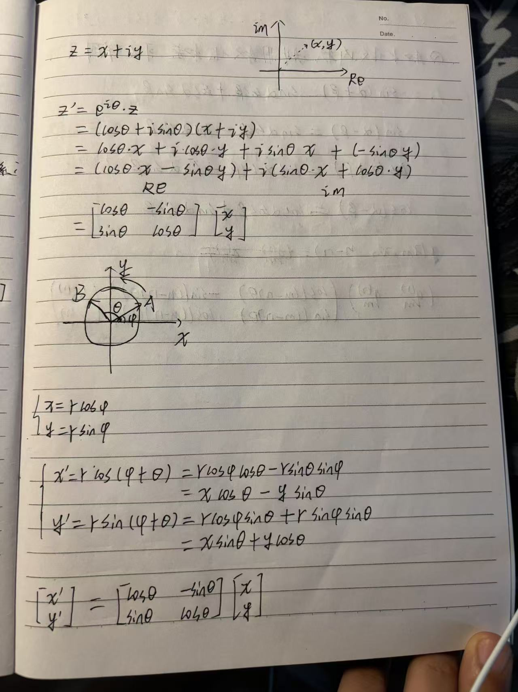
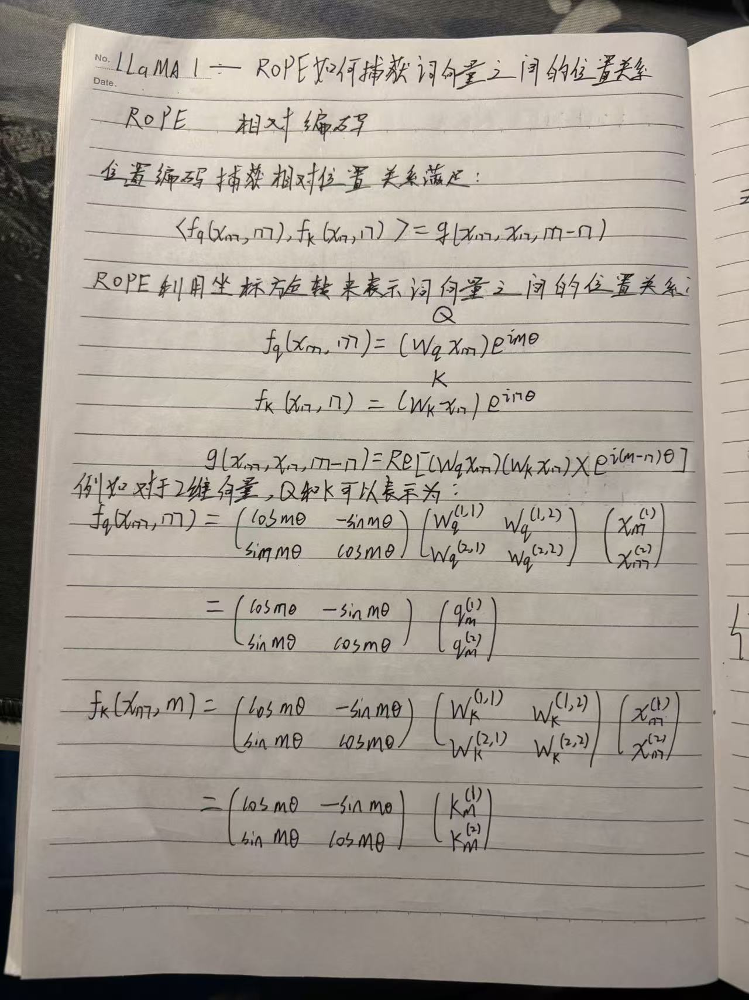
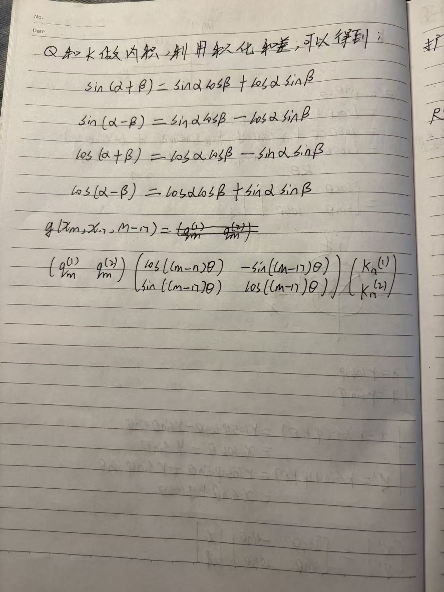
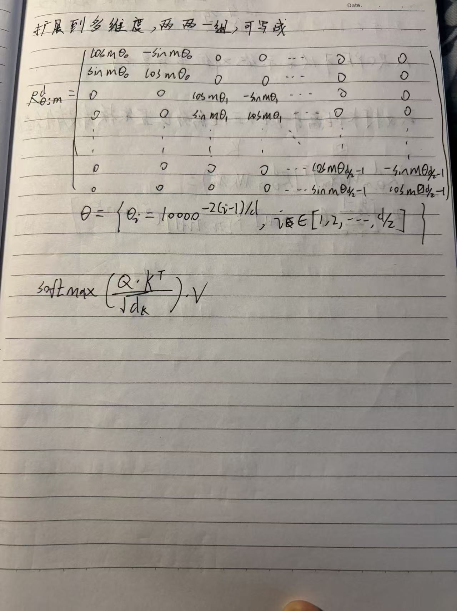

## 学习目标

学完本文，应能从旋转矩阵和复数两种形式写出 RoPE，解释为什么它保持向量长度，并独立证明旋转后的 Query、Key 点积只依赖相对位置 $n-m$。

## 先修知识

- [LLaMA（6）：从正弦位置编码的问题走向 RoPE](/notes/llama-rope-sinusoidal-limitations/)
- [Transformer（二）：缩放点积注意力、QKV 与 Mask](/notes/transformer-self-attention/)

## 1. 从二维旋转开始

二维向量 $u=(x,y)^\top$ 旋转角度 $\phi$ 后为：

$$
R(\phi)u=
\begin{bmatrix}
\cos\phi & -\sin\phi\\
\sin\phi & \cos\phi
\end{bmatrix}
\begin{bmatrix}x\\y\end{bmatrix}
$$

旋转不会改变向量范数：

$$
\|R(\phi)u\|_2=\|u\|_2
$$



把 $(x,y)$ 看成复数 $z=x+iy$，旋转就等价于：

$$
z'=ze^{i\phi}
$$

这也是 PyTorch 实现中可以使用 `view_as_complex` 和复数乘法的原因。

## 2. 把位置变成旋转角度

对于位置 $m$ 和第 $i$ 个二维特征对，定义频率：

$$
\theta_i=\text{base}^{-2i/d}
$$

标准 base 常取 10000。位置 $m$ 对应的旋转角为 $m\theta_i$：

$$
q_{m,i}'=R(m\theta_i)q_{m,i}
$$

$$
k_{n,i}'=R(n\theta_i)k_{n,i}
$$



## 3. 为什么点积只依赖相对距离

旋转矩阵满足：

$$
R(\alpha)^\top=R(-\alpha)
$$

$$
R(\alpha)R(\beta)=R(\alpha+\beta)
$$

因此：

$$
\begin{aligned}
(q_m')^\top k_n'
&=(R_mq_m)^\top(R_nk_n)\\
&=q_m^\top R_m^\top R_nk_n\\
&=q_m^\top R_{n-m}k_n
\end{aligned}
$$

绝对位置 $m,n$ 最终以差值 $n-m$ 的形式进入注意力分数。



> 若采用相反的旋转方向，最后可能得到 $m-n$。符号方向不是重点，只要 Q、K 的约定始终一致即可。

## 4. 扩展到高维

当 head dimension 为偶数 $d$ 时，把通道按相邻两维分成 $d/2$ 组：

$$
(x_0,x_1),(x_2,x_3),\ldots,(x_{d-2},x_{d-1})
$$

高维旋转矩阵是多个二维旋转块组成的块对角矩阵：

$$
R_m^d=\operatorname{diag}
\left(R(m\theta_0),R(m\theta_1),\ldots,R(m\theta_{d/2-1})\right)
$$



每组通道使用不同频率，因此模型可以同时感知细粒度的近距离变化和缓慢变化的长距离关系。

## 5. 张量形状

以 Query 为例：

```text
Q:                 [batch, heads, seq_len, head_dim]
Q_pairs:           [batch, heads, seq_len, head_dim / 2, 2]
rotation factors:  [seq_len, head_dim / 2]
Q_rotated:         [batch, heads, seq_len, head_dim]
```

要求 `head_dim` 为偶数。广播时，位置维必须与 `seq_len` 对齐，频率维必须与 `head_dim / 2` 对齐。

## 6. RoPE 保留了什么、改变了什么

- 保留 Q、K 每个二维对的长度；
- 改变向量方向，使其携带绝对位置对应的相位；
- 点积把两者的绝对相位差化成相对位置；
- Value 通常不旋转，因为位置关系已经进入注意力权重。

## 常见误区

### 误区一：RoPE 给整个向量只使用一个角度

不同二维通道对应不同的 $\theta_i$，是多频率旋转。

### 误区二：把前半维与后半维随意配对

不同实现可能使用“相邻配对”或“前后半区配对”，但频率布局和 `rotate_half` 必须匹配，不能只改一处。

### 误区三：RoPE 改变了向量的模长

理想旋转矩阵是正交矩阵，因此只改变方向，不改变范数。

## 一句话总结

RoPE 通过给 Q、K 的每组二维特征施加随位置变化的旋转，使两个位置的点积只保留旋转角之差，从而显式编码相对位置。

## 复习卡片

- 二维旋转：$R(\phi)$；
- 复数形式：$ze^{i\phi}$；
- 第 $i$ 组角度：$m\theta_i$；
- 高频通道变化快，低频通道变化慢；
- 核心证明：$R_m^\top R_n=R_{n-m}$。

## 自测问题

1. 为什么旋转不会改变 Q、K 的范数？
2. 复数乘法与二维旋转矩阵如何对应？
3. 高维 RoPE 为什么使用块对角矩阵？
4. 为什么标准实现通常不旋转 V？

## 下一篇

[LLaMA（8）：RoPE 可以表示绝对位置信息吗？](/notes/llama-rope-absolute-position/)

## 参考与推荐阅读

- [RoFormer 原论文](https://arxiv.org/abs/2104.09864)
- [LLaMA 1 论文](https://arxiv.org/abs/2302.13971)

