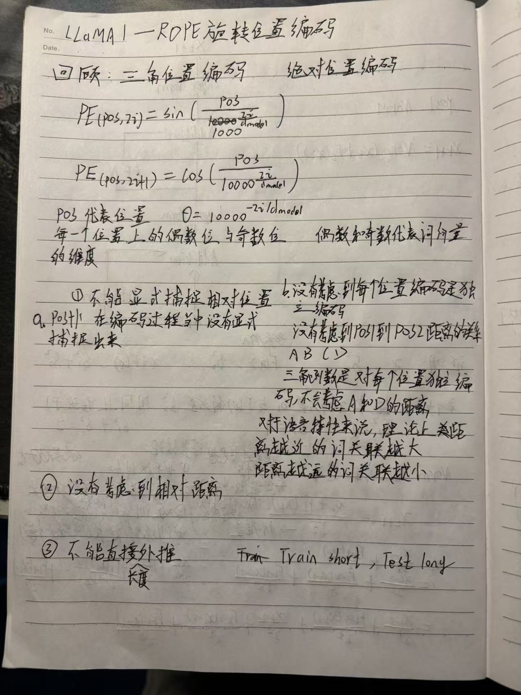

## 学习目标

本文是 RoPE 系列的起点。目标不是简单地说“原始位置编码不好”，而是准确回答：原始正弦位置编码做了什么、它能够计算任意位置为什么仍不等于可靠外推，以及 RoPE 改变了位置进入注意力的方式。

## 先修知识

- [Transformer（四）：位置编码与序列顺序](/notes/transformer-positional-encoding/)
- [Transformer（二）：缩放点积注意力、QKV 与 Mask](/notes/transformer-self-attention/)
- [LLaMA（2）：LLaMA 1 的整体架构与四项关键改进](/notes/transformer-llama1-architecture/)

## 1. 回顾原始正弦位置编码

对位置 $m$ 和第 $i$ 组二维通道，原始 Transformer 使用：

$$
PE(m,2i)=\sin(m\theta_i)
$$

$$
PE(m,2i+1)=\cos(m\theta_i)
$$

其中：

$$
\theta_i=10000^{-2i/d}
$$

$m$ 是 token 的绝对位置，$d$ 是隐藏维度。不同二维通道使用不同频率：前面的通道变化快，后面的通道变化慢。

原始方法把位置向量直接加到词向量上：

$$
z_m=x_m+PE_m
$$

> 这是本次学习的手写原稿。需要修正的一点是：正弦位置编码并非完全不能包含相对位置信息，而是相对关系没有直接写进注意力分数，需要模型间接学习。

## 2. 三个真正的问题

### 2.1 相对位置进入注意力的方式不够直接

加入位置编码后，Query 与 Key 的点积会展开为：

$$
(x_m+p_m)^\top(x_n+p_n)
=x_m^\top x_n+x_m^\top p_n+p_m^\top x_n+p_m^\top p_n
$$

内容项、位置项和交叉项混在一起。虽然正弦函数具有和差公式，网络理论上能够从中学习相对位置，但注意力分数并没有天然只依赖 $m-n$。

### 2.2 “公式可计算更长位置”不等于“模型能外推”

正弦公式可以计算训练长度之外的任意 $m$，因此它在数学上没有固定长度的查表限制。但模型只在训练窗口内见过有限的相位组合和注意力模式，测试时突然输入更长序列，性能仍可能下降。

需要区分：

- **可生成性**：能否为更远位置算出编码；
- **可辨识性**：不同位置在有限维度中是否容易区分；
- **长度外推**：模型能否在未训练长度上维持任务能力。

### 2.3 位置与内容在输入端直接相加

加法位置编码改变了传入后续线性层的内容表示。模型必须自己学习如何在同一个向量中分离“这个 token 是什么”和“它在哪里”。

## 3. RoPE 的改进方向

RoPE 不把一个位置向量加到 token embedding 上，而是在得到 Query、Key 后，对每一组二维特征执行位置相关的旋转：

$$
q_m'=R_m q_m,\qquad k_n'=R_n k_n
$$

这样做的关键结果是：

$$
(q_m')^\top k_n'
=q_m^\top R_m^\top R_n k_n
=q_m^\top R_{n-m}k_n
$$

注意力分数中的位置部分自然只依赖相对距离 $n-m$。

## 4. 对比总结

| 维度 | 正弦加法位置编码 | RoPE |
|---|---|---|
| 注入位置 | 加到输入表示 | 旋转 Query、Key |
| 内容表示 | 与位置直接相加 | 旋转保持向量范数 |
| 相对位置 | 可间接推导 | 显式进入 QK 点积 |
| 长度 | 公式可生成任意位置 | 公式同样可生成任意位置 |
| 长度外推 | 不自动保证 | 也不自动保证，仍受训练长度与频率分布影响 |

## 常见误区

### 误区一：正弦位置编码完全没有相对位置信息

正弦和余弦的和差关系允许相对位置被线性表示。更准确的说法是：它没有像 RoPE 那样把相对位移直接写成注意力点积中的旋转差。

### 误区二：只要位置编码没有最大长度，就一定能外推

编码公式的定义域和模型的泛化能力不是同一件事。

### 误区三：RoPE 是把旋转向量加到 embedding 上

标准 RoPE 作用在注意力层的 Query 和 Key 上，通常不旋转 Value。

## 一句话总结

RoPE 的核心动机是：把位置从“输入端的加法特征”改造成“Q、K 空间中的旋转”，让注意力分数天然感知相对位移。

## 复习卡片

- 原始编码：$x_m+PE_m$；
- RoPE：$q_m'=R_mq_m$，$k_n'=R_nk_n$；
- 核心恒等式：$R_m^\top R_n=R_{n-m}$；
- 可计算长位置不等于能可靠外推；
- RoPE 通常只应用于 Q、K。

## 自测问题

1. 正弦位置编码为什么并非完全没有相对位置信息？
2. 为什么“能计算位置 100000 的编码”不能证明模型能处理 100000 个 token？
3. RoPE 为什么选择作用在 Query 和 Key 上？
4. $R_m^\top R_n$ 为什么只与 $n-m$ 有关？

## 下一篇

[LLaMA（7）：RoPE 如何捕获向量之间的相对位置](/notes/llama-rope-relative-position/)

## 参考与推荐阅读

- [RoFormer 原论文](https://arxiv.org/abs/2104.09864)：RoPE 的定义、相对位置性质与远程衰减分析。
- [LLaMA 1 论文](https://arxiv.org/abs/2302.13971)：LLaMA 在各层注意力中采用 RoPE。
- [Attention Is All You Need](https://arxiv.org/abs/1706.03762)：原始正弦余弦位置编码。

