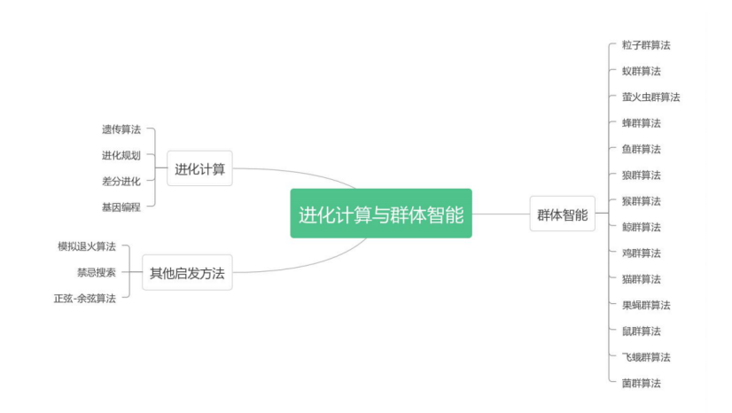
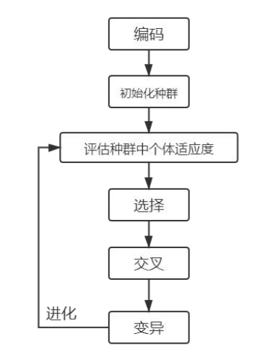
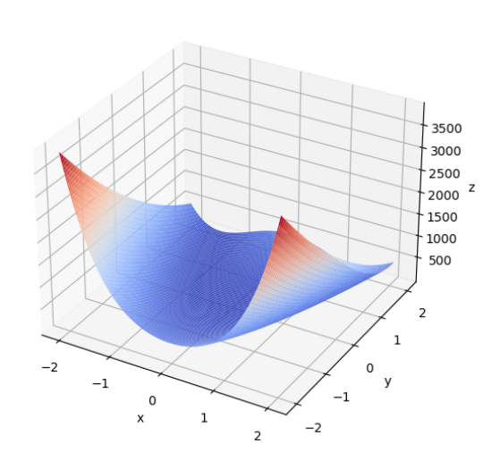
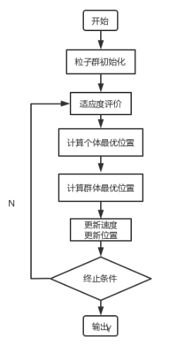
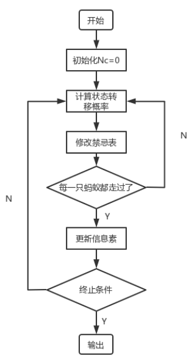
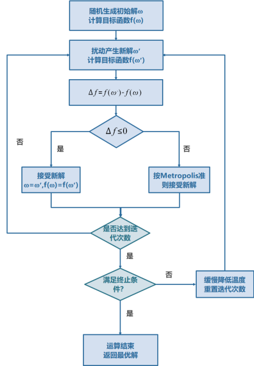

## 进化计算与群体智能



### 线性规划

> 线性规划是在一组线性约束条件下，求解线性目标函数最大值或最小值的数学方法。简单来说，就是在满足一系列限制条件下，寻求资源分配的最佳方案，以达到如最大化利润、最小化成本等目标。
>
> 例如，在生产制造场景中，企业要考虑原材料供应、设备产能、人力工时等限制，同时追求产品产量最大化或生产成本最小化，线性规划就能提供科学的决策依据。从数学本质看，线性规划处理的函数关系需为线性，即目标函数和约束条件都能表示为决策变量的一次线性组合，这使得线性规划在理论分析和实际求解上，相较于非线性问题拥有更成熟的方法和工具。

组成：

1. 决策变量:

   决策变量是线性规划模型中待确定的未知量，通常用$x_1,x_2,\cdots,x_n$表示。它们代表决策者在实际问题中的具体决策内容。比如在一个简单的家具生产企业中，若生产桌子和椅子两种产品，可设$x_1$为桌子的生产数量$x_2$为椅子的生产数量。这些决策变量的取值范围和相互关系，直接影响模型的求解结果与实际问题的解决方案。

2. 目标函数：

   目标函数是关于决策变量的线性表达式，体现决策者的核心诉求。当目标为最大化时，可表示为$max Z = c_1x_1 + c_2x_2+ \cdots+c_nx_n$；当目标为最小化时，则表示为$minZ=c_1x_1 + c_2x_2+ \cdots+c_nx_n$ 。其中$c_1,c_2,\cdots,c_n$，称为价值系数，量化每个决策变量对目标函数的贡献程度。

   仍以上述家具生产企业为例，若桌子单位利润为50元，椅子单位利润为30元，以利润最大化为目标的目标函数就是$max Z = 50x_1 + 30 x_2$​，明确企业决策生产数量时追求两种产品利润总和的最大化。

3. 约束条件：

   约束条件是对决策变量的限制集合，主要包含线性等式约束和线性不等式约束。

   * 线性等式约束：一般形式为$a_{i1}x_1 + a_{i2}x_2 + \cdots + a_{in}x_n = b_i$,在实际中，常表示资源的严格限制或固定关系。例如生产桌子和椅子都需木材，企业现有木材总量为100立方米，生产一张桌子需2立方米木材，生产一把椅子需1立方米木材，木材资源的约束条件可表示为$2x_1 + x_2 = 100$​

   * 线性不等式约束：分为小于等于和大于等于两种类型。

     小于等于约束：$a_{i1}x_1 + a_{i2}x_2 + \cdots + a_{in}x_n \leq b_i$，常用于表示资源上限或生产能力限制。例如企业生产设备每天最多运行8小时，生产一张桌子需0.5小时，生产一把椅子需0.2小时，设备运行时间的约束条件就是$0.5x_1+0.2x_2 \leq 8$​

     大于等于约束：$a_{i1}x_1 + a_{i2}x_2 + \cdots + a_{in}x_n \geq b_i$,一般用于描述需求下限或必须满足的最低要求。比如市场对桌子的最低需求量为10张，就有$x_1 \geq 10$的约束条件。

标准形式：
$$
max Z = \sum^n_{j=1}c_jx_j
$$

$$
s.t.\sum^n_{j=1}a_{ij}x_j = b_i,i=1,2,\cdots,m
$$

$$
x_j \geq 0, j = 1,2,\cdots,n
$$

> s.t.” 是 “subject to” 的缩写，表示 “受约束于”。在标准形式中，目标函数为最大化形式，约束条件均为等式约束，且所有决策变量均具有非负约束。这种标准形式具有简洁、规范的特点，便于统一进行理论分析和算法设计。例如单纯形法等经典求解算法，都是基于标准形式进行设计和实现的。通过将一般的线性规划问题转化为标准形式，能够利用这些成熟的算法高效地求

#### case1:游戏升满级

该游戏每天有100点体力，可通过反复通关A、B、C三张地图来获取经验升级，通关A图可获得20点经验，通关B图可获得30点经验，通关C图可获得45点经验，但通关地图会消耗体力，其中通关A图消耗4点体力，通关B图消耗8点体力，通关C图消耗15点体力，同时A、B、C三图每天加在一起最多通关20次，求该怎么组合通关ABC三个地图的次数来使今天获得的经验最大？

1. 决策变量：三个地图通关次数。设A、B、C三个地图通关的次数分别为$x_1,x_2,x_3$​
2. 目标函数：获得的经验最高。设经验为y。$max\quad y = 20x_1 + 30x_2 + 45 x_3 $​
3. 约束条件：消耗体力不能超过100。($4x_1 + 8 x_2 + 15x_3 \leq 100$)，三个地图最多超过20次($x_1 + x_2 + x_3 \leq 20$),隐藏约束条件($x_1,x_2,x_3 \geq 0$)

用标准形式表现为：
$$
max\quad y = 20x_1 + 30x_2 + 45 x_3
$$

$$
s.t.  \begin{cases}
4x_1 + 8 x_2 + 15x_3 \leq 100 \\
x_1 + x_2 + x_3 \leq 20 \\
x_1,x_2,x_3 \geq 0
\end{cases}
$$

转换为矩阵形式表现为：
$$
max\quad y = c^T  x
$$

$$
s.t.  \begin{cases}
Ax \leq b \\
x \geq 0
\end{cases}
$$

$$
c =\begin{bmatrix}20 & 30 & 45\end{bmatrix}^T  \newline
X = \begin{bmatrix}x_1 & x_2 & x_3\end{bmatrix}^T   \newline
A = \begin{bmatrix}
4 & 8 & 15 \\
1 & 1 & 1
\end{bmatrix}  \newline
b = \begin{bmatrix}100 & 20\end{bmatrix}^T
$$

其中：
$$
c =\begin{bmatrix}c_1 & c2 & \cdots & c_n\end{bmatrix}^T \quad  \text{目标函数的系统向量，即价值向量；} \newline
x =\begin{bmatrix}x_1 & x2 & \cdots & x_n\end{bmatrix}^T \quad  \text{决策向量；} \newline
A = (a_{ij})_{mxn} \quad  \text{约束方程组的系数矩阵；} \newline
b =\begin{bmatrix}b_1 & b2 & \cdots & b_m\end{bmatrix}^T \quad  \text{约束方程组的常数向量。} \newline
$$

```python
import numpy as np
from scipy.optimize import linprog

# max y = 20x1 + 30x2 + 45x3
# s.t.  4x1 + 8x2 + 15x3 <= 100
#       x1 + x2 + x3 <= 20
#       x1, x2, x3 >= 0

# 通关次数必须为整数；使用支持 integrality 的 SciPy/HiGHS。目标取负改为求最小。
c = [-20, -30, -45]

A = [[4, 8, 15],
   [1, 1, 1 ]]

b = [100, 20]

bounds = [(0, None), (0, None), (0, None)]

result = linprog(c, A_ub=A, b_ub=b, bounds=bounds, integrality=[1, 1, 1], method="highs")

if result.success:
  x1, x2, x3 = result.x
  print(f"通关A地图次数 x1 = {x1:.4f}")
  print(f"通关B地图次数 x2 = {x2:.4f}")
  print(f"通关C地图次数 x3 = {x3:.4f}")
  print(f"最大经验值    y  = {-result.fun:.4f}")
  print(f"\n验证:")
  print(f"  体力消耗: 4×{x1:.1f} + 8×{x2:.1f} + 15×{x3:.1f} = {4*x1 + 8*x2 + 15*x3:.1f} ≤ 100")
  print(f"  通关次数: {x1:.1f} + {x2:.1f} + {x3:.1f} = {x1 + x2 + x3:.1f} ≤ 20")
else:
  print(f"求解失败: {result.message}")
```

### 遗传算法

> 应用于：非线性规划，离散优化，TSP 问题，VRP 问题，车间调度问题

> 生物的发展与进化主要的过程就是三个：遗传，变异和选择。
>
> 只有适应环境的竞争力强的生物才能存活下来，不适应者就会消亡。
>
> 遗传算法：通过遗传和变异生成一批候选解，然后在逐代进化的过程中一步步逼近最优解。
>
> 遗传算法借鉴了生物学的概念，首先需要对问题进行编码，通常是将函数编码为二进制代码以后，*随机产生初始种群作为初始解*。随后是遗传算法的核心操作之一——**选择**，通常选择首先要计算出个体的适应度，根据适应度不同来采取不同选择方法进行选择，常用方法有**适应度比例法、期望值法、排位次法、轮盘赌法**等。
>
> 在自然界中，基因的突变与染色体的交叉组合是常见现象，这里也需要在选择以后按照一定的概率发生突变和组合。重复操作直到满足终止条件，返回搜索过程中最好的一组解；有限次迭代不能保证全局最优。
>
> 本质思想：是一个搜索。
>
> 从一堆可行解里面搜索最优解，没有方向漫无目的的检索叫暴力搜索，有方向的才叫启发式搜索。遗传算法的方向就是进化。




#### case1：**二元函数的寻优**

求此函数的极值：
$$
F(x,y) = 100(y-x^2)^2+(1-x)^2
$$

```python
def F(x, y):
    return 100.0 * (y - x ** 2.0) ** 2.0 + (1 - x) ** 2.0 # 以香蕉函数为例

def plot_3d(ax):
    X = np.linspace(*X_BOUND, 100)
    Y = np.linspace(*Y_BOUND, 100)
    X, Y = np.meshgrid(X, Y)
    Z = F(X, Y)
    ax.plot_surface(X, Y, Z, rstride=1, cstride=1, cmap=cm.coolwarm)
    ax.set_xlabel('x')
    ax.set_ylabel('y')
    ax.set_zlabel('z')
    plt.pause(3)
    plt.show()
```

```python
import matplotlib.pyplot as plt
from mpl_toolkits.mplot3d import Axes3D
from matplotlib import cm

fig = plt.figure()
ax = fig.add_subplot(projection='3d')        
plot_3d(ax)              # 调用绘图函数
```



执行遗传算法的第一步是**进行编码并初始化种群**，随后**评估种群适应度**。而评估适应度的过程中需要对编码后的算子进行解码，因此，给出**解码方法和适应度评估函数**：

```python
def get_fitness(pop):
    x, y = translateDNA(pop)
    pred = F(x, y)
    return np.max(pred) - pred + 1e-3  # 最小化目标；轮盘赌使用非负适应度
# return pred - np.min(pred)+1e-3 # 求最大值时的适应度
# return np.max(pred) - pred + 1e-3 # 求最小值时的适应度，通过这一步 fitness 的范围为[0, np.max(pred)-np.min(pred)]

def translateDNA(pop):
    # pop 表示种群矩阵，一行表示一个二进制编码表示的 DNA，矩阵的行数为种群数目
    x_pop = pop[:, 0:DNA_SIZE] # 前 DNA_SIZE 位表示 X
    y_pop = pop[:, DNA_SIZE:] # 后 DNA_SIZE 位表示 Y
    x = x_pop.dot(2 ** np.arange(DNA_SIZE)[::-1]) / float(2 ** DNA_SIZE - 1) * (X_BOUND[1] - X_BOUND[0]) + X_BOUND[0]
    y = y_pop.dot(2 ** np.arange(DNA_SIZE)[::-1]) / float(2 ** DNA_SIZE - 1) * (Y_BOUND[1] - Y_BOUND[0]) + Y_BOUND[0]
    return x, y
```

在迭代过程中，需要不断进行交叉变异等操作。这里给出**变异操作的代码**：

```python
def mutation(child, MUTATION_RATE=0.003):
    if np.random.rand() < MUTATION_RATE: # 以 MUTATION_RATE 的概率进行变异
        mutate_point = np.random.randint(0, child.size) # 随机产生一个实数，代表要变异基因的位置
        child[mutate_point] = child[mutate_point] ^ 1 # 将变异点的二进制为反转
```

**交叉操作的代码**

```python
def crossover_and_mutation(pop, CROSSOVER_RATE=0.8):
    new_pop = []
    for father in pop: # 遍历种群中的每一个个体，将该个体作为父亲
        child = father.copy() # 孩子先得到父亲的全部基因（这里我把一串二进制串的那些 0，1 称为基因）
        if np.random.rand() < CROSSOVER_RATE: # 产生子代时不是必然发生交叉，而是以一定的概率发生交叉
            mother = pop[np.random.randint(POP_SIZE)] # 再种群中选择另一个个体，并将该个体作为母亲
            cross_points = np.random.randint(low=0, high=DNA_SIZE * 2) # 随机产生交叉的点
            child[cross_points:] = mother[cross_points:] # 孩子得到位于交叉点后的母亲的基因
        mutation(child, MUTATION_RATE=MUTATION_RATE) # 每个后代有一定的机率发生变异
        new_pop.append(child)
    return new_pop
```

最终，会对种群进行**自然选择，留下适应度高的部分**。自然选择的代码形如：

```python
def select(pop, fitness):
    # nature selection wrt pop's fitness
    idx = np.random.choice(np.arange(POP_SIZE), size=POP_SIZE, replace=True,
                           p=(fitness) / (fitness.sum()))
    return pop[idx]
```

**完整代码**

```python
import numpy as np
import matplotlib.pyplot as plt
from matplotlib import cm
from mpl_toolkits.mplot3d import Axes3D

DNA_SIZE = 24
POP_SIZE = 80
CROSSOVER_RATE = 0.6
MUTATION_RATE = 0.01
N_GENERATIONS = 100
X_BOUND = [-2.048, 2.048]
Y_BOUND = [-2.048, 2.048]
def F(x, y):
    return 100.0 * (y - x ** 2.0) ** 2.0 + (1 - x) ** 2.0  # 以香蕉函数为例
def plot_3d(ax):
    X = np.linspace(*X_BOUND, 100)
    Y = np.linspace(*Y_BOUND, 100)
    X, Y = np.meshgrid(X, Y)
    Z = F(X, Y)
    ax.plot_surface(X, Y, Z, rstride=1, cstride=1, cmap=cm.coolwarm)
    ax.set_xlabel('x')
    ax.set_ylabel('y')
    ax.set_zlabel('z')
    plt.pause(3)
    plt.show()
def get_fitness(pop):
    x, y = translateDNA(pop)
    pred = F(x, y)
    return np.max(pred) - pred + 1e-3  # 最小化目标；轮盘赌使用非负适应度
    # return pred - np.min(pred)+1e-3  # 求最大值时的适应度
    # return np.max(pred) - pred + 1e-3  # 求最小值时的适应度，通过这一步fitness的范围为[0, np.max(pred)-np.min(pred)]
def translateDNA(pop):  # pop表示种群矩阵，一行表示一个二进制编码表示的DNA，矩阵的行数为种群数目
    x_pop = pop[:, 0:DNA_SIZE]  # 前DNA_SIZE位表示X
    y_pop = pop[:, DNA_SIZE:]  # 后DNA_SIZE位表示Y
    x = x_pop.dot(2 ** np.arange(DNA_SIZE)[::-1]) / float(2 ** DNA_SIZE - 1) * (X_BOUND[1] - X_BOUND[0]) + X_BOUND[0]
    y = y_pop.dot(2 ** np.arange(DNA_SIZE)[::-1]) / float(2 ** DNA_SIZE - 1) * (Y_BOUND[1] - Y_BOUND[0]) + Y_BOUND[0]
    return x, y
def crossover_and_mutation(pop, CROSSOVER_RATE=0.8):
    new_pop = []
    for father in pop:  # 遍历种群中的每一个个体，将该个体作为父亲
        child = father.copy()  # 孩子先得到父亲的全部基因（这里我把一串二进制串的那些0，1称为基因）
        if np.random.rand() < CROSSOVER_RATE:  # 产生子代时不是必然发生交叉，而是以一定的概率发生交叉
            mother = pop[np.random.randint(POP_SIZE)]  # 再种群中选择另一个个体，并将该个体作为母亲
            cross_points = np.random.randint(low=0, high=DNA_SIZE * 2)  # 随机产生交叉的点
            child[cross_points:] = mother[cross_points:]  # 孩子得到位于交叉点后的母亲的基因
        mutation(child, MUTATION_RATE=MUTATION_RATE)  # 每个后代有一定的机率发生变异
        new_pop.append(child)
    return new_pop
def mutation(child, MUTATION_RATE=0.003):
    if np.random.rand() < MUTATION_RATE:  # 以MUTATION_RATE的概率进行变异
        mutate_point = np.random.randint(0, child.size)  # 随机产生一个实数，代表要变异基因的位置
        child[mutate_point] = child[mutate_point] ^ 1  # 将变异点的二进制为反转
def select(pop, fitness):  # nature selection wrt pop's fitness
    idx = np.random.choice(np.arange(POP_SIZE), size=POP_SIZE, replace=True,
                           p=(fitness) / (fitness.sum()))
    return pop[idx]
def print_info(pop):
    fitness = get_fitness(pop)
    max_fitness_index = np.argmax(fitness)
    print("max_fitness:", fitness[max_fitness_index])
    x, y = translateDNA(pop)
    print("最优的基因型：", pop[max_fitness_index])
    print("(x, y):", (x[max_fitness_index], y[max_fitness_index]))
    print(F(x[max_fitness_index], y[max_fitness_index]))
if __name__ == "__main__":
    fig = plt.figure()
    ax = Axes3D(fig)
    plot_3d(ax)
    pop = np.random.randint(2, size=(POP_SIZE, DNA_SIZE * 2))  # matrix (POP_SIZE, DNA_SIZE)
    for _ in range(N_GENERATIONS):  # 迭代N代
        x, y = translateDNA(pop)
        if 'sca' in locals():
            sca.remove()
        sca = ax.scatter(x, y, F(x, y), c='black', marker='o')
        plt.show()
        plt.pause(0.1)
        pop = np.array(crossover_and_mutation(pop, CROSSOVER_RATE))
        fitness = get_fitness(pop)
        pop = select(pop, fitness)  # 选择生成新的种群
    print_info(pop)
    plot_3d(ax)
```

#### case2:求函数的极值

$$
F(x,y)=\frac12+\frac{\sin^2(x^2+y^2)-1/2}{[1+0.001(x^2+y^2)]^2}
$$

```python
import numpy as np
from sko.GA import GA

def schaffer(p):
    '''This function has plenty of local minimum, with strong shocks
    global minimum at (0,0) with value 0'''
    x1, x2 = p
    x = np.square(x1) + np.square(x2)
    return 0.5 + (np.square(np.sin(x)) - 0.5) / np.square(1 + 0.001 * x)

ga = GA(func=schaffer, n_dim=2, size_pop=50, max_iter=800, prob_mut=0.001, lb=[-1, -1], ub=[1, 1], precision=1e-7)
best_x, best_y = ga.run()
print('best_x:', best_x, '\n', 'best_y:', best_y)
```

最终搜索到的最优解为 [0,0][0,0]。在迭代过程中的损失函数曲线也可以进行绘制：

```python
import pandas as pd
import matplotlib.pyplot as plt
Y_history = pd.DataFrame(ga.all_history_Y)
fig, ax = plt.subplots(2, 1)
ax[0].plot(Y_history.index, Y_history.values, '.', color='red')
Y_history.min(axis=1).cummin().plot(kind='line')
plt.show()
```

#### case3:利用遗传算法解 TSP 问题

先创建数据点的横纵坐标，并定义目标函数为回路的距离之和：

```python
import numpy as np
from scipy import spatial
import matplotlib.pyplot as plt

num_points = 50
points_coordinate = np.random.rand(num_points, 2) # generate coordinate of points
distance_matrix = spatial.distance.cdist(points_coordinate, points_coordinate, metric='euclidean')

def cal_total_distance(routine):
    '''The objective function. input routine, return total distance.
    cal_total_distance(np.arange(num_points))'''
    num_points, = routine.shape
    return sum([distance_matrix[routine[i % num_points], routine[(i + 1) % num_points]] for i in range(num_points)])
```

在 sko 中，有专门用于解决 TSP 问题的接口 `GA_TSP` 来通过遗传算法解决 TSP 问题。

```python
from sko.GA import GA_TSP
ga_tsp = GA_TSP(func=cal_total_distance, n_dim=num_points, size_pop=50, max_iter=500, prob_mut=1)
best_points, best_distance = ga_tsp.run()
fig, ax = plt.subplots(1, 2)
best_points_ = np.concatenate([best_points, [best_points[0]]])
best_points_coordinate = points_coordinate[best_points_, :]
ax[0].plot(best_points_coordinate[:, 0], best_points_coordinate[:, 1], 'o-r')
ax[1].plot(ga_tsp.generation_best_Y)
plt.show()
```

#### case 4:遗传算法进行数据拟合

随机生成一组数据点：

```python
x_true = np.linspace(-1.2, 1.2, 30)
y_true = x_true ** 3 - x_true + 0.4 * np.random.rand(30)
plt.plot(x_true, y_true, 'o')
```

使用 sko 库中的遗传算法(GA) 进行拟合：

```python
def f_fun(x, a, b, c, d):
    return a * x ** 3 + b * x ** 2 + c * x + d

def obj_fun(p):
    a, b, c, d = p
    residuals = np.square(f_fun(x_true, a, b, c, d) - y_true).sum()
    return residuals

nga = GA(func=obj_fun, n_dim=4, size_pop=100, max_iter=500, lb=[-2] * 4, ub=[2] * 4)

best_params, residuals = nga.run()
print('best_x:', best_params, '\n', 'best_y:', residuals)
y_predict = f_fun(x_true, *best_params)
fig, ax = plt.subplots()
ax.plot(x_true, y_true, 'o')
ax.plot(x_true, y_predict, '-')
plt.show()
# best_x: [ 0.93360083 -0.0612649 -0.98437051 0.27416942] best_y: [0.2066883]
```

### 粒子群算法

> **引言：**
>
> 鸟群例如大雁在飞行的时候它们的飞行方向除了受到环境的影响，还会受到其他大雁的影响，从而使群体中每一只大雁的飞行轨迹都整齐划一。而当一只鸟飞离鸟群去寻找栖息地的时候，它不仅要考虑自身运动方向和周围环境，还会从其他优秀的个体的飞行轨迹去模仿学习经验（当然它自己也可能被其它鸟模仿）。这一过程揭示了鸟群运动过程中的两类重要的知识：自我智慧和群体智慧。

现在假设一群鸟在一块有食物的区域内，它们都瞎了都不知道食物在哪里，但知道当前位置与食物的距离。最简单的方法就是搜寻目前离食物最近的鸟的区域。那我现在把这个区域看做是函数的搜索空间，每个鸟被抽象为一个粒子（物理意义上的质点），每个粒子有一个适应度和速度描述飞行方向和距离。粒子通过分析当前最优粒子在解空间中的运动过程去搜索最优解。设微粒群体规模为 *N*，其中每个微粒在 D* 维空间中的坐标位置可表示为 $X_i=(x_{i,1},x_{i,2},\dots,x_{i,D})$，微粒 i 的速度定义为每次迭代中微粒移动的距离，表示为 $V_i=(v_{i,1},v_{i,2},\dots,v_{i,D})$，$P_i$表示微粒 *i* 所经历的最好位置，$P_g$为群体中所有微粒所经过的最好位置，则微粒 *i* 在第 *d* 维子空间中的飞行速度 $v_{i,d}$ 根据下式进行调整：
$$
v^{t+1}_{i,d} = w \cdot v^t_{i,d} + c_1 \cdot Rand() \cdot (p^t_{i,d} - x^t_{i,d}) + c_2 \cdot Rand() \cdot (p^t_{g,d} - x^t_{i,d} )
$$
在这个过程中，每次运动的时间间隔被视作单位 1，那么速度实际上也可以用于描述下一个时间间隔的移动方向和移动距离。
$$
x^{t+1}_{i,d} = x^t_{i,d} + v^{t+1}_{i,d}
$$
第一项为微粒先前速度乘一个权值进行加速，表示微粒对当前自身速度状态的信任，依据自身的速度进行惯性运动，因此称这个权值为惯性权值。第二项为微粒当前位置与自身最优位置之间的距离，为认知部分，表示微粒本身的思考，即微粒的运动来源于自己经验的部分。第三项为微粒当前位置与群体最优位置之间的距离，为社会部分，表示微粒间的信息共享与相互合作，即微粒的运动中来源于群体中其他微粒经验的部分。


粒子群算法基本流程：

1. 初始化：随机初始化每一微粒的位置和速度。
2. 评估：依据适应度函数计算每个微粒的适应度值，以作为判断每一微粒之好坏。
3. 寻找个体最优解：找出每一微粒到目前为止的搜寻过程中最佳解，这个最佳解称为 Pbest。
4. 寻找群体最优解：找出所有微粒到目前为止所搜寻到的整体最佳解，此最佳解称之为 Gbest。
5. 更新每一微粒的速度与位置。
6. 回到步骤 2 继续执行，直到获得一个令人满意的结果或符合终止条件为止。



#### case1:求函数的极值：

$$
F(x,y) = 3 \cos(xy) + x + y^2
$$

```python
import numpy as np
import matplotlib.pyplot as plt
X = np.arange(-4 ,4 ,0.01)
Y = np.arange(-4 ,4 ,0.01)
x, y = np.meshgrid(X ,Y)
Z = 3*np.cos(x * y) + x + y**2
# 作图
fig = plt.figure(figsize=(10,15))
ax3 = plt.axes(projection = "3d")
ax3.plot_surface(x,y,Z ,cmap = "rainbow")
plt.show()
```

图中有多个极值点，下面用粒子群搜索较优解；应对不同种子重复实验，不能从一条收敛曲线断言已找到全局最优。

```python
import numpy as np
import matplotlib.pyplot as plt

rng = np.random.default_rng(42)
N, D, T = 100, 2, 200
c1 = c2 = 1.5
x_min, x_max, v_max = -4.0, 4.0, 1.0

def func(x):
    return 3 * np.cos(x[..., 0] * x[..., 1]) + x[..., 0] + x[..., 1] ** 2

x = rng.uniform(x_min, x_max, (N, D))
v = rng.uniform(-v_max, v_max, (N, D))
p = x.copy()  # 历史最好位置必须独立保存，不能用 p = x
p_best = func(p)
best_index = p_best.argmin()
x_best = p[best_index].copy()
g_best = float(p_best[best_index])
history = []
for step in range(T):
    w = 0.8 - 0.4 * step / max(T - 1, 1)
    v = w*v + c1*rng.random((N,D))*(p-x) + c2*rng.random((N,D))*(x_best-x)
    v = np.clip(v, -v_max, v_max)  # 先限制速度，再更新位置
    x = np.clip(x + v, x_min, x_max)
    values = func(x)
    improved = values < p_best
    p[improved] = x[improved]
    p_best[improved] = values[improved]
    best_index = p_best.argmin()
    if p_best[best_index] < g_best:
        g_best = float(p_best[best_index])
        x_best = p[best_index].copy()
    history.append(g_best)
print("搜索到的最好值:", g_best, "位置:", x_best)
plt.plot(history)
plt.xlabel("iteration")
plt.ylabel("best objective")
plt.show()
```

### 蚁群算法

引言：

> 蚁群算法（Ant colony algorithm）是 20 世纪 90 年代初意大利学者 M.Dorigo，V.Maniezzo，A.Colorni 等从生物进化的机制中受到启发，通过模拟自然界蚂蚁搜索路径的行为提出来的一种新型的模拟进化算法。蚂蚁在运动过程中，能够在它所经过的路径上留下一种称之为外激素(pheromone)的物质进行信息传递，而且蚂蚁在运动过程中能够感知这种物质，并以此指导自己的运动方向，因此由大量蚂蚁组成的蚁群集体行为便表现出一种信息正反馈现象：某一路径上走过的蚂蚁越多，则后来者选择该路径的概率就越大。最优路径上的激素浓度越来越大，而其它的路径上激素浓度却会随着时间的流逝而消减。最终整个蚁群会找出最优路径。

蚁群算法的规则如下：

- 初始化：为每条边上的初始信息素和蚂蚁进行赋值。

- 如果满足算法外循环的停止规则则停止计算并输出最优解；否则蚂蚁们统统从起点出发，将走过的路径添加到集合中。

- 对每一只蚂蚁，按照信息素浓度分配各个路径的概率，并选择路径同时留下信息素。 分配规则如下：
  $$
  p_{i,j} = \frac{\tau ^\alpha _{i,j} \cdot  \eta^{\beta}_{i,j} }{\Sigma ^{n-1} _{k=0} \tau^{\alpha}_{ik} \cdot \eta ^{\beta}_{ik}}
  $$
  其中，$\tau_{i,j}$是从节点 *i* 到节点 *j* 的信息素浓度，$\eta_{i,j}$是启发式因子，通常是距离的倒数，*α* 和 *β* 是参数。

- 按照一定规则对最短路径上的信息素增强，其他路径上的信息素进行挥发。定义最短路径为 *W*，挥发的规则形如：
  $$
  \tau_{i,j} \leftarrow (1- \rho)\tau_{i,j} +  \Delta \tau_{i,j}
  $$
  其中，*ρ* 是挥发率，$\Delta \tau_{i,j}$是路径 *i* 到 *j* 上新增的信息素量。

> 注：蚁群算法的过程中边上信息素的一些状态和蚂蚁的行进信息可以用一个表格（数组）存储起来，其中已访问节点列表常称禁忌表，信息素浓度矩阵是另一份状态，不能混称。



下面保留一个受信息素思想启发的连续随机搜索教学示例。它不含上文 TSP 路径概率中的边信息素矩阵，不能当成标准 Ant System 的复现；这两种演示不应混为同一个实现。

```python
import numpy as np
import matplotlib.pyplot as plt

class ACO:
    def __init__(self, parameters):
        # 初始化
        self.NGEN = parameters[0] # 迭代的代数
        self.pop_size = parameters[1] # 种群大小
        self.var_num = len(parameters[2]) # 变量个数
        self.bound = [] # 变量的约束范围
        self.bound.append(parameters[2])
        self.bound.append(parameters[3])
        self.pop_x = np.zeros((self.pop_size, self.var_num)) # 所有蚂蚁的位置
        self.g_best = np.zeros(self.var_num) # 全局蚂蚁最优的位置

        # 初始化第 0 代初始全局最优解
        temp = -np.inf
        for i in range(self.pop_size):
            for j in range(self.var_num):
                self.pop_x[i][j] = np.random.uniform(self.bound[0][j], self.bound[1][j])
            fit = self.fitness(self.pop_x[i])
            if fit > temp:
                self.g_best = self.pop_x[i].copy()
                temp = fit

    def fitness(self, ind_var):
        """个体适应值计算"""
        x1 = ind_var[0]
        x2 = ind_var[1]
        x3 = ind_var[2]
        y = 4*x1 ** 2 + 2*x2 + x3 ** 3
        return y

    def update_operator(self, gen, t, t_max):
        """更新算子：根据概率更新下一时刻的位置"""
        rou = 0.8 # 信息素挥发系数
        Q = 1 # 信息释放总量
        lamda = 1 / gen
        pi = np.zeros(self.pop_size)
        for i in range(self.pop_size):
            pi[i] = (t_max - t[i]) / max(abs(t_max), np.finfo(float).eps)
            for j in range(self.var_num):
                # 更新位置
                if pi[i] < np.random.uniform(0, 1):
                    self.pop_x[i][j] = self.pop_x[i][j] + np.random.uniform(-1, 1) * lamda
                else:
                    self.pop_x[i][j] = self.pop_x[i][j] + np.random.uniform(-1, 1) * (
                    self.bound[1][j] - self.bound[0][j]) / 2
                # 越界保护
                if self.pop_x[i][j] < self.bound[0][j]:
                    self.pop_x[i][j] = self.bound[0][j]
                if self.pop_x[i][j] > self.bound[1][j]:
                    self.pop_x[i][j] = self.bound[1][j]
            # 更新 t 值
            t[i] = (1 - rou) * t[i] + Q * self.fitness(self.pop_x[i])
        # 更新全局最优值
        for i in range(self.pop_size):
            if self.fitness(self.pop_x[i]) > self.fitness(self.g_best):
                self.g_best = self.pop_x[i].copy()
        t_max = np.max(t)
        return t_max, t

    def main(self):
        popobj = []
        best = np.zeros((1, self.var_num))[0]
        for gen in range(1, self.NGEN + 1):
            if gen == 1:
                tmax, t = self.update_operator(gen, np.array(list(map(self.fitness, self.pop_x))),
                                                 np.max(np.array(list(map(self.fitness, self.pop_x)))))
            else:
                tmax, t = self.update_operator(gen, t, tmax)
            print('############ Generation {} ############'.format(str(gen)))
            print(self.g_best)
            print(self.fitness(self.g_best))
            if self.fitness(self.g_best) > self.fitness(best):
                best = self.g_best.copy()
                print('最好的位置：{}'.format(best))
                print('最大的函数值：{}'.format(self.fitness(best)))
            popobj.append(self.fitness(best))
            print("---- End of Searching ----")
        plt.figure()
        plt.title("Figure1")
        plt.xlabel("iterators", size=14)
        plt.ylabel("fitness", size=14)
        t = [t for t in range(1, self.NGEN + 1)]
        plt.plot(t, popobj, color='b', linewidth=2)
        plt.show()

if __name__ == '__main__':
    NGEN = 100
    popsize = 50
    low = [1, 1, 1]
    up = [30, 30, 30]
    parameters = [NGEN, popsize, low, up]
    aco = ACO(parameters)
    aco.main()
```

### 模拟退火算法

> 引言：
>
> 模拟退火算法(Simulated Annealing, SA)的思想借鉴于固体的退火原理，当固体的温度很高的时候，内能比较大，固体的内部粒子处于快速无序运动，当温度慢慢降低的过程中，固体的内能减小，粒子的慢慢趋于有序，最终，当固体处于常温时，内能达到最小，此时，粒子最为稳定。模拟退火算法便是基于这样的原理设计而成。
>
> 模拟退火算法来源于晶体冷却的过程，如果固体不处于最低能量状态，给固体加热再冷却，随着温度缓慢下降，固体中的原子按照一定形状排列，形成高密度、低能量的有规则晶体，对应于算法中的全局最优解。而如果温度下降过快，可能导致原子缺少足够的时间排列成晶体的结构，结果产生了具有较高能量的非晶体，这就是局部最优解。因此就可以根据退火的过程，给其在增加一点能量，然后再冷却，如果增加能量，跳出了局部最优解，本次退火就是成功的。

模拟退火算法包含两个部分即 **Metropolis 准则**和**退火过程**。Metropolis 准则以概率来接受新状态，而不是使用完全确定的规则，称为 Metropolis 准则，计算量较低。从某一个解到新解本质上是衡量其能量变化，若能量向递减的方向跃迁则接受这一次迭代，若能量反而增大，并不是一定拒绝而是以一定的采样概率接受。这一概率值满足 Metropolis 定义：
$$
P = \exp(-\frac{E_{new}-E_{old}}{T})
$$
直接使用 Metropolis 算法可能会导致寻优速度太慢，以至于无法实际使用，为了确保在有限的时间收敛，必须设定控制算法收敛的参数，在上面的公式中，可以调节的参数就是 *T*，较大的 $T$ 使算法更容易接受较差解，较小的 $T$ 使搜索更贪心；退火快慢取决于降温日程和每个温度下的迭代次数，实际应用中采用退火温度表，在退火初期采用较大的 *T* 值，随着退火的进行，逐步降低。



> 注：速度上模拟退火和粒子群都很快，但模拟退火略快一些，比遗传更快，蚁群的速度是最慢的。但粒子群求解大规模函数极值的时候容易碰到边界陷入的情况。模拟退火则相对比较稳定一些。

#### case1：求函数极值

$$
y = x^3 - 60x^2 - 4x + 6
$$

```python
import numpy as np
import math

def aimFunction(x):
    y = x ** 3 - 60 * x ** 2 - 4 * x + 6
    return y

x = [i / 10 for i in range(1000)]
y = [0 for i in range(1000)]
for i in range(1000):
    y[i] = aimFunction(x[i])

plt.plot(x, y)
plt.show()

T = 1000 # initiate temperature
Tmin = 10 # minimum value of temperature
x = np.random.uniform(low=0, high=100) # initiate x
k = 50 # times of internal circulation

y = 0 # initiate result
t = 0 # time
while T >= Tmin:
    for i in range(k):
        # calculate y
        y = aimFunction(x)
        # generate a new x in the neighboorhood of x by transform function
        xNew = x + np.random.uniform(low=-0.055, high=0.055) * T
        if (0 <= xNew and xNew <= 100):
            yNew = aimFunction(xNew)
            if yNew - y < 0:
                x = xNew
            else:
                # metropolis principle
                p = math.exp(-(yNew - y) / T)
                r = np.random.uniform(low=0, high=1)
                if r < p:
                    x = xNew
        t += 1
        T = 1000 / (1 + t) #降温函数，也可使用 T=0.9T
    print(x, aimFunction(x))
    # 39.78060332087924 -32150.24487975278
```

上述随机优化示例是教学实现，不提供有限预算下全局最优保证。先运行各案例的导入与参数定义，再运行分解步骤；完整代码块可单独运行。使用 scikit-opt 的案例还需要该包，不能把普通 Python 运行结果与全局最优证明混为一谈。
