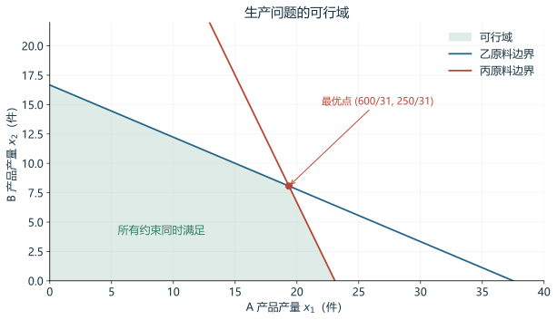
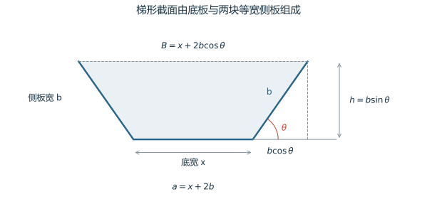
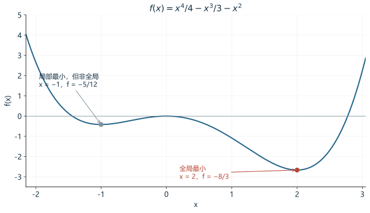
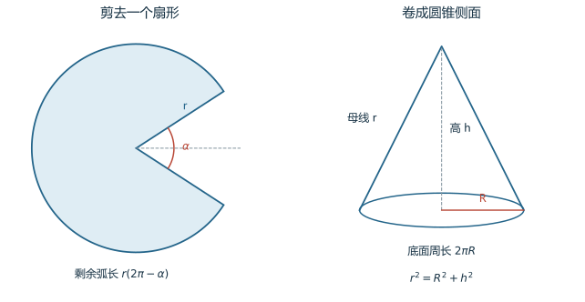

> [数学建模学习地图](/notes/mathematical-modeling-roadmap/) · 最优化方法第一章补充阅读
>
> [下载完整笔记与计算代码](/downloads/math-modeling/optimization-chapter-1-notes.zip)

优化要回答的问题是：**在所有允许的方案中，哪一个方案最好，为什么？** 本章先把现实问题翻译成数学模型，再给模型分类，最后精确定义“最好”的含义。

本文对应《最优化方法》第一章绪论第 1—7 页：1.1 的五个建模例题、1.2 的数学模型与分类、1.3 的最优解与最优值，以及习题 1.1—1.6。每个题目的数据在正文中重新列出，阅读时不需要对照课本。补充的数字例子明确标为“教学例子”；导数、凸性和计算代码用于帮助推导，不要求先完整学完高等数学。

学完后，应能独立定义变量，逐条写出约束，检查单位与取值类型，区分可行、局部最优和全局最优，并解释本章每一个公式的来由。第一次先看直觉和建模，第二次跟着推导计算，第三次遮住答案做自测。

## 1 优化问题在研究什么

### 1.1 决策变量 参数 目标函数和约束

考虑一个工厂：原料库存、每件产品耗料和单位利润已经给定，需要决定两种产品各生产多少。生产越多不一定越好，因为原料有限；只生产单位利润最高的产品也不一定最好，因为不同产品消耗的紧缺原料不同。

| 概念 | 含义 | 工厂中的对应量 |
|---|---|---|
| 参数 | 本次计算已经给定的量 | 库存、单位耗料、单位利润 |
| 决策变量 | 允许我们选择的量 | A、B 各生产多少 |
| 目标函数 | 用一个数评价方案 | 总利润 |
| 约束条件 | 必须同时满足的限制 | 原料消耗不超过库存、产量非负 |
| 可行解 | 满足全部限制的方案 | 一个合法生产计划 |
| 最优解 | 在合法方案中表现最好的方案 | 最赚钱的合法生产计划 |
| 最优值 | 最优解对应的目标函数数值 | 最大利润 |

“决策”意味着这个量由我们控制。如果明天市场需求无法控制，它就不应该被当作可以随意选择的产量变量；它应是给定、预测或需要考虑不确定性的参数。

模型描述的是简化后的现实。生产例题默认单位耗料和利润固定、生产的产品能售出，且暂不考虑换线和开工成本。如果这些假设不符合实际，需要修改模型。求解算法负责在模型里找答案，不能自动补上遗漏的现实限制。

### 1.2 从文字到模型的六个步骤

1. **说清任务**：到底是要利润最大、费用最小，还是别的指标。
2. **列出已知量**：每个参数的含义、数值和单位。
3. **定义变量**：写清一个变量代表什么、单位是什么、能否取小数。
4. **写目标**：用变量算出整个方案的评价结果。
5. **逐条写约束**：每条文字限制都应有对应的式子。
6. **求解并解释**：检查可行性，再给出最优性依据。

“最多”“不超过”通常对应 $\leq$；“至少”“不低于”对应 $\geq$；“恰好”“全部用完”对应 $=$。不过，是否真的需要“全部用完”必须由题意或推导决定，不能为了计算方便随意把 $\leq$ 改成 $=$。

### 1.3 第一页历史段落中的名词

课本的历史脉络是：微积分提供极值分析的工具，生产与运输等问题推动了线性规划的发展，约束最优性理论又使研究范围扩大到更一般的非线性问题。入门时应先掌握每个名词研究什么，不必先背人物生卒年。

| 名词 | 它解决的问题 | 当前需要掌握的程度 |
|---|---|---|
| 微积分 | 数量怎样变化、函数在哪里取得极值 | 本文补充导数的含义 |
| 变分法 | 选择一整条曲线或一个函数 | 知道优化对象也可以是函数 |
| 最速下降法 | 怎样迭代降低多元函数值 | 负梯度给出局部下降最快方向 |
| 线性规划 | 一次形式的目标和约束怎样求最优 | 能识别、建模并理解顶点 |
| 单纯形法 | 系统求解线性规划 | 可理解为在合适的顶点间寻找改进 |
| 对偶理论 | 用相关问题给原问题提供界限和解释 | 本文给出一个最优性上界例子 |
| K－T 条件 | 约束最优点应满足哪些条件 | 现代常见名称为 KKT 条件，完整理论属后续章节 |

这里的“规划”指安排和优化，不是专指编写计算机程序。历史段落提到了方法名称，并没有给出相应算法和定理；本章的学习重点仍是建模、分类和最优性的定义。

## 2 读懂本章需要的数学语言

### 2.1 变量 下标和函数

$x_1,x_2,\ldots,x_n$ 表示 $n$ 个变量。下标是编号，$x_2$ 不是 $x$ 的平方；平方写作 $x^2$。同一个字母在不同题目中可以有不同含义，以当前定义为准。

函数可以先看成一条计算规则。例如：

$$
f(x_1,x_2)=0.9x_1+1.5x_2.
$$

输入方案 $(10,5)$：

$$
f(10,5)=0.9\times10+1.5\times5=16.5.
$$

函数 $f$ 是规则，$f(10,5)$ 是在一个具体方案处算出的数。$f(x)$ 中的 $x$ 既可能是一个数，也可能是包含许多分量的向量，需看定义。

### 2.2 向量和转置

把多个变量装成一个整体：

$$
x=(x_1,x_2,\ldots,x_n)^T
=
\begin{pmatrix}
x_1\\x_2\\\vdots\\x_n
\end{pmatrix}.
$$

这个整体叫向量，$n$ 是它的维数。上标 $T$ 表示转置，在这里就是把横着的一排数改成竖着的一列。

例如，生产计划 $x=(19,8)^T$ 的两个分量分别表示两种产品的产量。比较两个向量是否相等，需要比较全部分量，不能只比较它们的和。

### 2.3 单重求和与双重求和

$$
\sum_{i=1}^{n}a_ix_i
=a_1x_1+a_2x_2+\cdots+a_nx_n.
$$

$i$ 是依次取值的编号。它从 1 到 $n$，每取一个值就计算一项，最后相加。例如：

$$
\sum_{i=1}^{3}a_ix_i=2\times1+5\times0+4\times1=6
$$

对应 $a=(2,5,4)^T,\ x=(1,0,1)^T$。

双重求和对两个编号的全部组合相加：

$$
\sum_{i=1}^{2}\sum_{j=1}^{3}c_{ij}x_{ij}
=c_{11}x_{11}+c_{12}x_{12}+c_{13}x_{13}
+c_{21}x_{21}+c_{22}x_{22}+c_{23}x_{23}.
$$

可以把 $x_{ij}$ 想成表格第 $i$ 行、第 $j$ 列的数。固定 $i$、对 $j$ 求和是在加一行；固定 $j$、对 $i$ 求和是在加一列。

### 2.4 集合 量词和模型中的缩写

| 记号 | 含义 | 例子 |
|---|---|---|
| $\mathbb R$ | 实数集合 | $-2,0,0.5,\sqrt2$ 都属于它 |
| $\mathbb Z$ | 整数集合 | $\ldots,-1,0,1,\ldots$ |
| $\mathbb R^n$ | 所有 $n$ 维实向量 | 一个由 $n$ 个实数组成的方案 |
| $\in$ | 属于 | $x\in D$ 表示 $x$ 是集合 $D$ 的元素 |
| $\{0,1\}$ | 只含 0 和 1 的集合 | 用于选择和开关变量 |
| $\forall$ | 对所有、任意一个 | $\forall x\in D$ |
| $\exists$ | 存在至少一个 | $\exists\delta>0$ |
| $\cap$ | 交集 | 同时属于两个集合的元素 |
| $\max,\min$ | 最大化、最小化 | 利润最大、费用最小 |
| $\mathrm{s.t.}$ | 满足以下限制 | 后面接约束 |
| $x^*$ | 特别标记的点，通常是最优解 | 星号不是乘法或乘方 |

集合写法：

$$
D=\{x\mid x\geq0,\ x\leq5\}
$$

读作“所有满足 $x\geq0$ 且 $x\leq5$ 的数构成的集合”，也就是区间 $[0,5]$。竖线 $\mid$ 读作“使得”。

### 2.5 距离和欧氏范数

平面点 $p=(p_1,p_2)$ 与 $q=(q_1,q_2)$ 的距离来自勾股定理：

$$
\|p-q\|=\sqrt{(p_1-q_1)^2+(p_2-q_2)^2}.
$$

原点到 $(3,4)$ 的距离为 $\sqrt{9+16}=5$。推广到 $n$ 维：

$$
\|x\|=\sqrt{x_1^2+\cdots+x_n^2},\qquad
\|x-y\|=\sqrt{\sum_{i=1}^{n}(x_i-y_i)^2}.
$$

$\|x\|$ 叫欧氏范数，表示向量长度；$\|x-y\|$ 表示两点距离。二维里是看得见的长度，高维中则是相同计算规则的推广。

### 2.6 正弦 余弦和弧度

在直角三角形中，对锐角 $\theta$：

$$
\sin\theta=\frac{\text{对边}}{\text{斜边}},\qquad
\cos\theta=\frac{\text{邻边}}{\text{斜边}}.
$$

若斜边长 $b$，则竖直分量为 $b\sin\theta$，水平分量为 $b\cos\theta$。由勾股定理：

$$
(b\sin\theta)^2+(b\cos\theta)^2=b^2,
$$

两边除以 $b^2$，得到：

$$
\sin^2\theta+\cos^2\theta=1.
$$

角度也可以用弧度表示。定义 $\theta=L/r$，其中 $L$ 是半径为 $r$ 的圆上对应的弧长。因此 $L=r\theta$，整圆角度为 $2\pi$：

$$
180^\circ=\pi,\qquad90^\circ=\frac\pi2,\qquad60^\circ=\frac\pi3.
$$

由一个边长为 2 的正三角形作高，可得 $30^\circ$、$60^\circ$、$90^\circ$ 三角形的边长为 $1,\sqrt3,2$。因此：

$$
\sin60^\circ=\frac{\sqrt3}{2},\qquad
\cos60^\circ=\frac12.
$$

### 2.7 量纲检查

相加的量必须能用同一单位表达，不等式两边也必须属于同一种量。例如：

$$
\frac{\text{千克}}{\text{件}}\times\text{件}=\text{千克}.
$$

因此“总耗料 $\leq$ 库存”的两边都是原料数量。“每件利润 × 件数”的结果是金额。若利润由元换成万元，系数应除以 $10000$，不能只改单位文字。

面积随长度单位平方变化，体积随长度单位立方变化：$1\text{ m}=100\text{ cm}$，但 $1\text{ m}^2=10000\text{ cm}^2$。

## 3 求最优值前先学一点导数

### 3.1 平均变化率怎样变成导数

函数从 $x$ 变到 $x+t$ 时，平均变化率是：

$$
\frac{f(x+t)-f(x)}{t}.
$$

让 $t$ 越来越接近 0，如果这个比值趋近一个确定值，就把它定义为导数：

$$
f'(x)=\lim_{t\to0}\frac{f(x+t)-f(x)}t.
$$

例如 $f(x)=x^2$：

$$
\frac{(x+t)^2-x^2}t=\frac{2xt+t^2}t=2x+t
\longrightarrow2x.
$$

所以 $f'(x)=2x$。在 $x=3$ 处，导数为 6，意味着输入增加很小的 $\Delta x$ 时，输出约增加 $6\Delta x$。取 $\Delta x=0.01$，预测增加 $0.06$，真实增加 $3.01^2-3^2=0.0601$。

### 3.2 求导规则及其来由

常数的导数为 0；和的导数是各项导数之和。对正整数 $n$，展开 $(x+t)^n$，减去 $x^n$ 后除以 $t$，只有 $nx^{n-1}$ 不含剩余的 $t$ 因子；其他项随 $t\to0$ 消失。因此：

$$
\frac{\mathrm d}{\mathrm dx}x^n=nx^{n-1}.
$$

对有理数幂 $p=m/n$，当 $x>0$ 时令 $y=x^{m/n}$，有 $y^n=x^m$。对两边求导：

$$
ny^{n-1}y'=mx^{m-1}
\quad\Longrightarrow\quad
y'=\frac mn x^{m/n-1}.
$$

因此本章需要的幂函数规则是：

$$
\boxed{(x^p)'=px^{p-1}}.
$$

乘积求导可以通过增加、减去 $u(x+t)v(x)$ 并取极限得到：

$$
(uv)'=u'v+uv'.
$$

令 $q=u/v$，则 $u=qv$，有 $u'=q'v+qv'$。解出 $q'$：

$$
\boxed{\left(\frac uv\right)'=\frac{u'v-uv'}{v^2}},\qquad v\ne0.
$$

复合函数使用链式法则：外层对内层求导，再乘内层对自变量的导数。例如：

$$
\frac{\mathrm d}{\mathrm dx}(3x+1)^2
=2(3x+1)\times3.
$$

三角函数在弧度制下满足：

$$
(\sin\theta)'=\cos\theta,\qquad
(\cos\theta)'=-\sin\theta.
$$

以正弦为例，由和角公式：

$$
\frac{\sin(\theta+t)-\sin\theta}{t}
=\sin\theta\frac{\cos t-1}{t}
+\cos\theta\frac{\sin t}{t}.
$$

当 $t\to0$，有 $\sin t/t\to1$、$(\cos t-1)/t\to0$，得到导数 $\cos\theta$。第一个极限可由单位圆中扇形与三角形面积比较得到；第二个由 $\cos t-1=-2\sin^2(t/2)$ 得到。这也解释了为什么不能直接拿角度制数值套进这些求导公式。

### 3.3 导数怎样帮助寻找最大值和最小值

在一个区间内，导数为正表示函数随自变量增加而增加，导数为负表示减少。若导数在某点由正变负，该点是局部最大点；由负变正，则是局部最小点。

可导函数在开区间内部取得局部极值时，导数必须为零。理由是：若一个内部最小点右侧的差商不小于 0，左侧的差商不大于 0，而左右极限必须相同，那么只能都等于 0。

但“导数为零”不够。例如 $x^3$ 在 0 处导数为零，函数却一直增加。闭区间上的求最优，还必须检查端点；不可导的位置也可能是最优点，例如 $|x|$ 在 0 处最小。

二阶导数是“导数的导数”。在满足相应可导条件且 $f'(x^*)=0$ 时：

- $f''(x^*)>0$，可判定严格局部最小；
- $f''(x^*)<0$，可判定严格局部最大；
- $f''(x^*)=0$，单靠这个条件不能判断。

例如 $x^4$ 和 $x^3$ 在 0 处的一阶、二阶导数都为零，但前者有最小值，后者没有局部极值。

### 3.4 偏导数 梯度与最速下降

多元函数 $f(x_1,\ldots,x_n)$ 对 $x_i$ 的偏导数，表示固定其他变量，只让 $x_i$ 变化时的变化率。全部偏导数组成梯度：

$$
\nabla f(x)=
\begin{pmatrix}
\partial f/\partial x_1\\
\vdots\\
\partial f/\partial x_n
\end{pmatrix}.
$$

例如 $f(x_1,x_2)=x_1^2+3x_2^2$，有 $\nabla f=(2x_1,6x_2)^T$。

在可微点附近，沿单位方向 $d$ 走很小的距离 $t$：

$$
f(x+td)=f(x)+t\nabla f(x)^Td+o(t).
$$

$o(t)$ 表示比 $t$ 更快趋近零的误差。向量内积 $a^Tb=\sum a_ib_i$。由柯西—施瓦茨不等式，对 $\|d\|=1$：

$$
\nabla f(x)^Td\geq-\|\nabla f(x)\|.
$$

梯度不为零时，取 $d=-\nabla f/\|\nabla f\|$ 达到等号。因此负梯度是欧氏长度衡量下，当前一阶近似中下降最快的方向。这说明“最速下降”的来由，但不保证任意大步长都下降，也不保证一般非凸问题都能到达全局最优。

## 4 例 1.1 配料与生产安排

### 4.1 题意 数据和模型假设

工厂生产 A、B 两种产品，需要甲、乙、丙三种原料。原料数量统一按题目给定的计量单位计算，题目没有指定千克，不能擅自补成千克。

| 产品 | 甲原料单耗 | 乙原料单耗 | 丙原料单耗 | 每件利润 |
|---|---:|---:|---:|---:|
| A | 8 | 4 | 13 | 9000 元 |
| B | 5 | 9 | 6 | 15000 元 |
| 库存 | 450 | 150 | 300 | — |

假设单位消耗、利润固定，产品能售出，不考虑开工和换线费用。先按课本的连续模型处理，再单独讨论整件生产。

设 $x_1,x_2$ 分别为 A、B 的产量，单位是件。利润以万元计：

$$
P=\frac{9000x_1+15000x_2}{10000}
=0.9x_1+1.5x_2.
$$

因此：

$$
\boxed{
\begin{aligned}
\max\quad&P=0.9x_1+1.5x_2\\
\mathrm{s.t.}\quad&
8x_1+5x_2\leq450,\\
&4x_1+9x_2\leq150,\\
&13x_1+6x_2\leq300,\\
&x_1,x_2\geq0.
\end{aligned}}
$$

每个资源约束的左边都是“单耗 × 产量”的总和，右边是库存；非负约束来自生产数量的含义。

### 4.2 课本中利润系数的单位问题

照片中先写 $0.9x_1+1.5x_2$ 万元，后面模型写为 $9x_1+15x_2$。后一式若按千元理解是正确的；若继续按万元理解，则整体差了 10 倍。

目标函数乘以正常数不改变方案排序，因此最优产量不变，但目标值和单位必须一起改。乘以负数则会反转排序，不能忽略。

### 4.3 可行区域和冗余约束

$8x_1+5x_2=450$ 是一条直线，$\leq450$ 表示它的一侧。多个半平面的交集，就是全部约束同时满足的区域。

由乙、丙约束和非负性：

$$
x_1\leq\frac{300}{13},\qquad x_2\leq\frac{50}{3}.
$$

于是：

$$
8x_1+5x_2
\leq8\cdot\frac{300}{13}+5\cdot\frac{50}{3}
\approx267.95<450.
$$

所以甲原料约束自动满足，是冗余约束。这里的 267.95 是一个便于证明的上界，不表示两种产量能够同时取到各自的上限。



图中阴影表示合法方案。边界上的点也合法，因为约束使用了小于等于号。最优点处乙、丙原料限制同时取等号。

### 4.4 为什么检查顶点

线性目标的等值线 $0.9x_1+1.5x_2=k$ 是一组平行直线。让 $k$ 增大，相当于把直线平移到更高利润的位置。最后接触有界多边形的位置可以是一个顶点，也可以是一条边；即便是一整条边，边的端点也是最优的。

因此本题可在顶点中找到最优解。这个结论不能直接推广到一般非线性问题：例如在 $[-1,1]$ 上最小化 $x^2$，最优点是内部的 0。

乙、丙边界交点满足：

$$
\begin{cases}
4x_1+9x_2=150,\\
13x_1+6x_2=300.
\end{cases}
$$

第一式乘 13，第二式乘 4，再相减：

$$
93x_2=750
\quad\Longrightarrow\quad
x_2=\frac{250}{31}.
$$

代回求得 $x_1=600/31$。全部顶点和利润为：

| 方案 $(x_1,x_2)$ | 利润 万元 |
|---|---:|
| $(0,0)$ | $0$ |
| $(300/13,0)$ | $270/13\approx20.7692$ |
| $(0,50/3)$ | $25$ |
| $(600/31,250/31)$ | $915/31\approx29.5161$ |

故连续模型的最优方案与最优值为：

$$
\boxed{
x^*=\left(\frac{600}{31},\frac{250}{31}\right)^T,\qquad
P^*=\frac{915}{31}\text{ 万元}.
}
$$

检查资源消耗：乙为 150，丙为 300，甲为 $6050/31\approx195.1613$。注意这和前面的宽松上界 267.95 是两回事。

### 4.5 不依赖画图的全局最优性证明

目标函数可以改写成两个资源消耗的正系数加权：

$$
0.9x_1+1.5x_2
=
\frac{47}{310}(4x_1+9x_2)
+
\frac7{310}(13x_1+6x_2).
$$

检查 $x_1$ 系数：$(188+91)/310=0.9$；$x_2$ 系数：$(423+42)/310=1.5$。

由于两个系数都非负，任何合法方案都满足：

$$
P\leq
\frac{47}{310}\times150+
\frac7{310}\times300
=\frac{915}{31}.
$$

刚才的交点恰好达到这个上界，所以不可能有更好的可行方案。这是“先建立所有方案都不能超过的界，再找到达到它的方案”的证明，也是理解线性规划对偶思想的一个入口。

### 4.6 如果产量必须是整数

若产品不能拆成小数件，应增加 $x_1,x_2\in\mathbb Z_{\geq0}$。连续解给出的是放宽整性后的上界，不应直接当成生产指令。

枚举 $x_2=0,\ldots,16$。固定 $x_2$ 后，由于 A 的利润为正，应选可行的最大整数：

$$
x_1=
\left\lfloor
\min\left\{\frac{150-9x_2}{4},\frac{300-6x_2}{13}\right\}
\right\rfloor.
$$

$\lfloor t\rfloor$ 是不大于 $t$ 的最大整数。比较得到 $(19,8)$，利润 29.1 万元，三种原料消耗为 192、148、295，全部合法。

还可用整性证明它已最优：利润为 $0.3(3x_1+5x_2)$，故只能以 0.3 万元为间隔变化。连续上界约为 29.5161，整数利润最高可能为 29.4。若利润为 29.4，则 $3x_1+5x_2=98$。代入乙、丙约束可得：

$$
\frac{374}{47}\leq x_2\leq\frac{58}{7}.
$$

唯一可能的整数是 $x_2=8$，但这使 $x_1=58/3$，不是整数。因此 29.4 不可达，29.1 已是全局最优整数利润。

### 4.7 为什么不能只比较每件利润

B 的每件利润高，但它每件消耗 9 单位乙原料，A 只消耗 4。对乙原料而言，A 的利润效率 $0.9/4=0.225$ 高于 B 的 $1.5/9\approx0.1667$。但只按这一种资源的效率排序也不够，因为丙原料同样有限。优化的作用正是同时处理多个相互影响的限制。

## 5 例 1.2 投资项目选择

### 5.1 用零一变量表示选择

总预算为 $a$ 万元，有 $n$ 个可选项目，第 $i$ 个项目需要 $a_i$ 万元、收益为 $b_i$ 万元。项目只能完整选择或不选择，收益按题意相加。

$$
x_i=
\begin{cases}
1,&\text{选择项目 }i,\\
0,&\text{不选择项目 }i.
\end{cases}
$$

$a$ 是总预算，$a_i$ 是单个项目成本，不要混淆。选中时 $a_ix_i=a_i$，未选时为 0，因此：

$$
\boxed{
\begin{aligned}
\max\quad&\sum_{i=1}^{n}b_ix_i\\
\mathrm{s.t.}\quad&\sum_{i=1}^{n}a_ix_i\leq a,\\
&x_i\in\{0,1\},\quad i=1,\ldots,n.
\end{aligned}}
$$

预算使用 $\leq$，因为项目不可分，最优组合可能恰好剩下一笔不足以再购买任何项目的资金。

### 5.2 课本的乘积约束为什么有效

课本写作 $x_i(x_i-1)=0$。两个实数乘积为零，至少一个因子为零，因此：

$$
x_i(x_i-1)=0
\iff x_i=0\ \text{或}\ x_i=1.
$$

这与 $x_i\in\{0,1\}$ 等价。直接写二元取值，更能看清这是一个 0－1 背包模型。不能把它随意改成 $0\leq x_i\leq1$；后者允许购买“半个项目”，已经改变了问题。

### 5.3 一个可以完整比较的教学例子

| 项目 | 资金需求 | 收益 |
|---|---:|---:|
| A | 6 | 12 |
| B | 5 | 9 |
| C | 5 | 9 |

预算为 10，单位统一。八种二元组合中，合法的只有全不选、只选 A、只选 B、只选 C、同时选 B 和 C，收益分别为 0、12、9、9、18。

因此最佳方案是 $(x_A,x_B,x_C)=(0,1,1)$。A 的单项收益和收益成本比都最高，但先买 A 只能得到 12，仍不如 B、C 的组合。一般背包问题不能保证按某个单项指标贪心选择就最优。

## 6 例 1.3 梯形水槽的几何模型与最优形状

### 6.1 铁皮宽度怎样分配

矩形铁皮宽 $a$、长 $l$，沿长度方向折起两边，截面为等腰梯形。设底宽为 $x$、侧板与水平底面的夹角为 $\theta$，每块侧板的宽度为 $b$。

由于三块板宽度之和等于铁皮宽：

$$
x+2b=a
\quad\Longrightarrow\quad
b=\frac{a-x}{2}.
$$

题目考虑两侧向外张开的形状，因此 $0\leq\theta\leq\pi/2$。这里 $\theta$ 是与水平延长线形成的角，不能误认成梯形底部的钝角内角。



### 6.2 逐步推导面积公式

每块侧板的水平投影为 $b\cos\theta$，竖直高度为 $b\sin\theta$。上口宽度和高度为：

$$
B=x+2b\cos\theta,\qquad h=b\sin\theta.
$$

梯形面积是上下底平均长度乘高：

$$
S=\frac{B+x}{2}h
=\frac{x+2b\cos\theta+x}{2}b\sin\theta
=(x+b\cos\theta)b\sin\theta.
$$

代入 $b=(a-x)/2$，得到课本的公式：

$$
\boxed{
S(x,\theta)=
\frac{2x+(a-x)\cos\theta}{4}(a-x)\sin\theta.
}
$$

所以模型是最大化 $S(x,\theta)$，满足 $0\leq x\leq a$、$0\leq\theta\leq\pi/2$。水槽体积 $V=lS$，因为长度 $l$ 固定且为正，最大化面积与最大化体积等价。

### 6.3 先固定折角 再优化板宽

换用 $b$ 作变量，$x=a-2b$：

$$
S(b,\theta)
=\left[ab-(2-\cos\theta)b^2\right]\sin\theta.
$$

固定 $\theta$，通过配方：

$$
\begin{aligned}
ab-(2-\cos\theta)b^2
={}&\frac{a^2}{4(2-\cos\theta)}\\
&-(2-\cos\theta)
\left(b-\frac{a}{2(2-\cos\theta)}\right)^2.
\end{aligned}
$$

平方项不小于零，且 $2-\cos\theta>0$。因此取：

$$
b_{\mathrm{best}}(\theta)
=\frac{a}{2(2-\cos\theta)}
$$

即可达到固定折角下的最大面积：

$$
S_{\mathrm{best}}(\theta)
=\frac{a^2}{4}\frac{\sin\theta}{2-\cos\theta}.
$$

由于 $\cos\theta\in[0,1]$，这个 $b$ 位于 $[a/4,a/2]$，符合 $0\leq b\leq a/2$ 的允许范围。折角为 0 时面积全为 0，上面的 $b$ 只是众多同样退化方案之一。

### 6.4 求最合适的折角

只需最大化 $F(\theta)=\sin\theta/(2-\cos\theta)$。由商的求导规则：

$$
\begin{aligned}
F'(\theta)
&=\frac{\cos\theta(2-\cos\theta)-\sin^2\theta}
{(2-\cos\theta)^2}\\
&=\frac{2\cos\theta-1}{(2-\cos\theta)^2}.
\end{aligned}
$$

在 $[0,\pi/2]$ 内，余弦从 1 减少到 0。于是导数在 $\theta<\pi/3$ 时为正，在 $\theta>\pi/3$ 时为负，因此全区间最大值出现在：

$$
\theta^*=\frac\pi3=60^\circ.
$$

代回得到：

$$
b^*=\frac a3,\qquad x^*=a-2b^*=\frac a3.
$$

所以底板与两块侧板等宽。进一步：

$$
B^*=\frac{2a}{3},\qquad
h^*=\frac{\sqrt3a}{6},
$$

$$
\boxed{
S_{\max}=\frac{\sqrt3}{12}a^2,\qquad
V_{\max}=\frac{\sqrt3}{12}a^2l.
}
$$

### 6.5 用具体尺寸检验

若 $a=6\text{ cm}$，则三块板宽均为 $2\text{ cm}$；高度 $\sqrt3\text{ cm}$，上口宽 $4\text{ cm}$。面积为：

$$
S=\frac{2+4}{2}\sqrt3=3\sqrt3\text{ cm}^2.
$$

代入通式也得到 $\sqrt3\times36/12=3\sqrt3$。若水槽长 $10\text{ cm}$，体积为 $30\sqrt3\text{ cm}^3$。

边界也值得理解：$\theta=0$ 或 $x=a$ 时没有高度或侧板，面积为 0；折成竖直侧板 $\theta=\pi/2$ 时的最佳面积为 $a^2/8$，小于 $\sqrt3a^2/12$。最大容量并不要求侧板竖直。

## 7 例 1.4 平衡运输问题

### 7.1 路线变量与总费用

$m$ 个产地 $A_i$ 的供应量为 $a_i$ 吨，$n$ 个销售地 $B_j$ 的需求量为 $b_j$ 吨，路线单价为 $c_{ij}$ 元/吨，且总供应等于总需求。

设 $x_{ij}$ 为从 $A_i$ 运往 $B_j$ 的吨数，路线费用为 $c_{ij}x_{ij}$ 元。全部路线相加：

$$
C=\sum_{i=1}^{m}\sum_{j=1}^{n}c_{ij}x_{ij}.
$$

### 7.2 为什么有行和与列和约束

固定产地 $i$，它送往各地的数量相加，必须等于它的供应量；固定销售地 $j$，它从各地收到的数量相加，必须等于需求量：

$$
\boxed{
\begin{aligned}
\min\quad&\sum_{i=1}^{m}\sum_{j=1}^{n}c_{ij}x_{ij}\\
\mathrm{s.t.}\quad&
\sum_{j=1}^{n}x_{ij}=a_i,\quad i=1,\ldots,m,\\
&\sum_{i=1}^{m}x_{ij}=b_j,\quad j=1,\ldots,n,\\
&x_{ij}\geq0.
\end{aligned}}
$$

总供应和总需求相等是全部货物恰好运完、全部需求恰好满足的必要条件。若所有路线允许且没有额外容量限制，供应需求均非负时，平衡还能保证存在运输方案；若有禁运路线，则还需检查连通和容量条件。

总行和与总列和计算的是同一批货，所以这些等式中有一条可以由其余等式和总量平衡推出。保留全部等式是清楚且正确的建模写法。

### 7.3 两产地两销售地的完整教学例子

供应量为 20、30 吨，需求量为 10、40 吨，运费如下：

| 元每吨 | 销售地 1 | 销售地 2 |
|---|---:|---:|
| 产地 1 | 2 | 4 |
| 产地 2 | 3 | 1 |

设 $x_{11}=t$。由行和、列和：

$$
x_{12}=20-t,\quad x_{21}=10-t,\quad x_{22}=20+t.
$$

非负性给出 $0\leq t\leq10$，总费用：

$$
C(t)=2t+4(20-t)+3(10-t)+(20+t)=130-4t.
$$

随着 $t$ 增加费用下降，所以取 $t=10$：

$$
X^*=
\begin{pmatrix}
10&10\\0&30
\end{pmatrix},\qquad C_{\min}=90\text{ 元}.
$$

检查每行是 20、30，每列是 10、40；再计算 $2\times10+4\times10+1\times30=90$。不能只算费用，不检查货物是否满足供需。

## 8 例 1.5 方程组与残差平方和

### 8.1 从精确等式到优化目标

要解 $m$ 个方程：

$$
f_i(x_1,\ldots,x_n)=0,\qquad i=1,\ldots,m.
$$

把 $f_i(x)$ 称为第 $i$ 个方程的残差。例如 $x^2=2$ 改成 $f_1(x)=x^2-2=0$，代入 $x=1$ 的残差是 $-1$，代入 $\sqrt2$ 的残差是 0。

构造：

$$
\boxed{F(x)=\sum_{i=1}^{m}[f_i(x)]^2}.
$$

平方的作用是让每项非负，避免正负误差抵消。若两个残差为 1、$-1$，直接相加是 0，但平方和是 2，能够识别方程并未满足。

由于每项非负：

$$
F(x)\geq0,\qquad
F(x)=0\iff f_i(x)=0\ \text{对所有 }i.
$$

因此原方程组的解，恰好是平方和目标能取得 0 的点。若存在精确解，平方和的全局最小值就是 0。

### 8.2 有解与无解的两个例子

方程 $x-1=0$ 与 $2x-2=0$ 的共同解是 1，对应：

$$
F(x)=(x-1)^2+(2x-2)^2=5(x-1)^2,
$$

最小值为 0。

方程 $x-1=0$ 与 $x-3=0$ 不可能同时成立。对应：

$$
F(x)=(x-1)^2+(x-3)^2=2(x-2)^2+2.
$$

全局最小值为 2，在 $x=2$ 取得。这个 2 是折中位置，既不等于 1 也不等于 3，所以不是精确解。这就是最小二乘思想：当所有方程不能完全满足时，让残差平方和尽量小。

### 8.3 不能忽略的全局性和取得性

“最小值为正，原方程无解”中的最小值必须是已经确认的**全局**最小值。某个算法得到正的局部最小值，不能据此判无解。

一个具体反例是：

$$
f_1(x)=x^3-3x+3,\qquad F(x)=[x^3-3x+3]^2.
$$

在 $x=1$，残差为 1，$F'(1)=0$，且：

$$
F''(1)=2[f_1'(1)]^2+2f_1(1)f_1''(1)=12>0.
$$

所以这里是值为 1 的严格局部最小点。但 $f_1(-3)=-15$、$f_1(-2)=1$，由连续性，它在 $(-3,-2)$ 内有根，那里 $F=0$。正的局部最小值没有排除精确解。

另外，$\inf F=0$ 不等于存在点使 $F=0$。例如 $f_1(x)=e^{-x}$ 始终为正，但 $F(x)=e^{-2x}$ 可以无限接近 0，没有有限点能取得 0。

因此，等价求解的准确说法是：**求原方程组的精确解，等价于寻找平方和目标的零点；只有零值确实被某个点取得，才得到精确解。**

数值计算中的 $10^{-12}$ 也不是严格数学上的 0，应结合计算精度和各残差尺度判断。若各方程单位或数量级不同，无精确解时的折中结果还会受残差权重影响。

## 9 课本 1.2 优化问题的数学模型

### 9.1 统一模型和各符号

把前面的例子统一写成：

$$
\boxed{
\begin{aligned}
\min\quad&f(x)\\
\mathrm{s.t.}\quad&
g_i(x)\geq0,\quad i=1,\ldots,m,\\
&h_j(x)=0,\quad j=1,\ldots,l.
\end{aligned}}
$$

$x\in\mathbb R^n$ 是决策向量，$n$ 是变量数；$m$ 是不等式约束数，$l$ 是等式约束数。$f$ 称为目标函数或评价函数，$g_i,h_j$ 称为约束函数。这些数字没有必须相等的关系。

例如：

$$
\min x_1^2+x_2^2
\quad\mathrm{s.t.}\quad
x_1+x_2\geq1,\quad x_1-x_2=0
$$

中，$n=2,m=1,l=1$，可取：

$$
f=x_1^2+x_2^2,\quad
g_1=x_1+x_2-1,\quad
h_1=x_1-x_2.
$$

等式给出 $x_1=x_2=t$，不等式给出 $t\geq1/2$，目标为 $2t^2$，最优为 $(1/2,1/2)$、最优值为 $1/2$。这是一个从一般符号回到具体计算的最小例子。

### 9.2 可行域的集合写法

$$
D=\{x\in\mathbb R^n\mid
g_i(x)\geq0\ (i=1,\ldots,m),\
h_j(x)=0\ (j=1,\ldots,l)\}.
$$

所有条件都要同时成立，因此是多个集合的交集，不是从中任选一条。模型简写为：

$$
\min_{x\in D}f(x).
$$

可行域只负责判定方案合法；目标函数负责比较合法方案。更换目标但保留约束，可行域不变；更换约束，即使目标不变，也可能改变最优方案。

### 9.3 最大化怎样转为最小化

若 $f(x)\leq f(x^*)$，两边乘以 $-1$ 得：

$$
-f(x)\geq-f(x^*).
$$

因此最大化 $f$ 与最小化 $-f$ 的最优方案相同。最优值的关系是：

$$
\boxed{\max_{x\in D}f(x)=-\min_{x\in D}[-f(x)]}
$$

（这里假设相应最优值能取得）。不能把等式右边的外层负号省掉。

例如 $x\in[0,2]$ 时，$\max 3x=6$，而 $\min(-3x)=-6$；两个问题都在 $x=2$ 取到最优值。

$\min f$ 指最小的函数值，$\operatorname{argmin}f$ 指取得最小值的点的集合。例如：

$$
\min_x(x-2)^2=0,\qquad
\operatorname{argmin}_x(x-2)^2=\{2\}.
$$

若有多个最优方案，argmin 中就有多个点。课本用 $x^*$ 表示其中一个点，不表示最优值。

### 9.4 不等号方向和等式的标准化

$$
g(x)\leq0\iff-g(x)\geq0.
$$

例如 $2x_1+3x_2\leq10$ 改成 $10-2x_1-3x_2\geq0$。如果只把不等号改向而没有乘负号，就改变了可行域。

等式可以拆成：

$$
h(x)=0
\iff
\begin{cases}
h(x)\geq0,\\
-h(x)\geq0.
\end{cases}
$$

两个条件合起来意味着 $h$ 同时不小于 0、不大于 0，只能为 0。只写其中一个不等式不等价。拆成两个不等式是可行集层面的等价，分析或计算时通常保留原等式更简洁。

## 10 优化问题怎样分类

### 10.1 按约束类型

| 类别 | 形式 | 一个例子 |
|---|---|---|
| 无约束 | 只有目标与自然定义域 | $\min_{x\in\mathbb R}(x-3)^2$ |
| 等式约束 | $h_j(x)=0$ | $x_1+x_2=1$ |
| 不等式约束 | $g_i(x)\geq0$ 或 $\leq0$ | $x_1+x_2\leq1$ |
| 混合约束 | 同时有等式和不等式 | 运输模型的供需等式与非负约束 |

无约束不是“任何输入都合法”：例如 $\log x$ 本身就要求 $x>0$，这属于函数的自然定义域。

约束可能改变答案。例如无约束最小化 $(x-3)^2$ 在 $x=3$ 取零；增加 $x\leq1$ 后，3 不合法，最优改为 $x=1$，最小值为 4。

### 10.2 按目标与约束函数类型

优化中的线性形式通常包括：

$$
c_0+c_1x_1+\cdots+c_nx_n,
$$

其中各 $c_i$ 为常数。严格线性代数术语把含常数项的形式称为仿射；线性规划允许这样的表达式。

| 表达式 | 分类理由 |
|---|---|
| $3x_1-2x_2+5$ | 线性规划允许的一次形式 |
| $x_1/2+x_2$ | 分母是常数，仍为一次形式 |
| $x_1^2+x_2$ | 有变量平方，非线性 |
| $x_1x_2$ | 变量之间相乘，非线性 |
| $1/x_1$ | 变量在分母，非线性 |
| $\sin x_1$ | 三角函数，非线性 |

目标与所有约束都是一次形式，称为线性规划。只要其中有非线性函数，就不再是线性规划。判断时必须把目标和约束都看一遍。

若目标为二次函数，约束为线性形式，称为二次规划，例如：

$$
\min x_1^2+2x_1x_2+3x_2^2
\quad\mathrm{s.t.}\quad x_1+x_2\leq10,\ x_1,x_2\geq0.
$$

二次规划属于非线性规划。不能仅凭“二次”断言一定只有一个最小点；还需要分析二次函数的曲率。

### 10.3 按变量取值类型

| 类别 | 取值规则 | 典型对象 |
|---|---|---|
| 连续优化 | 变量可在允许范围取实数 | 长度、重量、可分割流量 |
| 整数规划 | 所有决策变量要求整数 | 人数、整台设备 |
| 混合整数规划 | 只有部分变量要求整数 | 是否建厂与连续产量 |
| 0－1 规划 | 决策变量仅取 0、1 | 选项目、派人、开关 |

0－1 规划是整数规划的特殊情况。整数限制本身也是约束，不能在求出连续解后通过随意取整替代。

### 10.4 多目标与动态规划

单目标用一个数评价；多目标同时关心多个指标。若方案 A 费用 100、耗时 1，方案 B 费用 50、耗时 2，则无法在没有偏好时直接认定哪一个更好。

如果某个方案在所有指标上都不比另一个差，并至少有一项更好，就称为支配另一个方案。找不到其他方案支配它时，称为 Pareto 有效方案。多目标常得到一组取舍方案，不必存在各方面都最好的唯一方案。

可以用权重把目标组合起来，但权重表达偏好，金额和时间还要处理单位或兑换关系；直接相加原始数值已经暗含了一个兑换标准。

动态规划则把决策过程划为阶段，并用状态保存影响未来决策的信息。项目选择中，设 $V(k,B)$ 为只考虑前 $k$ 个项目、预算至多为 $B$ 时的最高收益。第 $k$ 个项目只有选与不选两种情况：

$$
V(k,B)=
\begin{cases}
V(k-1,B),&a_k>B,\\
\max\{V(k-1,B),\ b_k+V(k-1,B-a_k)\},&a_k\leq B.
\end{cases}
$$

起点 $V(0,B)=0$。选了第 $k$ 个项目，就把它的收益加上、从预算扣去成本，再处理前 $k-1$ 个项目。费用按整数单位计时，可以把这些状态排成有限表格。这是复用子问题的思想，“动态”不要求题目一定出现时间。

### 10.5 同一道题可以同时属于多个类别

| 本章问题 | 目标方向 | 函数结构 | 变量结构 |
|---|---|---|---|
| 配料生产连续模型 | 最大化 | 线性 | 连续 |
| 配料生产整件模型 | 最大化 | 线性 | 整数 |
| 项目选择 | 最大化 | 线性目标与预算 | 0－1 |
| 水槽 | 最大化 | 非线性 | 连续 |
| 运输 | 最小化 | 线性 | 连续吨数 |
| 方程残差平方和 | 最小化 | 一般可非线性 | 通常连续 |
| 指派 | 最小化 | 线性目标与行列约束 | 0－1 |

“有约束”“非线性”“整数”是不同分类维度，不是彼此排斥的标签。

## 11 课本 1.3 最优解与最优值

### 11.1 全局最优的正式定义

考虑 $\min_{x\in D}f(x)$。若 $x^*\in D$，并且：

$$
\boxed{\forall x\in D,\qquad f(x)\geq f(x^*)},
$$

则 $x^*$ 是全局最优解，$f(x^*)$ 是全局最优值。定义包含两件事：这个点本身合法；它与所有合法点比较都不差。

若还满足：

$$
f(x)>f(x^*),\qquad
\forall x\in D,\ x\ne x^*,
$$

则是严格全局最优解。必须排除 $x=x^*$，因为一个数不可能严格大于自身。

对最小化，严格全局最优等价于全局最优解存在且唯一。若是最大化问题，把这些比较中的 $\geq$ 改成 $\leq$，$>$ 改成 $<$。

### 11.2 局部最优的邻域定义

点 $x^*$ 的 $\delta$ 邻域为：

$$
N_\delta(x^*)=\{x\mid\|x-x^*\|<\delta\},\qquad\delta>0.
$$

一维是开区间，二维是圆盘，三维是球内部。局部最优要求：

$$
\boxed{
\exists\delta>0,\quad
\forall x\in D\cap N_\delta(x^*),\quad
f(x)\geq f(x^*).
}
$$

“存在一个足够小的范围”即可，并非要求对任何大小的范围都成立。比较对象必须在 $D$ 中，不合法的方向即使能下降，也不能用来否定约束局部最优。

若把不同点的 $\geq$ 改成 $>$，就是严格局部最优。

### 11.3 四个例子区分严格 局部和全局

$f(x)=x^2$ 在 0 处为严格全局最小，因此也为严格局部最小。

$f(x)=(x^2-1)^2$ 在 $-1,1$ 两点均取 0。它们都是全局最优，但不是严格全局最优，因为另一个点同样好。它们各自又是严格局部最优：取半径小于 2 的合适邻域，附近其他点都更差。

常数函数 $f(x)=0$ 在整个实数域上，每一点都既是全局最优也是局部最优，但没有严格局部最优，因为任何附近都有同样好的不同点。

要看到“局部最优却不是全局最优”，考虑：

$$
f(x)=\frac{x^4}{4}-\frac{x^3}{3}-x^2.
$$

$$
f'(x)=x^3-x^2-2x=x(x-2)(x+1).
$$

驻点为 $-1,0,2$。由导数变号可判定 $-1$、2 为局部最小，0 为局部最大。但：

$$
f(-1)=-\frac5{12},\qquad f(2)=-\frac83.
$$

由于四次项在两端占主导，$f(x)\to+\infty$；比较两个最低候选可知 2 是全局最小，$-1$ 只在附近最好。



图中左侧谷底已经比附近低，但右侧谷底更低。梯度为零不能单独证明全局最优。

### 11.4 边界最优不必导数为零

$$
\min x\quad\mathrm{s.t.}\quad0\leq x\leq1
$$

的最优点是 0，然而导数处处为 1。向左走虽然能降低目标，却离开了可行域。无约束内部极值的必要条件，不能原封不动地用于边界点。

### 11.5 最优解存在 最优值有限和下确界

| 情况 | 例子 | 解释 |
|---|---|---|
| 有唯一最优解 | $\min x^2$ | 在 0 取到 0 |
| 有多个最优解 | $\min(x^2-1)^2$ | 在 $\pm1$ 取到 0 |
| 无可行解 | $x\geq1$ 且 $x\leq0$ | 没有合法方案 |
| 向下无界 | $\min(-x),\ x\geq0$ | 可以不断减小到任意负数 |
| 有有限下界但取不到 | $\min e^{-x}$ | 可逼近 0，但始终大于 0 |

下确界 $\inf f$ 是最大的下界。$e^{-x}$ 的每个函数值都大于 0，同时可以比任意给定正数更小，所以它的下确界是 0。但没有点取得它，因此不能把 0 称为已取得的最小值。

一个常用的存在性保证是：在有限维空间中，可行域非空、闭且有界，目标连续，则最大、最小值都能取得。“闭”指包含所有收敛序列应落入的极限点，“有界”指整体装得进一个有限半径的球；它们比“看起来有边界”更精确。

简单对照：$D=[0,1]$ 上最小化 $x$，在 0 取得；改成 $D=(0,1]$，0 被排除，只能逼近而取不到。这个定理给的是充分条件，不是说任何无界可行域都没有最优解；$\mathbb R$ 上的 $x^2$ 就有最小值。

### 11.6 怎样证明一个方案最优

本章已经出现几种证据：检查有界线性可行域的全部顶点；推导导数在整个区间的增减；证明所有方案都有某个界且当前方案达到它；枚举全部有限候选；或利用凸性、凹性证明没有别处更好的点。

求解器打印“成功”是计算信息，数学证明则需要相应条件。一般非凸问题只找到局部最优，不足以承诺全局最好。

## 12 六道课后习题详解

### 12.1 习题 1.1 指派问题

有 $n$ 项工作 $B_1,\ldots,B_n$，分配给 $n$ 个人 $A_1,\ldots,A_n$。第 $i$ 个人做第 $j$ 项工作的费用为 $c_{ij}$。每个人恰好做一项工作，每项工作恰好由一个人完成。

设：

$$
x_{ij}=
\begin{cases}
1,&\text{把工作 }j\text{ 分给人 }i,\\
0,&\text{否则}.
\end{cases}
$$

模型：

$$
\boxed{
\begin{aligned}
\min\quad&\sum_{i=1}^{n}\sum_{j=1}^{n}c_{ij}x_{ij}\\
\mathrm{s.t.}\quad&
\sum_{j=1}^{n}x_{ij}=1,\quad i=1,\ldots,n,\\
&\sum_{i=1}^{n}x_{ij}=1,\quad j=1,\ldots,n,\\
&x_{ij}\in\{0,1\}.
\end{aligned}}
$$

第一组等式防止某个人做多项或零项，第二组防止某项工作被重复安排或无人负责。只写其中一组不够。

教学例子：两人的费用表为 $\begin{pmatrix}2&6\\5&1\end{pmatrix}$。只有两种一一分配：按对角线安排，费用 $2+1=3$；交叉安排，费用 $6+5=11$。所以第一种最优。原题没有给出具体 $c_{ij}$，因此原题只能写一般模型，不能给出具体人选。

### 12.2 习题 1.2 扇形材料卷成圆锥

原材料为半径 $r$ 的圆，剪去圆心角为 $\alpha$ 的扇形，把剩余部分无重叠、无损耗地卷成圆锥侧面。忽略厚度、接缝和底面材料；$r$ 是已知参数，不是要优化的圆锥底面半径。

设圆锥底面半径为 $R$，高为 $h$。卷起后：

- 原圆半径 $r$ 变成圆锥母线；
- 剩余扇形的弧长变成底面周长。



因此：

$$
2\pi R=r(2\pi-\alpha)
\quad\Longrightarrow\quad
R=r\left(1-\frac{\alpha}{2\pi}\right).
$$

母线、高和底半径形成直角三角形：

$$
h=\sqrt{r^2-R^2}.
$$

圆锥体积 $V=\pi R^2h/3$。这个 $1/3$ 也可通过截面累加理解：从尖端起高度为 $z$ 的水平截面半径为 $Rz/h$，所以：

$$
V=\int_0^h\pi\left(\frac{Rz}{h}\right)^2\mathrm dz
=\frac{\pi R^2}{h^2}\frac{h^3}{3}
=\frac{\pi R^2h}{3}.
$$

这里积分表示把许多很薄的圆片体积累加；若尚未学习积分，先掌握其几何含义即可。

以剪角为变量的模型：

$$
\boxed{
\begin{aligned}
\max_\alpha\quad&
V=\frac{\pi r^3}{3}
\left(1-\frac{\alpha}{2\pi}\right)^2\\
&\qquad\cdot
\sqrt{1-\left(1-\frac{\alpha}{2\pi}\right)^2}\\
\mathrm{s.t.}\quad&0\leq\alpha\leq2\pi.
\end{aligned}}
$$

端点为退化形状、体积为零，允许它们不影响内部的最优答案。为了计算方便，等价地改用 $R$：

$$
\max_{0\leq R\leq r}
\frac\pi3R^2\sqrt{r^2-R^2}.
$$

由于体积非负，最大化体积等价于最大化其平方。再设 $t=R^2$，忽略正常数后只需最大化：

$$
G(t)=t^2(r^2-t),\qquad0\leq t\leq r^2.
$$

$$
G'(t)=2r^2t-3t^2=t(2r^2-3t).
$$

在内部候选 $t=2r^2/3$ 前导数为正、后为负，而端点值为零。因此：

$$
R^*=r\sqrt{\frac23},\qquad h^*=\frac r{\sqrt3}.
$$

代回弧长关系：

$$
\boxed{
\alpha^*=2\pi\left(1-\sqrt{\frac23}\right)
\approx1.152986\text{ 弧度}
\approx66.0612^\circ.
}
$$

$$
\boxed{V_{\max}=\frac{2\pi r^3}{9\sqrt3}}.
$$

易错点：母线是 $r$，底面半径是 $R$，二者不相等；底面周长对应的是剩余扇形弧长，不是剪掉的弧长。

### 12.3 习题 1.3 固定周长的最大面积三角形

用 50 m 栅栏围三角形，三边为 $a,b,c$。若未用完而已有非退化三角形，可按相同比例放大以增加面积，所以最优时 $a+b+c=50$。

半周长 $s=(a+b+c)/2=25$。海伦公式给出：

$$
A=\sqrt{s(s-a)(s-b)(s-c)}.
$$

模型为：

$$
\boxed{
\begin{aligned}
\max\quad&\sqrt{25(25-a)(25-b)(25-c)}\\
\mathrm{s.t.}\quad&a+b+c=50,\\
&a+b>c,\quad a+c>b,\quad b+c>a,\\
&a,b,c>0.
\end{aligned}}
$$

**海伦公式的推导。** 设 $a,b$ 夹角为 $C$，对边为 $c$。面积 $A=ab\sin C/2$，余弦定理给出 $\cos C=(a^2+b^2-c^2)/(2ab)$。于是：

$$
\begin{aligned}
16A^2
&=4a^2b^2-(a^2+b^2-c^2)^2\\
&=[c^2-(a-b)^2][(a+b)^2-c^2]\\
&=(c-a+b)(c+a-b)(a+b-c)(a+b+c)\\
&=16s(s-a)(s-b)(s-c).
\end{aligned}
$$

除以 16、取非负平方根，就得到海伦公式。余弦定理本身也可由投影和勾股定理得到：把夹角边的水平分量写成 $b\cos C$，另一分量写成 $b\sin C$，第三边平方等于 $(a-b\cos C)^2+(b\sin C)^2$，展开即可。

**最大面积的推导。** 令：

$$
u=25-a,\quad v=25-b,\quad w=25-c.
$$

三角形不等式保证 $u,v,w>0$，且 $u+v+w=25$。面积平方为 $A^2=25uvw$，所以只需最大化乘积。

先固定 $u$，由 $(v-w)^2\geq0$：

$$
vw\leq\frac{(v+w)^2}{4}
=\frac{(25-u)^2}{4}.
$$

因此 $uvw\leq u(25-u)^2/4$，等号需 $v=w$。求导：

$$
\frac{\mathrm d}{\mathrm du}\frac{u(25-u)^2}{4}
=\frac{(25-u)(25-3u)}4.
$$

在 $0<u<25$ 内，最大值在 $u=25/3$，此时 $v=w=25/3$。所以：

$$
\boxed{a=b=c=\frac{50}{3}\text{ m}}.
$$

也就是等边三角形。作高得到 $H=\sqrt3a/2$，再用面积 $aH/2$：

$$
\boxed{
A_{\max}
=\frac{\sqrt3}{4}\left(\frac{50}{3}\right)^2
=\frac{625\sqrt3}{9}
\approx120.2813\text{ m}^2.
}
$$

这个推导也解释了三个正数在和固定时，为什么乘积在它们相等时最大。

### 12.4 习题 1.4 四类广告的预算分配

预算为 1000 万元，$x_1,x_2,x_3,x_4$ 分别是广播、电视、报纸、户外广告费用，单位均为万元。题表给出收益：

| 媒体 | 收益 |
|---|---|
| 广播 | $8x_1^{0.5}$ |
| 电视 | $2x_2^{0.3}$ |
| 报纸 | $3x_3^{0.6}$ |
| 户外 | $11x_4^{0.4}$ |

按题意把四项相加：

$$
\boxed{
\begin{aligned}
\max\quad&
F(x)=8x_1^{0.5}+2x_2^{0.3}\\
&\phantom{F(x)=}{}+3x_3^{0.6}+11x_4^{0.4}\\
\mathrm{s.t.}\quad&
x_1+x_2+x_3+x_4\leq1000,\\
&x_i\geq0,\quad i=1,2,3,4.
\end{aligned}}
$$

系数自带与费用单位匹配的收益尺度，不能在改用元作费用单位后仍原封不动使用这些系数。题目没有进一步指定收益单位，以下目标值沿用题表的单位。

**第一步，预算会用完。** 每项收益都随费用增加而增加，若有剩余，继续投入可提高收益，因此最优时总费用为 1000。

**第二步，理解边际收益。** 导数为：

$$
f_1'=4x_1^{-0.5},\quad
f_2'=0.6x_2^{-0.7},\quad
f_3'=1.8x_3^{-0.4},\quad
f_4'=4.4x_4^{-0.6}.
$$

导数表示再多投入很小一笔钱时，大约增加多少收益。如果渠道 A 的边际收益大于 B，把 B 的极小一笔钱移给 A，增加会超过损失。因此在没有各渠道额外上下限且投入为正时，最优需要边际收益相等，而不是投入相等、总收益相等或收益费用比相等。

本题每项都是 $cx^p$，$0<p<1$。当 $x\to0^+$，边际收益 $cpx^{p-1}\to+\infty$。若某渠道投入为零，从一个已有正投入的渠道移入极小金额 $\varepsilon$，新渠道增加量为 $c\varepsilon^p$，而原渠道损失约为常数乘 $\varepsilon$；因为 $\varepsilon^p/\varepsilon\to+\infty$，可以改善。因此最优时四项均为正。

设共同边际收益为 $\lambda>0$：

$$
4x_1^{-0.5}=0.6x_2^{-0.7}
=1.8x_3^{-0.4}=4.4x_4^{-0.6}=\lambda.
$$

分别解出：

$$
\begin{aligned}
x_1&=(4/\lambda)^2,\\
x_2&=(0.6/\lambda)^{10/7},\\
x_3&=(1.8/\lambda)^{5/2},\\
x_4&=(4.4/\lambda)^{5/3}.
\end{aligned}
$$

例如 $0.6x_2^{-0.7}=\lambda$ 等价于 $x_2^{0.7}=0.6/\lambda$，两边取 $1/0.7=10/7$ 次幂即得第二式。

**第三步，解一个未知数的方程。**

$$
\begin{aligned}
&(4/\lambda)^2+(0.6/\lambda)^{10/7}\\
&\quad +(1.8/\lambda)^{5/2}+(4.4/\lambda)^{5/3}
=1000.
\end{aligned}
$$

左边连续、严格递减，从 $\lambda\to0^+$ 时的无穷大，下降到 $\lambda\to+\infty$ 时的 0，因此只有一个解。可用二分法：取左右端点，把中点代入；若总预算大于 1000，说明 $\lambda$ 太小，向右缩小区间；反之向左缩小区间。

结果：

$$
\lambda\approx0.1818491721.
$$

| 媒体 | 最优费用 万元 |
|---|---:|
| 广播 | 483.83505 |
| 电视 | 5.50337 |
| 报纸 | 308.24990 |
| 户外 | 202.41169 |
| 总计 | 1000.00000 左右，末位受四舍五入影响 |

$$
\boxed{F_{\max}\approx364.75192}.
$$

**第四步，为什么是全局最大。** 对 $f(x)=cx^p$，$c>0,0<p<1$：

$$
f''(x)=cp(p-1)x^{p-2}<0.
$$

这表示边际收益递减，函数为严格凹函数。凹函数的曲线在切线下：

$$
f(y)\leq f(x)+f'(x)(y-x).
$$

这也可由平均值定理理解：曲线斜率递减，走向右侧的平均斜率不大于当前位置的斜率；走向左侧同样得到此不等式。

在候选解 $x^*$，各导数为 $\lambda$。对任意合法分配 $y$，相加得：

$$
F(y)\leq F(x^*)+\lambda\sum_i(y_i-x_i^*)
\leq F(x^*).
$$

因此是全局最大，而且严格凹性保证最优分配唯一。

### 12.5 习题 1.5 三城市机场选址

三个城市为 $A=(60,30)^T,\ B=(0,0)^T,\ C=(0,50)^T$。课本的 $x^1,x^2,x^3$ 是城市位置编号，不是三次乘方。

设机场为 $p=(u,v)^T$，按平面直线距离、不加额外禁建限制建模。令：

$$
\begin{aligned}
d_A&=\sqrt{(u-60)^2+(v-30)^2},\\
d_B&=\sqrt{u^2+v^2},\\
d_C&=\sqrt{u^2+(v-50)^2}.
\end{aligned}
$$

模型：

$$
\boxed{\min_{(u,v)\in\mathbb R^2}\ L(u,v)=d_A+d_B+d_C}.
$$

这些坐标使用同一长度单位，题目未指定的单位不另行补充。

**不要直接取坐标平均。** 平均值 $(20,80/3)$ 最小化的是距离平方和，而原题是距离之和。对平方和 $G=\sum_i[(u-a_i)^2+(v-b_i)^2]$，令偏导为零可得 $u=\sum a_i/3,v=\sum b_i/3$；这个推导不能搬到有根号的距离和上。

**求一阶条件。** 对不与城市重合的位置，由链式法则：

$$
\frac{\partial d_A}{\partial u}
=\frac{2(u-60)}{2\sqrt{(u-60)^2+(v-30)^2}}
=\frac{u-60}{d_A}.
$$

其余类似。候选点满足：

$$
\begin{cases}
\dfrac{u-60}{d_A}+\dfrac u{d_B}+\dfrac u{d_C}=0,\\[6pt]
\dfrac{v-30}{d_A}+\dfrac v{d_B}+\dfrac{v-50}{d_C}=0.
\end{cases}
$$

收集 $u,v$ 的系数，得到可用于数值迭代的更新：

$$
u_{\mathrm{new}}
=\frac{60/d_A}{1/d_A+1/d_B+1/d_C},
$$

$$
v_{\mathrm{new}}
=\frac{30/d_A+50/d_C}{1/d_A+1/d_B+1/d_C}.
$$

先从重心出发，用旧位置算距离，再更新到新位置，反复进行。此公式要求旧位置不与任一城市重合，否则需另行处理零距离，不能直接除以零。

本题结果为：

$$
\boxed{p^*\approx(14.298813,\ 27.787966)^T}.
$$

$$
d_A\approx45.754689,\quad
d_B\approx31.251034,\quad
d_C\approx26.416482,
$$

$$
\boxed{L_{\min}\approx103.422205}.
$$

**为什么三条连线夹角为 120 度。** 一阶条件写为：

$$
\frac{p-A}{\|p-A\|}
+\frac{p-B}{\|p-B\|}
+\frac{p-C}{\|p-C\|}=0.
$$

三项都是单位向量，记为 $e_1,e_2,e_3$。由 $e_1+e_2=-e_3$，取长度平方：

$$
1+1+2e_1^Te_2=1
\quad\Longrightarrow\quad e_1^Te_2=-\frac12.
$$

单位向量的内积是夹角余弦，所以夹角为 $120^\circ$，其余两组同理。这种内点称为三点的费马点。若城市三角形某个角大于等于 $120^\circ$，最优点会在该城市，不能强求内部三线都为 $120^\circ$。

本题三角形各角都小于 $120^\circ$；城市点处也能找到进入三角形使距离和下降的方向，故最优不在城市点。

**为什么这是全局最优。** 范数的三角不等式给出：

$$
\|tp+(1-t)q-A\|
\leq t\|p-A\|+(1-t)\|q-A\|,
\quad0\leq t\leq1.
$$

到一个城市的距离是凸函数，三项相加仍然凸。可微凸函数的切平面位于曲面下方，所以梯度为零的点是全局最小。三个城市不共线，又保证最优位置唯一。这些条件解释了为什么本题的驻点足够，而一般非凸问题不够。

### 12.6 习题 1.6 最大容积圆柱容器

设底面半径为 $r$ cm，高为 $h$ cm。题意是：

- $r,h$ 均不超过 20 cm；
- $r$ 至少为 5 cm；
- $2.4\leq h/r\leq3.4$；
- 侧面积不超过 $900\text{ cm}^2$。

圆柱体积是底面积乘高 $V=\pi r^2h$。侧面展开为宽 $2\pi r$、高 $h$ 的矩形，因此侧面积为 $2\pi rh$，不含上下两个底面。

因为 $r\geq5>0$，比例约束可安全改写为 $2.4r\leq h\leq3.4r$：

$$
\boxed{
\begin{aligned}
\max\quad&V=\pi r^2h\\
\mathrm{s.t.}\quad&
5\leq r\leq20,\quad0<h\leq20,\\
&2.4r\leq h\leq3.4r,\\
&2\pi rh\leq900.
\end{aligned}}
$$

**先给所有方案找上界。** 由 $h\geq2.4r$ 和侧面积限制：

$$
4.8\pi r^2\leq2\pi rh\leq900.
$$

故：

$$
r\leq\sqrt{\frac{900}{4.8\pi}}
=\sqrt{\frac{187.5}{\pi}}.
$$

再把体积改写成：

$$
V=\frac r2(2\pi rh)
\leq450r
\leq450\sqrt{\frac{187.5}{\pi}}.
$$

**再找达到上界的合法方案。** 取：

$$
r^*=\sqrt{\frac{187.5}{\pi}},\qquad h^*=2.4r^*.
$$

此时 $2\pi r^*h^*=900$，两个上界都取等号。数值：

$$
\boxed{r^*\approx7.725484\text{ cm},\qquad
h^*\approx18.541162\text{ cm}}.
$$

检查半径不小于 5、高不超过 20、半径不超过 20、比例为 2.4，全部满足。因此：

$$
\boxed{
V_{\max}=450\sqrt{\frac{187.5}{\pi}}
\approx3476.467818\text{ cm}^3.
}
$$

这个证明没有先猜测哪些条件取等号，而是从所有方案必须满足的界出发，再验证达到它的方案确实合法。

## 13 用 Python 复算本章结果

这一部分用于核对数值，不替代前面的推导。只需 Python 3 的标准库，不用安装 NumPy 或 SciPy。下载[计算脚本](/downloads/math-modeling/optimization-chapter-1-checks.py)，在所在文件夹运行：

```text
python optimization-chapter-1-checks.py
```

`range(24)` 会生成 0—23，`assert` 用于检查一个结论是否成立，`math.isclose` 按允许误差比较浮点数。浮点计算有微小舍入误差，所以不能处处要求两个小数逐位完全相同。

下面是完整脚本，下载版与此代码块一致。程序对整数生产采用完整枚举，对广告采用二分法，对机场采用距离加权迭代；圆锥和圆柱则复算已推导出的解析结果。

```python
import math


def close(a, b, tol=1e-8):
    return math.isclose(a, b, rel_tol=tol, abs_tol=tol)


def production_feasible(x, y):
    return (x >= 0 and y >= 0
            and 8*x + 5*y <= 450 + 1e-9
            and 4*x + 9*y <= 150 + 1e-9
            and 13*x + 6*y <= 300 + 1e-9)


# Example 1.1: continuous solution and complete integer enumeration.
x, y = 600/31, 250/31
assert production_feasible(x, y)
assert close(0.9*x + 1.5*y, 915/31)
plans = [(0.9*i + 1.5*j, i, j)
         for i in range(24) for j in range(17)
         if production_feasible(i, j)]
profit, ix, iy = max(plans)
assert (ix, iy) == (19, 8) and close(profit, 29.1)
print("Production continuous:", x, y, "profit =", 915/31)
print("Production integer:", ix, iy, "profit =", profit)

# Example 1.2: the small teaching investment problem.
projects = [(6, 12), (5, 9), (5, 9)]
choices = []
for mask in range(2**len(projects)):
    bits = [(mask >> i) & 1 for i in range(len(projects))]
    cost = sum(a*z for (a, b), z in zip(projects, bits))
    gain = sum(b*z for (a, b), z in zip(projects, bits))
    if cost <= 10:
        choices.append((gain, bits))
assert max(choices) == (18, [0, 1, 1])
print("Investment teaching example:", max(choices))

# Example 1.3: trough with sheet width a = 6.
a = 6.0
bottom, side, angle = a/3, a/3, math.pi/3
upper = bottom + 2*side*math.cos(angle)
height = side*math.sin(angle)
area = (bottom + upper)*height/2
assert close(area, math.sqrt(3)*a*a/12)
print("Trough:", "bottom =", bottom, "area =", area)

# Example 1.4: the two-by-two teaching transport problem.
shipments = [[10, 10], [0, 30]]
assert [sum(row) for row in shipments] == [20, 30]
assert [sum(row[j] for row in shipments) for j in range(2)] == [10, 40]
costs = [[2, 4], [3, 1]]
transport_cost = sum(costs[i][j]*shipments[i][j]
                     for i in range(2) for j in range(2))
assert transport_cost == 90
print("Transport teaching example:", shipments, transport_cost)

# Exercise 1.2: cone, using original sheet radius r = 1.
r = 1.0
base = r*math.sqrt(2/3)
cone_height = r/math.sqrt(3)
alpha = 2*math.pi*(1 - math.sqrt(2/3))
cone_volume = math.pi*base*base*cone_height/3
assert close(2*math.pi*base, r*(2*math.pi-alpha))
assert close(base*base + cone_height*cone_height, r*r)
assert close(cone_volume, 2*math.pi*r**3/(9*math.sqrt(3)))
print("Cone cut angle in degrees:", math.degrees(alpha))

# Exercise 1.3: triangle, checking Heron's formula.
side_length = 50/3
s = 25
triangle_area = math.sqrt(s*(s-side_length)**3)
assert close(triangle_area, 625*math.sqrt(3)/9)
print("Triangle side and area:", side_length, triangle_area)

# Exercise 1.4: bisection for the common marginal return.
def spending(lam):
    return [(4/lam)**2, (0.6/lam)**(10/7),
            (1.8/lam)**2.5, (4.4/lam)**(5/3)]


lo, hi = 0.001, 10.0
assert sum(spending(lo)) > 1000 > sum(spending(hi))
for _ in range(100):
    mid = (lo + hi)/2
    if sum(spending(mid)) > 1000:
        lo = mid
    else:
        hi = mid
lam = (lo + hi)/2
budget = spending(lam)
gain = (8*budget[0]**0.5 + 2*budget[1]**0.3
        + 3*budget[2]**0.6 + 11*budget[3]**0.4)
assert close(sum(budget), 1000)
assert all(z > 0 for z in budget)
assert close(gain, 364.7519235947512)
print("Advertising allocation:", budget, "gain =", gain)

# Exercise 1.5: distance-weighted iteration for these three cities.
cities = [(60.0, 30.0), (0.0, 0.0), (0.0, 50.0)]
point = [20.0, 80/3]
for _ in range(10000):
    distances = [math.dist(point, q) for q in cities]
    if min(distances) < 1e-12:
        raise ValueError("City point reached; zero-distance handling is needed.")
    weight = sum(1/d for d in distances)
    updated = [sum(q[k]/d for q, d in zip(cities, distances))/weight
               for k in range(2)]
    if math.dist(updated, point) < 1e-12:
        point = updated
        break
    point = updated
else:
    raise RuntimeError("Iteration did not meet the stopping tolerance.")
distances = [math.dist(point, q) for q in cities]
gradient = [sum((point[k]-q[k])/d for q, d in zip(cities, distances))
            for k in range(2)]
assert math.hypot(*gradient) < 1e-10
assert close(sum(distances), 103.42220468887054)
print("Airport:", point, "distance sum =", sum(distances))

# Exercise 1.6: cylinder and all original constraints.
radius = math.sqrt(187.5/math.pi)
height = 2.4*radius
lateral = 2*math.pi*radius*height
volume = math.pi*radius*radius*height
assert 5 <= radius <= 20 and 0 < height <= 20
assert 2.4 - 1e-12 <= height/radius <= 3.4 + 1e-12
assert close(lateral, 900)
assert close(volume, 3476.4678182087064)
print("Cylinder:", radius, height, "volume =", volume)
print("All numerical checks passed.")
```

计算结果与笔记应一致，最后出现 `All numerical checks passed.`。枚举范围之所以完整，是因为丙原料保证 $x_1\leq23$、乙原料保证 $x_2\leq16$，不是凭经验随便截断一个范围。

## 14 方法选择与容易混淆的地方

| 容易出现的想法 | 应当怎样检查 |
|---|---|
| 单位利润最高就应该全做它 | 还要考虑每种紧缺资源的消耗 |
| 连续解四舍五入就能执行 | 检查整性与全部约束，必要时重新求整数模型 |
| 所有资源最优时都应耗尽 | 有的资源可能充足或是冗余约束 |
| 总预算一定写等号 | 不可分项目可能剩钱；需由题意或单调性判断 |
| 目标乘任何数都不改变最优方案 | 正数保序，负数反序，乘零会丢失全部排序 |
| 最大化变最小化后数值相同 | 方案相同，最优值互为相反数 |
| 等式只需换成一个不等式 | 需要同时写正、负两个方向 |
| 方程残差相加等于零就解出了方程 | 正负会抵消，平方和为零才保证每个残差为零 |
| 平方和有正的局部最小就说明无解 | 还可能在别处取得零 |
| 越来越接近零就说明存在零点 | 要检查是否真的取得，而非只有下确界 |
| 导数为零就是最优 | 可能是最大、最小或都不是，还需分类与比较 |
| 最优点导数一定为零 | 边界点、不可导点不一定满足 |
| 局部最优一定比全局最优差 | 全局最优本身也可以是局部最优 |
| 严格局部最优意味着全局唯一 | 严格只比较相应局部范围 |
| 多个最优解意味着最优值不同 | 多个最优解通常共享同一个最优值 |
| 机场应建在三个坐标的平均点 | 平均点对应平方距离和，原题为距离和 |
| 圆柱侧面积包括两个底面 | 侧面积只为 $2\pi rh$ |
| 圆锥底半径等于原材料半径 | 原材料半径变成母线 |
| 非线性就一定有多个局部最优 | 凸性与具体结构才决定是否有这种困难 |
| 求解器成功就证明现实最优 | 仍需核对模型假设、可行性和全局性条件 |

## 15 自测问题

先不看答案，写出理由。只记住最终数字，尚不足以独立建模。

1. 在生产题中，库存和产量哪个是参数，哪个是决策变量？为什么？
2. 把“总耗料不超过 12，其中 A 每件耗 2、B 每件耗 3”写成约束。若 A 至少生产 1 件，还要加什么？
3. 对 $\max_{0\leq x\leq2}(3x+1)$，转成最小化后，最优解和最优值分别怎样变化？
4. $x(x-1)=0$ 是否允许 $x=0.5$？约束 $0\leq x\leq1$ 呢？
5. 函数 $f(x)=(x^2-1)^2$ 有几个全局最优解？这些点是否严格局部最优、严格全局最优？
6. 在 $[0,1]$ 上最小化 $x$，为什么不能通过“令导数为零”找到答案？
7. 方程组 $x=0$、$x=2$ 的残差平方和最小点与最小值是什么？它是精确解吗？
8. 函数 $1/x$ 在 $x>0$ 上的下确界是多少？有没有最小值？
9. 宽 $12$ cm 的铁皮做最优水槽，底宽、单侧板宽、折角、高度、最大截面积各是多少？
10. 为什么广告最优时要比较边际收益，而不能只比较当前总收益？
11. 指派问题若只有“每人做一项工作”，可能出现什么非法安排？需要哪一组约束排除？
12. 将圆锥题所有长度扩大两倍，最优剪角和最大体积怎样变化？
13. 三角形周长改为 100 m，最大面积是原来的几倍？理由是什么？
14. 圆柱题中若误把侧面积写成 $2\pi r^2+2\pi rh\leq900$，得到的还是原题吗？
15. “找到合法方案”和“证明全局最优”之间还缺少什么？请用生产题或圆柱题回答。

## 16 自测参考答案

1. 库存是本次计算给定的参数；产量是我们能选择的决策变量。参数会随情境改变，但在当前模型中不是可以自由决定的量。
2. $2x_A+3x_B\leq12$；另外 $x_A\geq1$。还应说明两者非负，以及是否要求整数。
3. 改成 $\min(-3x-1)$。两者最优解均为 $x=2$；最大值为 7，新的最小值为 $-7$。
4. 乘积约束只允许 0、1，不允许 0.5。区间约束允许 0.5，所以不是同一个模型。
5. 全局最优点有 $-1$、1 两个，最优值都是 0；每个都是严格局部最优，但都不是严格全局最优。
6. 导数为 1，不为零；最优点 $x=0$ 在边界，往左下降的方向被约束禁止。
7. $F(x)=x^2+(x-2)^2=2(x-1)^2+2$，在 $x=1$ 最小，最小值为 2。原方程组无解，1 是最小二乘折中点。
8. 下确界为 0，但没有最小值，因为任何有限正数 $x$ 都使 $1/x>0$；增大 $x$ 可取得更小的值。
9. 底宽和侧板宽均为 4 cm，折角 $60^\circ$，高度 $2\sqrt3$ cm，面积为 $12\sqrt3\text{ cm}^2$。检查上口宽 8，梯形面积 $(4+8)\times2\sqrt3/2=12\sqrt3$。
10. 最优性关心“再转移一点预算还能不能改善”。当前总收益高，不代表下一笔钱的收益高；边际收益不等时，通常还能从低边际渠道转向高边际渠道。
11. 可能两个人都选同一项工作，另一项无人负责。增加每项工作 $\sum_i x_{ij}=1$ 的列和约束。
12. 剪角不变，因为只取决于比例 $R/r=\sqrt{2/3}$；体积乘 $2^3=8$，因为体积按长度三次方缩放。
13. 周长翻倍，最优边长翻倍，面积乘 $2^2=4$。仍是等边三角形。
14. 不是。那增加了两个底面面积，缩小了可行域，可能改变最优尺寸。
15. 还需证明没有更好的合法方案。生产题可给出利润上界 $915/31$ 并验证方案达到；圆柱题可给出体积上界 $450\sqrt{187.5/\pi}$ 并验证达到它的尺寸合法。

## 17 复习卡片与进一步学习

**建模检查顺序：** 谁是可控变量 → 参数和单位是什么 → 目标为什么符合题意 → 每个限制是否写全 → 变量能否取小数 → 解是否合法 → 最优性依据是什么。

**标准模型：**

$$
\min_{x\in D}f(x),\qquad
D=\{x\mid g_i(x)\geq0,\ h_j(x)=0\}.
$$

**全局最优看全部合法方案，局部最优看附近合法方案，严格最优排除不同点与它并列。** 方案是 $x^*$，评价结果是 $f(x^*)$，二者不能混淆。

| 题目 | 应能独立恢复的结果 |
|---|---|
| 连续生产 | $(600/31,250/31)$，利润 $915/31$ 万元 |
| 整件生产 | $(19,8)$，利润 29.1 万元 |
| 梯形水槽 | 三板等宽，折角 $60^\circ$，面积 $\sqrt3a^2/12$ |
| 圆锥剪角 | $2\pi(1-\sqrt{2/3})$，约 $66.0612^\circ$ |
| 三角形 | 三边均为 $50/3$ m，面积约 $120.2813\text{ m}^2$ |
| 广告 | 四项费用约为 483.835、5.503、308.250、202.412 万元 |
| 机场 | 位置约 $(14.2988,27.7880)$，距离和约 103.4222 |
| 圆柱 | 半径约 7.7255 cm，高约 18.5412 cm，容积约 3476.4678 cm³ |

建议先独立重做生产、水槽、指派、圆柱四题，分别练习线性建模、几何关系、二元变量和最优性上界。之后阅读[线性规划与整数优化](/notes/mathematical-modeling-optimization/)，把本章模型与实际求解器连接起来；需要系统复习矩阵和 Python 时，可看[必备数学与 Python 基础](/notes/mathematical-modeling-foundations/)。

## 附录 凸性与向量不等式的补充说明

### A1 柯西施瓦茨不等式从哪里来

对任意向量 $a,b$ 和实数 $t$，平方长度不能为负：

$$
\|a-tb\|^2=\|a\|^2-2t\,a^Tb+t^2\|b\|^2\geq0.
$$

若 $b\ne0$，取 $t=(a^Tb)/\|b\|^2$，得到：

$$
\|a\|^2-\frac{(a^Tb)^2}{\|b\|^2}\geq0
\quad\Longrightarrow\quad
|a^Tb|\leq\|a\|\,\|b\|.
$$

$b=0$ 时不等式也显然成立。将 $b$ 换成单位方向，就得到最速下降部分使用的内积界。

### A2 三角不等式为什么成立

由内积展开与上一不等式：

$$
\begin{aligned}
\|a+b\|^2
&=\|a\|^2+2a^Tb+\|b\|^2\\
&\leq\|a\|^2+2\|a\|\|b\|+\|b\|^2\\
&=(\|a\|+\|b\|)^2.
\end{aligned}
$$

两边取非负平方根：

$$
\|a+b\|\leq\|a\|+\|b\|.
$$

几何含义是三角形两边长度之和不小于第三边。机场问题中到某城市的距离之所以是凸函数，正是把这里的 $a,b$ 取成两个带非负权重的位移向量。

### A3 凸函数怎样保证驻点是全局最小

若任意两点间的线段仍在可行域中，该集合称为凸集。函数在凸集上满足：

$$
f((1-t)x+ty)\leq(1-t)f(x)+tf(y),\qquad0\leq t\leq1,
$$

称为凸函数：两点之间的曲线不高于它们的连线。凹函数则反向，广告收益就是凹函数。

对可微凸函数，将上式整理：

$$
f(y)-f(x)\geq
\frac{f(x+t(y-x))-f(x)}t.
$$

让 $t\to0^+$，得到：

$$
f(y)\geq f(x)+\nabla f(x)^T(y-x).
$$

若 $\nabla f(x^*)=0$，则对所有可行 $y$ 都有 $f(y)\geq f(x^*)$，所以 $x^*$ 全局最小。这解释了机场驻点的全局性；对凹函数把不等号反向，就得到广告题使用的切线界。

凸函数并不要求一定严格向上弯，线性函数也是凸函数。严格凸性可以保证最小点至多一个，但不能单独保证最小点存在；仍需考虑定义域和取得性。

## 内容来源与对照

- 《最优化方法》第一章“绪论”，第 1—7 页，用户提供的七张课本照片。书名以照片页眉为准；未提供作者和版次，不另行推定。
- 课本 1.1 对应本文第 4—8 节，1.2 对应第 9—10 节，1.3 对应第 11 节；习题 1.1—1.6 对应第 12 节的六个小节。
- 第 2—3 节、具体教学例子、计算代码、自测和附录为帮助独立阅读而补充的解释与推导。图为针对这些关系绘制的教学示意图，不依赖课本照片。
