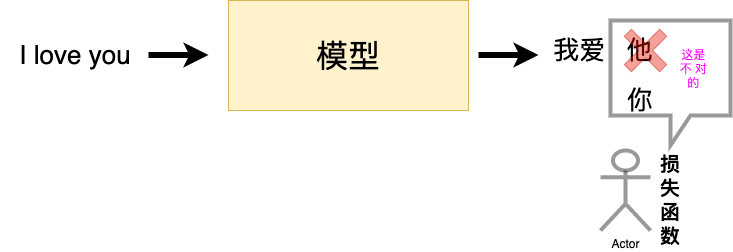
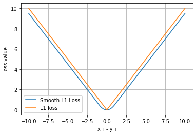

## 损失函数

损失函数定义训练时要优化的目标，不等同于准确率等评估指标。选用之前，应先核对：模型输出是 logits、概率、对数概率，还是距离？标签是类别索引、概率分布，还是正负关系？shape 是否一致？



下面的代码按顺序执行，使用 PyTorch 2.x。公式默认不加权；除特别说明外，`none` 保留逐项结果、`sum` 求和、`mean` 求均值。不同损失的“均值”分母并不总相同，不能统一称为“加权平均”。旧的 `size_average/reduce` 参数已不推荐使用。

```python
import torch
from torch import nn
import torch.nn.functional as F

torch.manual_seed(42)
```

## 二分类交叉熵损失函数

对预测概率 $p\in[0,1]$、目标 $y\in[0,1]$，二元交叉熵为：

$$
\ell(p,y)=-y\log p-(1-y)\log(1-p).
$$

`BCELoss` 接收概率，输入与标签 shape 相同。二分类或独立多标签任务通常由每个 logit 分别经过 sigmoid 得到概率，不应直接把整组互斥类别的 softmax 输出与同样的二元标签约定混用。

训练时更常用 `BCEWithLogitsLoss`：直接接收 logits，在内部稳定地组合 sigmoid 与 BCE，**前面不要再加一次 sigmoid**。

```python
logits = torch.tensor([-1., 0., 2.], requires_grad=True)
binary_target = torch.tensor([0., 1., 1.])
bce_probability = nn.BCELoss()(logits.sigmoid(), binary_target)
bce_logits = nn.BCEWithLogitsLoss()(logits, binary_target)
torch.testing.assert_close(bce_probability, bce_logits)
bce_logits.backward()
assert torch.isfinite(logits.grad).all()
```

`weight` 用于样本或元素的重标定，应按接口核对形状；不是 `CrossEntropyLoss` 的类别权重约定。`BCEWithLogitsLoss` 的 `pos_weight` 则调整正例项的权重，二者作用不同。

## 交叉熵损失函数

对于互斥多分类，输入 $x\in\mathbb{R}^{C}$ 是 **logits**，类别索引 $y\in\{0,\ldots,C-1\}$：

$$
\ell(x,y)=-x_y+\log\sum_{j=0}^{C-1}\exp(x_j).
$$

```python
scores = torch.tensor([[1., 2., -1.], [0.5, -0.5, 1.]], requires_grad=True)
classes = torch.tensor([1, 2], dtype=torch.long)
ce = nn.CrossEntropyLoss()(scores, classes)
manual_ce = (scores.logsumexp(1) - scores[torch.arange(2), classes]).mean()
torch.testing.assert_close(ce, manual_ce)
ce.backward()
```

不必先做 softmax，`CrossEntropyLoss` 已包含相应的 log-softmax 计算。它也支持与 logits 同形状的浮点概率标签，但使用者应保证标签有效、每行归一化。

`weight` 是长度为 $C$ 的类别权重。对类别索引标签，带权 `mean` 通常除以有效目标类别权重之和，不是简单除以 batch 大小。`ignore_index` 排除的是标签等于该值的**位置**，并不是从 softmax 分母中删除某个类别；该参数也不适用于概率标签的同一套语义。

## L1损失函数

对残差 $e_i=x_i-y_i$，逐元素损失为：

$$
\ell_i=|e_i|.
$$

```python
prediction = torch.tensor([[1., 3.], [-1., 2.]], requires_grad=True)
target = torch.tensor([[0., 1.], [1., 2.]])
l1 = nn.L1Loss()(prediction, target)
torch.testing.assert_close(l1, (prediction - target).abs().mean())
```

默认 `mean` 对所有元素求平均，不只对 batch 维。回归任务应保持预测和标签 shape 一致，避免 `[N,1]` 与 `[N]` 意外广播成 `[N,N]`。

## MSE损失函数

$$
\ell_i=e_i^2.
$$

```python
mse = nn.MSELoss()(prediction, target)
torch.testing.assert_close(mse, (prediction - target).square().mean())
```

MSE 对大残差的惩罚比 L1 增长更快；是否更适合任务，应结合噪声假设和目标尺度判断。

## 平滑L1 (Smooth L1)损失函数

当 $\beta>0$ 时：

$$
\ell_\beta(e)=
\begin{cases}
\dfrac{e^2}{2\beta}, & |e|<\beta,\\
|e|-\dfrac{\beta}{2}, & |e|\ge\beta.
\end{cases}
$$

原先仅以阈值 1 写出的公式只对应 `beta=1`。`beta=0` 时 PyTorch 按 L1 处理，不能继续代入带除法的分段式。

```python
beta = 0.5
residual = prediction - target
smooth = nn.SmoothL1Loss(beta=beta)(prediction, target)
manual_smooth = torch.where(
    residual.abs() < beta,
    0.5 * residual.square() / beta,
    residual.abs() - 0.5 * beta,
).mean()
torch.testing.assert_close(smooth, manual_smooth)
```



在小残差附近采用二次形式，在大残差处线性增长。它与 HuberLoss 有尺度差异：正阈值下，Smooth L1 等于相同阈值的 Huber 损失除以 `beta`。

## 目标泊松分布的负对数似然损失

适用于非负计数目标。令输入为对数率 $a=\log\lambda$，忽略与模型参数无关的常数时：

$$
\ell(a,y)=\exp(a)-ya.
$$

```python
log_rate = torch.tensor([0.2, 0.7, -0.1], requires_grad=True)
counts = torch.tensor([0., 2., 1.])
poisson = nn.PoissonNLLLoss(log_input=True, full=False)(log_rate, counts)
torch.testing.assert_close(poisson, (log_rate.exp() - counts * log_rate).mean())
poisson.backward()
```

`torch.randn` 可能产生负目标，不能拿它随意生成泊松计数标签。`log_input=False` 时输入改为率 $\lambda$，公式为 $\lambda-y\log(\lambda+\mathrm{eps})$；`eps` 只用于这种分支，不会把负的率变成合法输入。

`full=True` 为目标计数大于 1 的位置补上 Stirling 近似项 $y\log y-y+\frac12\log(2\pi y)$，不是“决定是否计算所有样本”。省略计数阶乘项后，某些损失值可能为负，不应据此单独判断实现错误。

## KL散度

离散分布的 KL 散度为：

$$
D_{KL}(P\Vert Q)=\sum_c P_c(\log P_c-\log Q_c).
$$

`KLDivLoss` 的默认约定是：**input 为预测分布 Q 的对数，target 为目标分布 P 的概率**。把概率 Q 直接作为 input 会得到错误结果。

```python
q = torch.tensor([[0.5, 0.3, 0.2], [0.2, 0.3, 0.5]])
p = torch.tensor([[0.9, 0.05, 0.05], [0.1, 0.7, 0.2]])
kl = nn.KLDivLoss(reduction="batchmean")(q.log(), p)
manual_kl = (p * (p.log() - q.log())).sum() / p.size(0)
torch.testing.assert_close(kl, manual_kl)
assert kl >= 0
```

`batchmean` 除以 batch 大小，得到每个分布的平均散度；`mean` 还会除以类别等维度的元素数，并非同一个数值。`log_target=True` 时 target 也应传入对数概率。KL 通常不对称，也不满足距离的全部公理，因此不应直接称为“距离度量”。

## MarginRankingLoss

比较两个分数的相对顺序，目标 $y\in\{-1,1\}$：

$$
\ell(x_1,x_2,y)=\max(0,-y(x_1-x_2)+m).
$$

$y=1$ 希望第一个分数至少比第二个高出 margin；$y=-1$ 希望相反。它不是直接计算两个向量的相似度。

```python
first = torch.tensor([2., 1.], requires_grad=True)
second = torch.tensor([1., 2.], requires_grad=True)
order = torch.tensor([1., -1.])
ranking = nn.MarginRankingLoss(margin=0.5)(first, second, order)
torch.testing.assert_close(ranking, torch.tensor(0.))
```

## 多标签边界损失函数

对 $C$ 个类别的得分 $x$ 和真实标签集合 $Y$，单样本损失为：

$$
\ell(x,Y)=\frac1C\sum_{y\in Y}\sum_{j\notin Y}
\max(0,1-x_y+x_j).
$$

注意第二个求和排除**全部真实标签**，不能只排除当前的 $y$。`MultiLabelMarginLoss` 的 target 是标签索引列表，不是 multi-hot：有效且不重复的类别放在前面，用 `-1` 填满剩余位置。

```python
multi_scores = torch.tensor([[0.9, 0.2, 0.4, 0.8]], requires_grad=True)
multi_labels = torch.tensor([[3, 0, -1, -1]], dtype=torch.long)
multi_margin = nn.MultiLabelMarginLoss()(multi_scores, multi_labels)
torch.testing.assert_close(multi_margin, torch.tensor(0.45))
```

这是正负类别之间的间隔损失。独立多标签分类也常使用 `BCEWithLogitsLoss`，但二者的标签格式和优化目标不同。

## 二分类损失函数

`SoftMarginLoss` 同样是 logistic 形式，但标签采用 $y\in\{-1,1\}$，输入是未激活分数：

$$
\ell(x,y)=\log(1+\exp(-yx)).
$$

```python
binary_scores = torch.tensor([0.3, -0.7], requires_grad=True)
signs = torch.tensor([1., -1.])
soft_margin = nn.SoftMarginLoss()(binary_scores, signs)
torch.testing.assert_close(soft_margin, F.softplus(-signs * binary_scores).mean())
```

这里是逐元素计算；分母对应参与归约的元素数，不必等于样本数。实际数值计算可用稳定的 softplus，不要直接对极大正数计算 `exp`。

<span id="多分类的折页损失"></span>

## 多分类合页损失

`MultiMarginLoss` 接收 $x\in\mathbb{R}^{C}$ 和正确类别索引 $y$，不是要求得分 x 本身属于类别索引集合：

$$
\ell(x,y)=\frac1C\sum_{j\ne y}
\left[\max(0,m-x_y+x_j)\right]^p.
$$

其中 `p` 可为 1 或 2，`weight` 可给正确类别对应的损失加权。

```python
margin_scores = torch.tensor([[0.3, 0.7], [0.5, 0.5]], requires_grad=True)
margin_target = torch.tensor([0, 1], dtype=torch.long)
multi_class_margin = nn.MultiMarginLoss()(margin_scores, margin_target)
torch.testing.assert_close(multi_class_margin, torch.tensor(0.6))
```

## 三元组损失

三元组是 anchor、positive、negative 三个样本，不是知识图谱的“实体—关系—实体”标签格式。目标是让 anchor 与正样本更近、与负样本更远：

$$
\ell(a,p,n)=\max(0,d(a,p)-d(a,n)+m).
$$

`TripletMarginLoss` 使用由参数 `p` 指定的范数距离，`p` 不仅限于 1 或 2。默认还使用 `eps` 做数值稳定处理，`swap=True` 可启用距离交换策略。下面用非零距离和 `eps=0` 演示最直接的欧氏距离公式：

```python
anchor = torch.tensor([[0., 0.]], requires_grad=True)
positive = torch.tensor([[0.5, 0.]])
negative = torch.tensor([[1., 0.]])
triplet = nn.TripletMarginLoss(margin=1., p=2, eps=0)(anchor, positive, negative)
torch.testing.assert_close(triplet, torch.tensor(0.5))
triplet.backward()
```

<span id="hingembeddingloss"></span>

## HingeEmbeddingLoss

输入通常是两个表示之间的非负距离或不相似度 x，而不是把整组 embedding 直接当成距离：

$$
\ell(x,y)=
\begin{cases}
x,&y=1,\\
\max(0,m-x),&y=-1.
\end{cases}
$$

距离可以来自 L1、L2 等计算，不必限定为“两个输入之差的绝对值”。正例希望距离小，负例希望距离至少达到 margin。

```python
distances = torch.tensor([0.25, 1.5], requires_grad=True)
pair_labels = torch.tensor([1., -1.])
hinge = nn.HingeEmbeddingLoss(margin=1.)(distances, pair_labels)
torch.testing.assert_close(hinge, torch.tensor(0.125))
```

## 余弦相似度

`CosineEmbeddingLoss` 实际返回损失，不是直接返回余弦相似度。对非零向量，$\cos(u,v)=u^Tv/(\|u\|\|v\|)$，损失为：

$$
\ell(u,v,y)=
\begin{cases}
1-\cos(u,v),&y=1,\\
\max(0,\cos(u,v)-m),&y=-1.
\end{cases}
$$

正例希望相似度接近 1，负例则希望不超过 margin。不能笼统说“两个向量越接近，损失总是越小”，因为还取决于标签。

```python
vectors_1 = torch.tensor([[1., 0.], [1., 0.]], requires_grad=True)
vectors_2 = torch.tensor([[0., 1.], [-1., 0.]])
cos_labels = torch.tensor([1., -1.])
cosine_loss = nn.CosineEmbeddingLoss(margin=0.)(vectors_1, vectors_2, cos_labels)
torch.testing.assert_close(cosine_loss, torch.tensor(0.5))
```

## CTC损失函数

CTC 是 Connectionist Temporal Classification，用于没有逐时刻对齐标注的序列任务。它对能折叠为目标序列的路径求概率和：

$$
\ell=-\log\sum_{\pi:\mathcal{B}(\pi)=y}
\prod_{t=1}^{T}p_t(\pi_t).
$$

折叠操作先合并相邻重复标签，再移除 blank。输入是 `[T,N,C]` 的**对数概率**；有效目标标签不能包含 blank。若目标长度为 L、相邻重复标签对数为 R，通常至少需要 `T >= L + R` 才有有效路径，不能仅检查 `L <= T`。

下面的目标 `[1,1,2]` 需要在重复的 1 之间留出 blank；另一条有效目标是 `[2,3]`。

```python
T, N, C = 6, 2, 4
ctc_logits = torch.randn(T, N, C, requires_grad=True)
log_probs = ctc_logits.log_softmax(dim=2)
padded_targets = torch.tensor([[1, 1, 2], [2, 3, 0]], dtype=torch.long)
input_lengths = torch.tensor([6, 6], dtype=torch.long)
target_lengths = torch.tensor([3, 2], dtype=torch.long)
ctc_fn = nn.CTCLoss(blank=0, reduction="mean", zero_infinity=False)
ctc = ctc_fn(log_probs, padded_targets, input_lengths, target_lengths)

# 按 target_lengths 串联有效标签，也可使用一维 target。
packed_targets = torch.tensor([1, 1, 2, 2, 3], dtype=torch.long)
ctc_packed = ctc_fn(log_probs, packed_targets, input_lengths, target_lengths)
torch.testing.assert_close(ctc, ctc_packed)
ctc.backward()
assert torch.isfinite(ctc) and torch.isfinite(ctc_logits.grad).all()
```

补齐 target 中的最后一个 0 不属于有效目标，因为第二条 `target_lengths=2`。`reduction="mean"` 会先按每条目标长度归一化，再对 batch 求平均。`zero_infinity=True` 会将无穷损失及相关梯度清零，但不能用来掩盖不满足对齐条件的数据。

## 参考

- [PyTorch：损失函数总览](https://docs.pytorch.org/docs/stable/nn.html#loss-functions)
- [KLDivLoss 的输入约定与归约](https://docs.pytorch.org/docs/stable/generated/torch.nn.KLDivLoss.html)
- [PoissonNLLLoss](https://docs.pytorch.org/docs/stable/generated/torch.nn.PoissonNLLLoss.html)
- [MultiLabelMarginLoss](https://docs.pytorch.org/docs/stable/generated/torch.nn.MultiLabelMarginLoss.html)
- [CTCLoss 的形状与长度约束](https://docs.pytorch.org/docs/stable/generated/torch.nn.CTCLoss.html)
