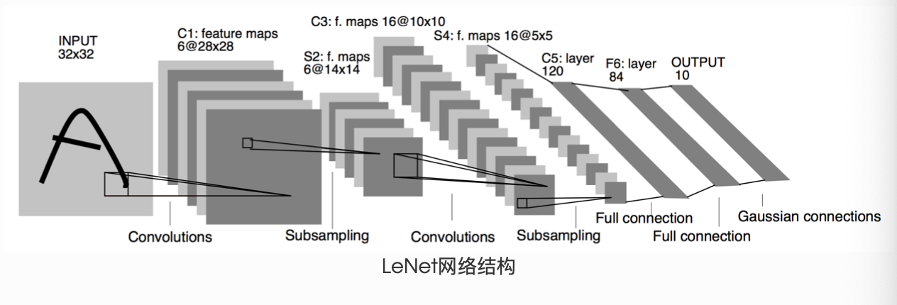
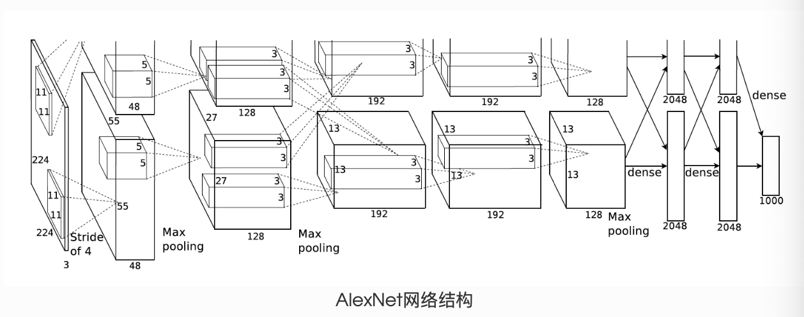

## 模型构建

PyTorch 通常通过继承 `nn.Module` 来组织神经网络：在 `__init__` 中注册子模块和参数，在 `forward` 中定义数据如何流动。下面的示例按顺序执行，使用浮点张量；模型与输入需要位于同一设备、使用兼容的数据类型。

### 神经网络构造

下面的 MLP 有**一个隐藏层和一个输出层**，共两个全连接层。输入是已经展平的 `[batch_size, 784]` 张量，输出是 10 个类别的 logits。

```python
import torch
from torch import nn
import torch.nn.functional as F


class MLP(nn.Module):
    def __init__(self):
        super().__init__()
        self.hidden = nn.Linear(784, 256)
        self.act = nn.ReLU()
        self.output = nn.Linear(256, 10)

    def forward(self, x):
        return self.output(self.act(self.hidden(x)))


torch.manual_seed(42)
X = torch.rand(2, 784)
net = MLP()
assert net(X).shape == (2, 10)
```

`net(X)` 通过 `nn.Module` 的调用机制执行 `forward`，并处理注册的 hooks 等逻辑，所以通常应调用模型本身，而不是直接调用 `net.forward(X)`。

当运算涉及需要梯度的张量且梯度记录开启时，autograd 会记录计算图，再由 `loss.backward()` 沿图计算梯度。这里不需要为整个 MLP 手写反向传播函数；这不等于系统会给自定义类生成一个 `backward` 方法。

### 神经网络中的层

`nn.Module` 既可以表示一层，也可以表示完整模型或模型的一部分。除了使用内置的全连接层、卷积层和池化层，也可以组合张量运算定义自己的层。

#### 不含模型参数的层

这个层减去**整个输入张量的均值**，不包含可学习参数。对于二维输入，它不会分别对每个样本做中心化；若需要按样本处理，应明确指定 `dim` 和 `keepdim`。

```python
class MyLayer(nn.Module):
    def forward(self, x):
        return x - x.mean()


layer = MyLayer()
result = layer(torch.tensor([1., 2., 3., 4., 5.]))
torch.testing.assert_close(result, torch.tensor([-2., -1., 0., 1., 2.]))
```

不含参数并不意味着不能求导：只要输入需要梯度，中心化运算仍可以参与计算图。

#### 含模型参数的层

`nn.Parameter` 是 Tensor 的子类。将它赋给 `nn.Module` 的属性后，它会被注册为模型参数；单纯创建一个 `Parameter` 对象并不会让所有模型自动收集它。普通 Python 列表中的参数也不会自动注册，应使用 `nn.ParameterList` 或 `nn.ParameterDict`。

```python
class MyListDense(nn.Module):
    def __init__(self):
        super().__init__()
        self.params = nn.ParameterList(
            [nn.Parameter(torch.randn(4, 4)) for _ in range(3)]
        )
        self.params.append(nn.Parameter(torch.randn(4, 1)))

    def forward(self, x):
        for weight in self.params:
            x = x @ weight
        return x


net = MyListDense()
assert len(list(net.parameters())) == 4
assert net(torch.randn(2, 4)).shape == (2, 1)
```

`ParameterDict` 则适合按名字选择参数。下面每次只选择一个矩阵，不是依次执行字典中的所有矩阵；输入最后一维必须为 4。

```python
class MyDictDense(nn.Module):
    def __init__(self):
        super().__init__()
        self.params = nn.ParameterDict({
            "linear1": nn.Parameter(torch.randn(4, 4)),
            "linear2": nn.Parameter(torch.randn(4, 1)),
        })
        self.params["linear3"] = nn.Parameter(torch.randn(4, 2))

    def forward(self, x, choice="linear1"):
        return x @ self.params[choice]


net = MyDictDense()
assert net(torch.randn(2, 4), "linear3").shape == (2, 2)
```

#### 二维卷积层

PyTorch 的二维卷积执行的是**互相关**，不翻转卷积核。下面先实现单输入通道、单输出通道、步幅为 1、无填充的教学版本：

$$
Y_{i,j}=\sum_{a=0}^{h-1}\sum_{b=0}^{w-1}X_{i+a,j+b}K_{a,b}.
$$

```python
def corr2d(X, K):
    if X.ndim != 2 or K.ndim != 2:
        raise ValueError("X 和 K 必须是二维张量")
    if X.dtype != K.dtype or X.device != K.device:
        raise ValueError("X 和 K 必须使用相同的 dtype 和 device")
    if not X.is_floating_point():
        raise TypeError("教学实现要求浮点张量")
    h, w = K.shape
    if h == 0 or w == 0 or h > X.shape[0] or w > X.shape[1]:
        raise ValueError("卷积核必须非空，且不能大于输入")
    rows = []
    for i in range(X.shape[0] - h + 1):
        row = [
            (X[i:i + h, j:j + w] * K).sum()
            for j in range(X.shape[1] - w + 1)
        ]
        rows.append(torch.stack(row))
    return torch.stack(rows)


class Conv2D(nn.Module):
    def __init__(self, kernel_size):
        super().__init__()
        self.weight = nn.Parameter(torch.randn(kernel_size))
        self.bias = nn.Parameter(torch.zeros(1))

    def forward(self, x):
        return corr2d(x, self.weight) + self.bias
```

使用 `torch.stack` 保留计算图，也让输出跟随输入的设备和数据类型。这里不会悄悄把 float64 转成 float32，或在 GPU 输入旁创建 CPU 输出。循环实现便于理解，实际训练应使用经过优化的 `nn.Conv2d`。

卷积核形状为 $p\times q$，表示核的高为 $p$、宽为 $q$，二者不必相等。对于每侧对称填充，输出高度为：

$$
H_{out}=\left\lfloor\frac{H_{in}+2p_h-d_h(k_h-1)-1}{s_h}+1\right\rfloor.
$$

输出宽度同理，将下标 $h$ 换为 $w$。这里 $p$ 是每侧填充数，$s$ 是步幅，$d$ 是膨胀系数，$k$ 是卷积核大小。

下面的辅助函数只处理**单样本、单输入通道、单输出通道**的示例：

```python
def comp_conv2d(conv2d, X):
    Y = conv2d(X.unsqueeze(0).unsqueeze(0))
    return Y.squeeze(0).squeeze(0)


X = torch.rand(8, 8)
conv2d = nn.Conv2d(1, 1, kernel_size=3, padding=1)
assert comp_conv2d(conv2d, X).shape == (8, 8)

conv2d = nn.Conv2d(1, 1, kernel_size=(5, 3), padding=(2, 1))
assert comp_conv2d(conv2d, X).shape == (8, 8)

conv2d = nn.Conv2d(1, 1, kernel_size=(3, 5), padding=(0, 1), stride=(3, 4))
assert comp_conv2d(conv2d, X).shape == (2, 2)
```

前两个例子在步幅为 1、膨胀系数为 1 时，通过适当填充保持尺寸。步幅增大通常会减小输出尺寸，但应代入公式计算，不能一概写成输入尺寸除以步幅。

#### 池化层

池化对窗口内的值求最大值或均值。下面的教学实现仍限定为二维浮点输入、步幅为 1、无填充；它不包含 `nn.MaxPool2d` 的所有参数。

```python
def pool2d(X, pool_size, mode="max"):
    if X.ndim != 2 or not X.is_floating_point():
        raise ValueError("X 必须是二维浮点张量")
    if mode not in ("max", "avg"):
        raise ValueError("mode 必须为 max 或 avg")
    p_h, p_w = pool_size
    if p_h <= 0 or p_w <= 0 or p_h > X.shape[0] or p_w > X.shape[1]:
        raise ValueError("池化窗口必须为正，且不能大于输入")
    rows = []
    for i in range(X.shape[0] - p_h + 1):
        row = []
        for j in range(X.shape[1] - p_w + 1):
            window = X[i:i + p_h, j:j + p_w]
            row.append(window.max() if mode == "max" else window.mean())
        rows.append(torch.stack(row))
    return torch.stack(rows)


X = torch.arange(9, dtype=torch.float32).reshape(3, 3)
torch.testing.assert_close(pool2d(X, (2, 2)), torch.tensor([[4., 5.], [7., 8.]]))
torch.testing.assert_close(pool2d(X, (2, 2), "avg"), torch.tensor([[2., 3.], [5., 6.]]))
```

### 完整模型 LeNet



下面是常见的 LeNet 风格教学网络，使用 ReLU 和最大池化，并非原论文网络所有细节的逐项复现。输入约定为 `[N, 1, 32, 32]`，两次卷积和池化后得到 `[N, 16, 5, 5]`。

```python
class Net(nn.Module):
    def __init__(self):
        super().__init__()
        self.conv1 = nn.Conv2d(1, 6, 5)
        self.conv2 = nn.Conv2d(6, 16, 5)
        self.fc1 = nn.Linear(16 * 5 * 5, 120)
        self.fc2 = nn.Linear(120, 84)
        self.fc3 = nn.Linear(84, 10)

    def forward(self, x):
        x = F.max_pool2d(F.relu(self.conv1(x)), 2)
        x = F.max_pool2d(F.relu(self.conv2(x)), 2)
        x = torch.flatten(x, 1)  # 保留 batch 维度
        x = F.relu(self.fc1(x))
        x = F.relu(self.fc2(x))
        return self.fc3(x)


net = Net()
params = list(net.parameters())
assert len(params) == 10  # 5 个带参数的层，各有 weight 和 bias
assert params[0].shape == (6, 1, 5, 5)
assert net(torch.randn(2, 1, 32, 32)).shape == (2, 10)
```

若使用 28×28 的 MNIST 图像，需要先调整为 32×32，或重新计算全连接层输入维度。输出是 logits，接 `F.cross_entropy` 时不应先手动做 softmax。

一次最小训练步骤包括清零梯度、前向计算、计算损失、反向传播和更新参数：

```python
inputs = torch.randn(2, 1, 32, 32)
labels = torch.tensor([1, 7], dtype=torch.long)
optimizer = torch.optim.SGD(net.parameters(), lr=0.01)

net.train()
optimizer.zero_grad()
logits = net(inputs)
loss = F.cross_entropy(logits, labels)
loss.backward()
optimizer.step()
```

对非标量 `out` 调用 `out.backward(gradient)` 计算的是给定上游梯度的向量—雅可比积，不能把传入随机张量直接当成常规监督学习的训练损失。

`torch.nn` 并非所有模块都只支持带 batch 的输入。例如，`nn.Conv2d` 支持 `[C,H,W]` 或 `[N,C,H,W]`。不过，**本文这个 Net 的展平方式按带 batch 的输入编写**，单张图像应先用 `unsqueeze(0)` 添加 batch 维度。

- `torch.Tensor`：多维数组；浮点或复数张量可在满足条件时参与自动求导，并非每个 Tensor 都有 `grad_fn`。
- `nn.Module`：组织子模块、参数和前向计算，可通过 `state_dict()` 保存参数与持久缓冲区。
- `nn.Parameter`：赋给 Module 属性时会自动注册的参数张量。
- `autograd.Function`：扩展自定义求导规则的接口；组合内置可微运算时通常无需使用。

#### AlexNet



下面是面向灰度图、10 分类任务的 AlexNet 风格变体。代码采用 `[N,1,224,224]` 输入，卷积部分输出 `[N,256,5,5]`，因此第一个全连接层接收 `256×5×5` 个特征。Fashion-MNIST 原始图像只有 28×28，不能直接传入；需要先缩放到本文约定的大小。

```python
class AlexNet(nn.Module):
    def __init__(self):
        super().__init__()
        self.conv = nn.Sequential(
            nn.Conv2d(1, 96, 11, stride=4),
            nn.ReLU(),
            nn.MaxPool2d(3, stride=2),
            nn.Conv2d(96, 256, 5, padding=2),
            nn.ReLU(),
            nn.MaxPool2d(3, stride=2),
            nn.Conv2d(256, 384, 3, padding=1),
            nn.ReLU(),
            nn.Conv2d(384, 384, 3, padding=1),
            nn.ReLU(),
            nn.Conv2d(384, 256, 3, padding=1),
            nn.ReLU(),
            nn.MaxPool2d(3, stride=2),
        )
        self.fc = nn.Sequential(
            nn.Linear(256 * 5 * 5, 4096),
            nn.ReLU(),
            nn.Dropout(0.5),
            nn.Linear(4096, 4096),
            nn.ReLU(),
            nn.Dropout(0.5),
            nn.Linear(4096, 10),
        )

    def forward(self, img):
        return self.fc(torch.flatten(self.conv(img), 1))


net = AlexNet().eval()
with torch.no_grad():
    assert net(torch.randn(1, 1, 224, 224)).shape == (1, 10)
```

`eval()` 切换 Dropout 等层的行为，`torch.no_grad()` 关闭梯度记录，二者作用不同。随机初始化的网络只能验证计算流程和形状，输出还不具备分类能力。

## 参考与推荐阅读

- [PyTorch：nn.Module](https://docs.pytorch.org/docs/stable/generated/torch.nn.Module.html)
- [PyTorch：Conv2d 的输入与输出形状](https://docs.pytorch.org/docs/stable/generated/torch.nn.Conv2d.html)
- [PyTorch：Autograd mechanics](https://docs.pytorch.org/docs/stable/notes/autograd.html)
