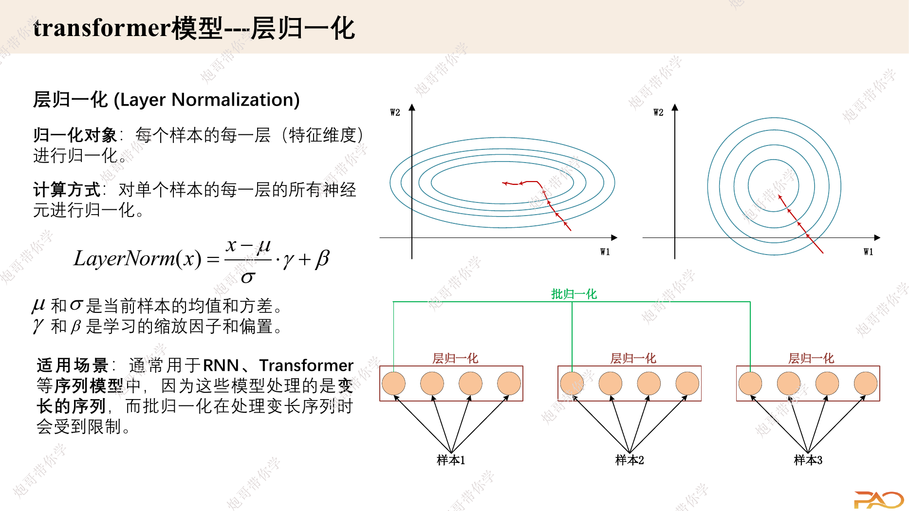
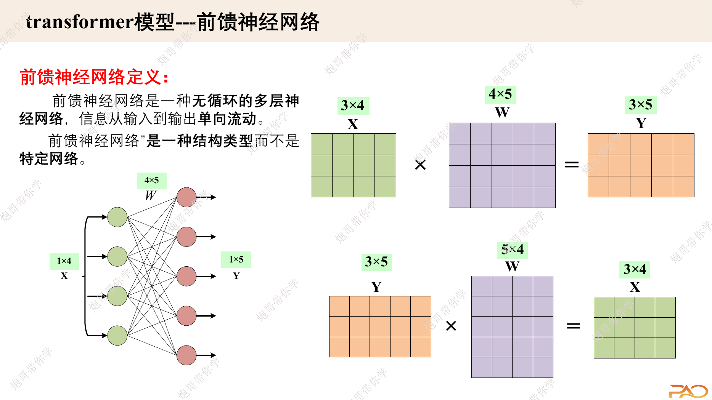

## 学习目标

学完本文后，应该能够：

- 说清 Encoder Layer 中每个子层的职责；
- 写出 LayerNorm 与逐位置 FFN 的公式和 shape；
- 区分 Pre-LN 与 Post-LN；
- 理解残差连接为什么要求子层输入输出维度一致；
- 组装一个能接收 Padding Mask 的 Encoder。

## 先修知识

- [多头注意力与张量变形](/notes/transformer-multi-head-attention/)
- [位置编码与序列顺序](/notes/transformer-positional-encoding/)
- [深层网络中的残差连接](/notes/deep-learning-resnet/)
- [Batch Normalization](/notes/deep-learning-batch-normalization/)

## 1. Encoder Layer 的总体任务

Encoder 接收带有 token 语义和位置信息的表示：

```text
输入 X: [B, S, D]
```

每一层做两件核心事情：

1. **多头自注意力**：在 token 之间交换信息；
2. **逐位置 FFN**：在每个 token 内部变换特征。

残差连接和 LayerNorm 则负责让深层网络更容易优化、数值更稳定。

## 2. LayerNorm 在归一化什么

对一个 token 的 $D$ 个特征计算均值和方差。设该 token 向量为 $x\in\mathbb{R}^{D}$：

$$
\mu = \frac{1}{D}\sum_{j=1}^{D}x_j
$$

$$
\sigma^2 = \frac{1}{D}\sum_{j=1}^{D}(x_j-\mu)^2
$$

$$
\operatorname{LN}(x)
=
\gamma\odot\frac{x-\mu}{\sqrt{\sigma^2+\epsilon}}+\beta
$$

$\gamma,\beta\in\mathbb{R}^{D}$ 是所有 token 共享的可学习参数。

```text
输入: [B, S, D]
均值: [B, S, 1]
方差: [B, S, 1]
gamma、beta: [D]
输出: [B, S, D]
```

课件图直观展示了 LayerNorm 与 BatchNorm 选择统计维度的差异。



> 图片来源：课程课件《transformer算法原理-S》第 11 页。

### 2.1 LayerNorm 与 BatchNorm 的主要区别

| 对比 | LayerNorm | BatchNorm |
|---|---|---|
| 主要统计维度 | 单个样本/单个 token 的特征维 | batch 中同一通道 |
| 是否依赖 batch 统计量 | 否 | 是 |
| 训练与推理统计方式 | 基本一致 | 推理使用运行均值/方差 |
| 小 batch、变长序列 | 更自然 | 处理更麻烦 |

### 2.2 Notebook 中的实现纠正

`LayerNorm.ipynb` 的独立版本中有两个容易忽略的问题：

```python
return gamma * (x - mean) / (std + eps) - beta
```

1. 偏置应当是 `+ beta`，不是 `- beta`；
2. 标准 LayerNorm 更准确地写作 `sqrt(var + eps)`，PyTorch 还使用总体方差估计，即 `unbiased=False`。

手写版本可写成：

```python
def manual_layer_norm(x, gamma, beta, eps=1e-5):
    mean = x.mean(dim=-1, keepdim=True)
    var = x.var(dim=-1, keepdim=True, unbiased=False)
    normalized = (x - mean) / torch.sqrt(var + eps)
    return normalized * gamma + beta
```

实际项目优先使用 `nn.LayerNorm(dim)`。

## 3. 逐位置前馈网络 FFN

原始 Transformer 的 FFN 对每个 token 独立应用同一组两层全连接网络：

$$
\operatorname{FFN}(x)
=
\operatorname{ReLU}(xW_1+b_1)W_2+b_2
$$

shape 变化：

```text
[B, S, D]
→ Linear(D, Dff)
→ 激活函数
→ Dropout
→ Linear(Dff, D)
→ [B, S, D]
```

原论文 Base 模型中 $D=512$，$D_{ff}=2048$。



> 图片来源：课程课件《transformer算法原理-S》第 12 页。

### 3.1 “逐位置”是什么意思

同一层 FFN 在每个位置使用完全相同的参数，但不同 token 之间不在 FFN 内直接混合：

$$
y_t = \operatorname{FFN}(x_t)
$$

token 之间的信息交换由注意力负责；FFN 负责对每个 token 已汇总的特征进行非线性加工。

### 3.2 FFN 的参数量

忽略 bias：

$$
D\times D_{ff}+D_{ff}\times D=2DD_{ff}
$$

当 $D_{ff}=4D$ 时，约为：

$$
8D^2
$$

这往往比一个标准 MHA 的约 $4D^2$ 参数更多。

## 4. 残差连接

对子层 $F$，残差连接为：

$$
y=x+F(x)
$$

它的作用包括：

- 提供更短的梯度传播路径；
- 允许子层只学习对当前表示的增量修正；
- 让堆叠更多层更容易优化。

残差相加要求 $x$ 与 $F(x)$ shape 完全一致。这解释了为什么 MHA 和 FFN 最终都要输出 $D$ 维。

## 5. Post-LN 与 Pre-LN

### 5.1 原始论文：Post-LN

$$
y=\operatorname{LN}(x+F(x))
$$

LayerNorm 位于残差相加之后。原始 Transformer 图中的 “Add & Norm” 指的是这种结构。

### 5.2 现代常见结构：Pre-LN

$$
y=x+F(\operatorname{LN}(x))
$$

LayerNorm 位于子层之前，残差主干更直接。很多现代大模型和给出的 Notebook 使用 Pre-LN，因为深层训练通常更稳定。

| 对比 | Post-LN | Pre-LN |
|---|---|---|
| 归一化位置 | 残差相加之后 | 子层之前 |
| 原始论文 | 是 | 否 |
| 深层优化 | 对学习率 warmup 更敏感 | 通常更稳定 |
| 堆叠末尾 | 通常不额外加最终 LN | 通常再加一个最终 LN |

不能一边称代码为“原始 Transformer”，一边不说明它实际使用了 Pre-LN。两者都是合理结构，但要明确区分。

## 6. Pre-LN Encoder Layer 实现

下面假设已经实现上一节的 `MultiHeadAttention`，并约定 `blocked_mask=True` 表示被屏蔽。

```python
import torch
import torch.nn as nn


class FeedForward(nn.Module):
    def __init__(self, dim: int, hidden_dim: int, dropout: float):
        super().__init__()
        self.net = nn.Sequential(
            nn.Linear(dim, hidden_dim),
            nn.ReLU(),
            nn.Dropout(dropout),
            nn.Linear(hidden_dim, dim),
            nn.Dropout(dropout),
        )

    def forward(self, x):
        return self.net(x)


class EncoderLayer(nn.Module):
    def __init__(self, dim, num_heads, hidden_dim, dropout):
        super().__init__()
        self.attn_norm = nn.LayerNorm(dim)
        self.ffn_norm = nn.LayerNorm(dim)
        self.self_attn = MultiHeadAttention(dim, num_heads, dropout)
        self.ffn = FeedForward(dim, hidden_dim, dropout)

    def forward(self, x, source_blocked_mask=None):
        norm_x = self.attn_norm(x)
        attn_out, _ = self.self_attn(
            norm_x,
            norm_x,
            norm_x,
            blocked_mask=source_blocked_mask,
        )
        x = x + attn_out
        x = x + self.ffn(self.ffn_norm(x))
        return x
```

## 7. 多层 Encoder

```python
class Encoder(nn.Module):
    def __init__(self, layer_factory, num_layers: int, dim: int):
        super().__init__()
        self.layers = nn.ModuleList(
            [layer_factory() for _ in range(num_layers)]
        )
        self.final_norm = nn.LayerNorm(dim)

    def forward(self, x, source_blocked_mask=None):
        for layer in self.layers:
            x = layer(x, source_blocked_mask)
        return self.final_norm(x)
```

每一层都有独立参数。不要把“一个 Encoder Layer 在计算中重复调用”误解成“所有 Encoder Layer 参数共享”。标准 Transformer 的不同层不共享参数。

## 8. Padding Mask 的广播形状

若源端 `source_is_pad` 为 `[B,S]`，手写 MHA 常转换为：

```python
source_blocked_mask = source_is_pad[:, None, None, :]
# [B, 1, 1, S]，广播到 [B, H, S, S]
```

它屏蔽的是 Key 位置。对于填充 Query 位置，通常还需要在后续损失、池化或输出处理中忽略相应结果。

## 9. 完整 Shape 流程

```text
token ids                   [B, S]
Embedding + Position        [B, S, D]
LayerNorm                   [B, S, D]
Multi-Head Self-Attention   [B, S, D]
Residual Add                [B, S, D]
LayerNorm                   [B, S, D]
FFN: D → Dff → D            [B, S, D]
Residual Add                [B, S, D]
重复 N 层                  [B, S, D]
Encoder memory              [B, S, D]
```

序列长度与模型维度在整个 Encoder 中保持不变，因此多层可以直接堆叠。

## 10. 常见误区

### 误区一：LayerNorm 对整个 batch 求均值

标准 Transformer 中通常对每个 token 的最后一个特征维单独归一化。

### 误区二：FFN 负责 token 之间交换信息

FFN 是逐位置的；跨 token 信息交互主要发生在注意力中。

### 误区三：原始 Transformer 使用 Pre-LN

原论文图 1 是 Post-LN。现代实现常改为 Pre-LN，Notebook 也采用了 Pre-LN。

### 误区四：多个 Encoder Layer 共享参数

标准实现为每层创建独立模块和参数。

## 一句话总结

Encoder Layer 的本质是：先用自注意力完成 token 间通信，再用逐位置 FFN 变换每个 token 的特征，残差与 LayerNorm 则把这些模块稳定地堆叠成深层网络。

## 复习卡片

- MHA：跨 token 混合；
- FFN：逐 token、跨特征变换；
- LayerNorm：沿最后一个特征维归一化；
- 残差：输入输出 shape 必须相同；
- 原论文：Post-LN；现代常见：Pre-LN；
- Encoder 输出：`[B,S,D]`。

## 自测问题

1. 为什么 FFN 被称为 position-wise？
2. LayerNorm 的 $\gamma$ 和 $\beta$ shape 是什么？
3. 为什么 FFN 要先升维再降维？
4. Pre-LN 与 Post-LN 的公式有什么区别？
5. Padding Mask 在手写 MHA 中通常如何广播？

## 参考与推荐阅读

- [Attention Is All You Need](https://arxiv.org/abs/1706.03762)：3.1、3.3 和 3.4 节。
- [层归一化](https://www.rethink.fun/chapter15/%E5%B1%82%E5%BD%92%E4%B8%80%E5%8C%96.html)：适合比较 LayerNorm 与 BatchNorm。
- [把这一切组装起来](https://www.rethink.fun/chapter15/%E6%8A%8A%E8%BF%99%E4%B8%80%E5%88%87%E7%BB%84%E8%A3%85%E8%B5%B7%E6%9D%A5.html)：适合查看 Encoder Block 的组装过程。
- [On Layer Normalization in the Transformer Architecture](https://arxiv.org/abs/2002.04745)：深入理解 Pre-LN 与 Post-LN 的优化差异。
- 本地学习代码：`LayerNorm.ipynb`、`FeedForward.ipynb`、`Encoder.ipynb`。
