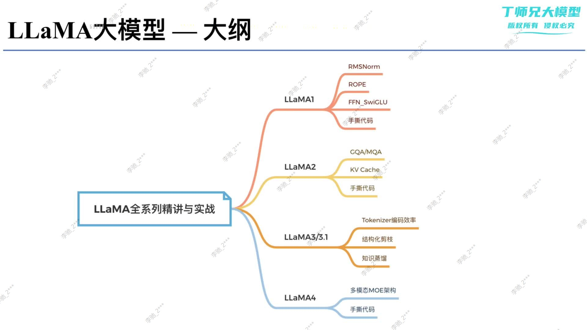

## 学习目标

本文先建立 LLaMA 家族的全局地图。学完后应能说清各代模型主要解决了什么问题，区分架构改进、训练数据改进和产品能力扩展，并知道后续应该按什么顺序深入学习。

## 先修知识

- [Transformer 的动机与整体架构](/notes/transformer-overview/)
- [Decoder、因果注意力与交叉注意力](/notes/transformer-decoder-cross-attention/)
- [训练、损失与自回归推理](/notes/transformer-training-inference/)

## 1. LLaMA 是什么

LLaMA 最初是 **Large Language Model Meta AI** 的缩写。它不是一种完全脱离 Transformer 的新网络，而是一系列以 Decoder-only Transformer 为主干、持续优化训练效率和推理效率的基础模型。

第一代通常写作 **LLaMA**，后续官方命名逐渐写作 **Llama 2、Llama 3、Llama 4**。本文讨论的是模型家族，不是某一个固定参数规模。

> 用一句话理解：LLaMA 家族是在稳定的自回归 Transformer 主干上，逐代改进归一化、位置编码、FFN、注意力效率、Tokenizer、训练数据、上下文长度和模态能力。

## 2. 先看学习路线

下面这张课程大纲图给出了本阶段的知识顺序。当前五篇笔记先完成 LLaMA 1 与归一化部分；MQA/GQA、KV Cache、Tokenizer、剪枝、蒸馏和 MoE 会在后续阶段继续展开。



> 图片来源：本次课程材料。阅读时关注“每一代主要解决什么问题”，不要把所有技术误认为都在同一代首次提出。

## 3. 家族时间线

| 版本 | 发布时间 | 代表规模与上下文 | 这一代的学习重点 |
|---|---:|---|---|
| LLaMA 1 | 2023-02 | 7B～65B，2K | RMSNorm、Pre-Norm、RoPE、SwiGLU，证明高质量数据与充分训练的重要性 |
| Llama 2 | 2023-07 | 7B、13B、70B，4K | 更长训练与上下文；70B 使用 GQA；发布 Chat 对齐模型 |
| Llama 3 | 2024-04 | 8B、70B，8K | 128K 词表 Tokenizer、全尺寸 GQA、超过 15T 训练 token |
| Llama 3.1 | 2024-07 | 8B、70B、405B，128K | 405B、长上下文、多语言、工具调用与合成数据体系 |
| Llama 3.2 | 2024-09 | 1B/3B 文本，11B/90B 视觉 | 1B/3B 通过结构化剪枝和知识蒸馏获得；加入视觉模型 |
| Llama 3.3 | 2024-12 | 70B，128K | 以较小推理成本逼近此前更大指令模型的能力 |
| Llama 4 | 2025-04 | Scout：109B 总/17B 激活；Maverick：400B 总/17B 激活 | 原生多模态、早期融合、MoE、百万级到千万级上下文 |

表中的上下文长度和规模是代表性公开配置，不意味着同一代所有衍生模型都完全相同。

## 4. 四条真正的演进主线

### 4.1 主干结构：从高效 Dense 到稀疏 MoE

LLaMA 1～Llama 3 的文本主干总体保持 Dense Decoder-only Transformer。Llama 4 转向 MoE：模型保存大量专家参数，但每个 token 只激活少量专家，以较低的单 token 计算量获得更大的参数容量。

必须区分：

- **总参数量**：模型需要保存的全部参数；
- **激活参数量**：一次处理 token 时实际参与主要计算的参数。

例如 Llama 4 Maverick 有约 400B 总参数，但每个 token 激活约 17B 参数。MoE 节省的是激活计算，不代表模型权重只占 17B 的存储空间。

### 4.2 推理效率：减少 KV Cache 压力

自回归生成需要缓存历史 Key、Value。Llama 2 的大模型开始采用 GQA，Llama 3 将 GQA 扩展到 8B 与 70B，从而减少 KV 头数量、缓存容量和显存带宽压力。

### 4.3 数据与 Tokenizer：让同样的计算更“值钱”

模型能力不只由网络结构决定。Llama 3 使用 128K 词表 Tokenizer，官方报告称相较 Llama 2 可提高编码效率；训练数据规模、代码比例、去重和质量过滤也显著加强。

因此不能把 Llama 3 的提升简单归因于“模型参数更多”。8B 相对上一代 7B 的改进同时来自 Tokenizer、数据、训练规模、GQA 和后训练流程。

### 4.4 能力边界：文本 → 多语言、工具、视觉与原生多模态

Llama 3.1 加强多语言、长上下文与工具使用；Llama 3.2 发布视觉模型；Llama 4 使用早期融合训练原生多模态模型，使图像与文本能在统一模型中交互。

## 5. 一个重要的版本归属纠正

课程大纲把“结构化剪枝、知识蒸馏”写在 LLaMA 3/3.1 分支下，容易产生歧义。更准确的说法是：

- Llama 3.1 提供了 8B、70B 和 405B；
- Llama 3.2 的 **1B 与 3B 文本模型**由 Llama 3.1 8B 进行结构化剪枝，并结合较大模型 logits 做知识蒸馏；
- 剪枝和蒸馏不是整个 Llama 3.1 家族的统一架构特征。

## 6. 最小知识网络

```text
原始 Transformer
  └─ Decoder-only + Causal Mask
       ├─ LLaMA 1：RMSNorm + Pre-Norm + RoPE + SwiGLU
       ├─ Llama 2：更长上下文 + 大模型 GQA + Chat 对齐
       ├─ Llama 3.x：Tokenizer/数据/长上下文/多语言/轻量与视觉
       └─ Llama 4：原生多模态 + MoE + 超长上下文
```

## 7. 常见误区

### 误区一：LLaMA 发明了 RMSNorm、RoPE 和 SwiGLU

这些技术均来自更早的研究。LLaMA 的贡献之一是把它们组合成有效、易扩展的基础模型架构，并通过充分训练验证组合效果。

### 误区二：LLaMA/Llama 是完全开源软件

更严谨的表述是 **开放权重模型**。各代模型受相应社区许可证约束，不应仅凭“可以下载权重”就等同于满足所有开源定义。

### 误区三：上下文窗口越长，模型就一定能同等质量地使用全部内容

可接收长度、长上下文检索能力、推理显存和真实任务收益是不同问题。标称窗口只说明接口上限的一部分。

### 误区四：MoE 的总参数都参与每次推理

MoE 每个 token 只路由到部分专家；但所有专家权重仍需要被存储和调度。

## 一句话总结

LLaMA 家族的演进本质是：在 Decoder-only Transformer 主干上，同时扩大高质量训练、降低推理成本、延长上下文并扩展模态，而不是每一代都重新发明一套网络。

## 复习卡片

- LLaMA 1：RMSNorm、Pre-Norm、RoPE、SwiGLU；
- Llama 2：4K，大模型 GQA，Chat 对齐；
- Llama 3：128K 词表、GQA、8K、大规模数据；
- Llama 3.1：405B、128K、多语言和工具；
- Llama 3.2：1B/3B 剪枝蒸馏，11B/90B 视觉；
- Llama 4：原生多模态、MoE、超长上下文；
- 关键辨析：开放权重不等于无条件开源，激活参数不等于总参数。

## 自测问题

1. LLaMA 家族与 Transformer 是替代关系还是继承关系？
2. Llama 3 的提升为什么不能只归因于参数量？
3. 剪枝与知识蒸馏主要对应 Llama 3.x 中的哪些模型？
4. MoE 的总参数量和激活参数量有什么区别？
5. Llama 2、Llama 3 和 Llama 4 分别把效率优化推进到了哪里？

## 下一篇

[LLaMA（2）：LLaMA 1 的整体架构与四项关键改进](/notes/transformer-llama1-architecture/)

## 参考与推荐阅读

- [LLaMA 1 论文](https://arxiv.org/abs/2302.13971)：第一代模型、训练规模和架构改进。
- [Llama 2 论文](https://arxiv.org/abs/2307.09288)：预训练、GQA、Chat 对齐和安全评估。
- [The Llama 3 Herd of Models](https://arxiv.org/abs/2407.21783)：Llama 3/3.1 的架构、数据和后训练体系。
- [Meta：Llama 3.2](https://ai.meta.com/blog/llama-3-2-connect-2024-vision-edge-mobile-devices/)：轻量模型的剪枝、蒸馏与视觉模型。
- [Meta Llama 4 Model Card](https://github.com/meta-llama/llama-models/blob/main/models/llama4/MODEL_CARD.md)：Llama 4 的参数、上下文、模态和许可证。
