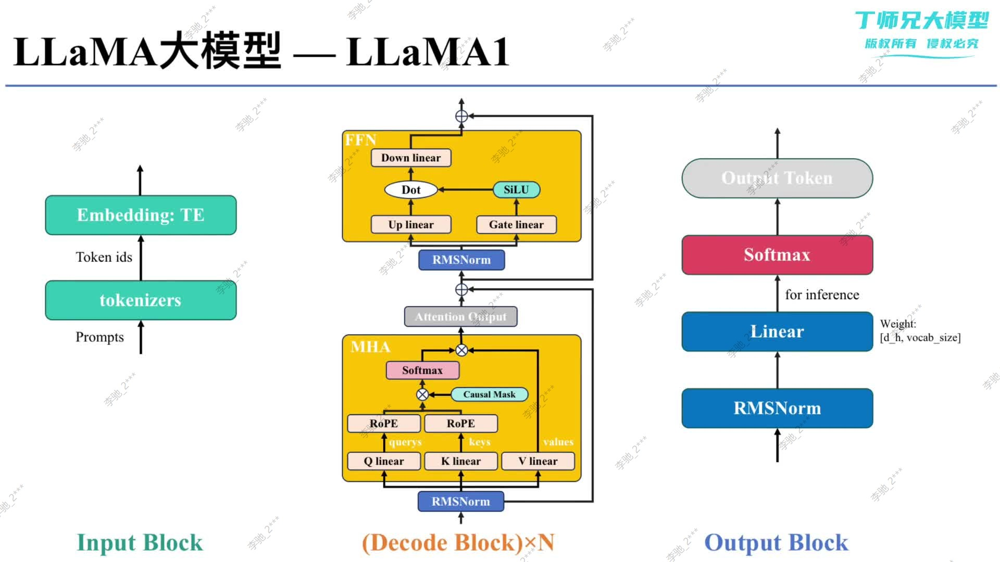

## 学习目标

本文从上帝视角拆解 LLaMA 1。学完后应能画出其完整前向路径，指出它与原始 Transformer 的主要差异，并能追踪每一层的张量形状。

## 先修知识

- [LLaMA 家族演进](/notes/transformer-llama-family-evolution/)
- [Transformer 的整体架构](/notes/transformer-overview/)
- [缩放点积注意力、QKV 与 Mask](/notes/transformer-self-attention/)
- [多头注意力与张量变形](/notes/transformer-multi-head-attention/)

## 1. 为什么需要重新看架构

仅记住“LLaMA 是 Decoder-only Transformer”还不够。工程实现中的训练稳定性、位置信息和 FFN 表达能力，分别由归一化位置、归一化类型、RoPE 和 SwiGLU 决定。

LLaMA 1 没有推翻注意力，而是选择了一组经过验证、适合大规模预训练的组件：

```text
Pre-Norm + RMSNorm + RoPE + SwiGLU
```

## 2. 从输入到输出的完整路径

课程图把模型分为 Input Block、重复 $N$ 次的 Decoder Block 和 Output Block。



> 图片来源：本次课程材料。重点沿中间的残差主干自下而上阅读；图中的 Softmax 主要用于推理选词，训练损失通常直接接收 logits。

完整流程如下：

```text
文本 Prompt
→ Tokenizer
→ token ids [B, T]
→ Token Embedding [B, T, D]
→ Decoder Block × N [B, T, D]
→ Final RMSNorm [B, T, D]
→ Output Linear [B, T, V]
→ logits
→ 训练：CrossEntropyLoss
  推理：对最后位置进行采样
```

LLaMA 是自回归语言模型：第 $t$ 个位置根据不晚于 $t$ 的 token 预测下一个 token。

## 3. 一个 Decoder Block 内部发生什么

设输入为 $x_l\in\mathbb{R}^{B\times T\times D}$。

### 3.1 因果自注意力子层

$$
h_l=x_l+\operatorname{Attention}(\operatorname{RMSNorm}(x_l))
$$

计算注意力时：

1. RMSNorm 稳定输入尺度；
2. 线性投影得到 $Q,K,V$；
3. 对 $Q,K$ 应用 RoPE；
4. 计算缩放点积并加入 Causal Mask；
5. softmax 后聚合 $V$；
6. 输出投影后与 $x_l$ 残差相加。

注意：RoPE 通常只作用于 $Q$ 和 $K$，不作用于 $V$。

### 3.2 SwiGLU FFN 子层

$$
x_{l+1}=h_l+\operatorname{FFN}_{\text{SwiGLU}}(\operatorname{RMSNorm}(h_l))
$$

一种常见写法是：

$$
\operatorname{FFN}(x)
=W_2\left(\operatorname{SiLU}(W_1x)\odot W_3x\right)
$$

$\odot$ 表示逐元素乘法。两个输入投影分别产生“内容分支”和“门控分支”，再投影回模型维度。

## 4. LLaMA 1 的四项关键改进

| 改进 | 原始 Transformer 常见做法 | LLaMA 1 | 主要作用 |
|---|---|---|---|
| 归一化位置 | Post-Norm | Pre-Norm | 改善深层网络梯度传播与训练稳定性 |
| 归一化类型 | LayerNorm | RMSNorm | 省略均值中心化，简化计算 |
| 位置信息 | 绝对正弦位置编码加到输入 | RoPE 旋转 $Q,K$ | 在注意力点积中自然表达相对位置 |
| FFN | ReLU FFN | SwiGLU FFN | 通过门控增强逐 token 非线性变换 |

严格来说，这些组件并不是 LLaMA 首次提出；关键在于 LLaMA 将它们组合并验证在大规模预训练中的有效性。

## 5. Shape 检查

设：

- batch 大小 $B$；
- 序列长度 $T$；
- 隐藏维度 $D$；
- 注意力头数 $H$；
- 每头维度 $D_h=D/H$；
- 词表大小 $V$。

```text
token_ids                  [B, T]
embedding                  [B, T, D]
RMSNorm                    [B, T, D]
Q, K, V 投影               [B, T, D]
拆头后的 Q, K, V           [B, H, T, Dh]
attention scores           [B, H, T, T]
attention output           [B, T, D]
SwiGLU 中间表示            [B, T, Dff]
block output               [B, T, D]
logits                     [B, T, V]
```

RMSNorm、RoPE、注意力输出投影和 FFN 输出都保持主干的 `[B,T,D]`，因此残差相加才成立。

## 6. 最小例子：预测下一个 token

假设输入为：

```text
<bos> 深度 学习 很
```

Tokenizer 先转为 token id。每个 Decoder Block 都在 Causal Mask 下更新四个位置的表示；最终只取最后一个位置的 logits，预测“有趣”“重要”等候选 token。预测结果追加到序列后，再进行下一次前向。

这解释了两个常见现象：

- 训练时可并行计算全部位置的 next-token loss；
- 推理时 token 之间仍必须逐步生成。

## 7. 输出层的两个易错点

### 7.1 Softmax 不一定写在模型 `forward` 中

训练时 `CrossEntropyLoss` 直接接收 logits；推理时才根据 temperature、top-k、top-p 等策略把 logits 转成概率并选 token。

### 7.2 Token Embedding 与输出矩阵不应凭图判断是否共享

图中 `Embedding: TE` 表示 token embedding，不能据此推出一定做 weight tying。是否共享输入 Embedding 与输出 projection，需要以具体模型配置和实现为准。

## 8. 优势与局限

### 优势

- 纯 Decoder 结构简单，适合统一 next-token 预训练目标；
- Pre-Norm 与 RMSNorm 有利于稳定大规模训练；
- RoPE 不需要向残差流直接加入绝对位置向量；
- SwiGLU 提高 FFN 表达能力。

### 局限

- 标准自注意力训练复杂度仍随 $T^2$ 增长；
- 自回归生成仍是串行过程；
- MHA 的 KV Cache 在长上下文和大 batch 推理中占用大量显存；
- 模型能力高度依赖训练数据、算力和后训练，架构组件并非全部答案。

## 9. 常见误区

### 误区一：LLaMA 1 是原始 Transformer Decoder 的原样复制

它保留 Decoder-only 注意力主干，但归一化、位置编码和 FFN 已明显变化，而且没有 Encoder-Cross-Attention 结构。

### 误区二：RoPE 旋转 $Q,K,V$

标准 LLaMA 实现对 Query 和 Key 应用旋转位置编码，Value 不旋转。

### 误区三：RMSNorm 与 Pre-Norm 是同一项改进

RMSNorm回答“归一化怎么算”，Pre-Norm回答“归一化放在哪里”，二者是两个独立维度。

## 一句话总结

LLaMA 1 的核心是在 Decoder-only Transformer 上，用 Pre-Norm/RMSNorm 稳定残差流、用 RoPE 注入位置、用 SwiGLU 改造 FFN，从而形成高效且易扩展的大模型基本块。

## 复习卡片

- 主干：Decoder-only Causal Transformer；
- Attention 前：RMSNorm；
- 位置：RoPE 作用于 $Q,K$；
- FFN：`SiLU(gate) ⊙ up → down`；
- 残差：注意力和 FFN 各一次；
- 输出：Final RMSNorm → Linear → logits；
- 训练不要先 softmax。

## 自测问题

1. LLaMA 1 的一个 Decoder Block 有哪两条子层？
2. RMSNorm、Pre-Norm 分别改变了什么？
3. RoPE 为什么作用于 $Q,K$ 而不是输出 logits？
4. SwiGLU 的两条输入投影分别承担什么作用？
5. 为什么训练时输出 logits 而不是概率？

## 下一篇

[LLaMA（3）：RMSNorm 原理及其与 LayerNorm 的区别](/notes/transformer-rmsnorm/)

## 参考与推荐阅读

- [LLaMA 1 论文](https://arxiv.org/abs/2302.13971)：2.2 节列出 Pre-Norm、SwiGLU、RoPE 和 RMSNorm。
- [Transformer Decoder 与因果注意力](/notes/transformer-decoder-cross-attention/)：回顾 Decoder 与 Causal Mask。
- [GLU Variants Improve Transformer](https://arxiv.org/abs/2002.05202)：SwiGLU 的来源与实验。
- [RoFormer](https://arxiv.org/abs/2104.09864)：RoPE 的正式定义。
