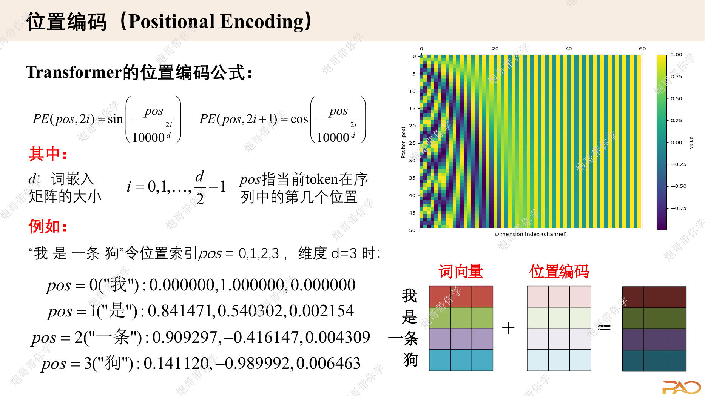

## 学习目标

学完本文后，应该能够：

- 解释为什么没有位置机制的自注意力无法区分顺序；
- 写出正弦余弦位置编码公式并检查 shape；
- 理解不同维度为什么使用不同频率；
- 说明它如何表达相对位置偏移；
- 区分绝对位置、相对位置、RoPE 与 ALiBi 的基本思路。

## 先修知识

- [缩放点积注意力](/notes/transformer-self-attention/)
- [多头注意力与张量变形](/notes/transformer-multi-head-attention/)
- [Token 编码与词嵌入](/notes/deep-learning-token-encoding/)

## 代码主线说明

本文实现以本地 `PositionEncoding.ipynb` 为主：预先生成正弦/余弦矩阵，用 `register_buffer` 保存，再与 token embedding 相加。代码采用 `Loss.ipynb` 中已经修正的长度切片写法 `self.pe[:, :x.size(1)]`，避免输入短于 `max_seq_len` 时发生 shape 不匹配。

## 1. 问题背景：注意力本身不知道顺序

考虑两个序列：

```text
狗 咬 人
人 咬 狗
```

如果只把 token embedding 输入自注意力，交换输入 token 的顺序，输出也只会跟着做相同交换。模型知道“有哪些 token”，却没有额外证据判断谁在前、谁在后。

### 1.1 排列等变的直觉

设 $P$ 是一个排列矩阵，把输入行顺序打乱。忽略位置机制时：

$$
Q=PXW^Q,\quad K=PXW^K,\quad V=PXW^V
$$

注意力输出会满足：

$$
\operatorname{Attention}(PQ,PK,PV)
=P\operatorname{Attention}(Q,K,V)
$$

也就是说，输入怎么重排，输出就怎么重排；注意力本身不会产生“第几个位置”的概念。

## 2. 最直接的方案：加入位置向量

令 token embedding 为 $X$，位置编码为 $P$，两者 shape 相同：

$$
H^{(0)} = X + P
$$

```text
X: [B, L, D]
P: [1, L, D]  # 在 batch 维广播
H: [B, L, D]
```

相加要求 token 语义和位置信息处在相同维度空间，也保持输入输出维度不变。

## 3. 正弦余弦位置编码

原始 Transformer 使用固定的正弦余弦位置编码。位置为 $pos$，模型维度下标为 $2i$ 或 $2i+1$：

$$
PE(pos,2i)=\sin\left(\frac{pos}{10000^{2i/D}}\right)
$$

$$
PE(pos,2i+1)=\cos\left(\frac{pos}{10000^{2i/D}}\right)
$$

偶数维用 sin，奇数维用 cos。同一对维度使用相同角频率：

$$
\omega_i = 10000^{-2i/D}
$$

所以也可以写成：

$$
PE(pos,2i)=\sin(pos\,\omega_i)
$$

$$
PE(pos,2i+1)=\cos(pos\,\omega_i)
$$

下面的课件图展示了不同维度随位置变化的频率差异。



> 图片来源：课程课件《transformer算法原理-S》第 5 页。

## 4. 为什么要有不同频率

可以把不同维度想成不同转速的指针：

- 低维对应较高频率，随位置变化较快；
- 高维对应较低频率，随位置变化较慢；
- 多个频率组合后，每个位置得到独特且连续的表示。

这种设计比单个位置编号更丰富，也比纯离散二进制编码更平滑。

## 5. 为什么 sin 和 cos 成对出现

sin 和 cos 的和角公式使固定偏移可以表示成线性变换。

设偏移为 $\Delta$，对某个频率 $\omega$：

$$
\sin((pos+\Delta)\omega)
=
\sin(pos\omega)\cos(\Delta\omega)
+
\cos(pos\omega)\sin(\Delta\omega)
$$

$$
\cos((pos+\Delta)\omega)
=
\cos(pos\omega)\cos(\Delta\omega)
-
\sin(pos\omega)\sin(\Delta\omega)
$$

写成矩阵后，$PE(pos+\Delta)$ 可以由 $PE(pos)$ 乘一个只依赖 $\Delta$ 的 $2\times2$ 旋转矩阵得到。

这意味着模型不仅能识别绝对位置，也更容易通过线性运算学习固定相对距离。

## 6. 正确的 PyTorch 实现

```python
import math
import torch
import torch.nn as nn


class SinusoidalPositionEncoding(nn.Module):
    def __init__(self, dim: int, max_len: int, dropout: float = 0.0):
        super().__init__()
        if dim % 2 != 0:
            raise ValueError("此简化实现要求 dim 为偶数")

        position = torch.arange(max_len, dtype=torch.float32).unsqueeze(1)
        frequency = torch.exp(
            torch.arange(0, dim, 2, dtype=torch.float32)
            * (-math.log(10000.0) / dim)
        )

        pe = torch.zeros(max_len, dim)
        pe[:, 0::2] = torch.sin(position * frequency)
        pe[:, 1::2] = torch.cos(position * frequency)

        self.register_buffer("pe", pe.unsqueeze(0), persistent=False)
        self.dropout = nn.Dropout(dropout)

    def forward(self, x: torch.Tensor) -> torch.Tensor:
        # x: [B, L, D]
        length = x.size(1)
        if length > self.pe.size(1):
            raise ValueError("输入长度超过预先计算的 max_len")

        x = x + self.pe[:, :length].to(dtype=x.dtype)
        return self.dropout(x)
```

### 6.1 为什么使用 `register_buffer`

位置编码：

- 需要随模型移动到 CPU/GPU；
- 需要出现在模块状态中或至少成为模块缓冲区；
- 不需要梯度更新。

因此它是 buffer，而不是 `nn.Parameter`。

### 6.2 为什么必须切片

预计算的 `pe` shape 可能是 `[1,max_len,D]`，实际输入可能只有 `[B,L,D]`。必须使用：

```python
self.pe[:, :x.size(1)]
```

直接写 `x + self.pe` 只有在 $L=max\_len$ 时才能对齐。`PositionEncoding.ipynb` 的独立版本遗漏了这个切片，而 `Loss.ipynb` 的整合版本已经修正。

## 7. Embedding 为什么常乘 $\sqrt{D}$

原始 Transformer 在加入位置编码前，把 token embedding 乘以 $\sqrt{D}$：

$$
H^{(0)}=\sqrt{D}\,X+P
$$

直觉上，这是为了让训练初期 token embedding 的数值尺度不会被幅值固定在 $[-1,1]$ 的位置编码淹没。

这属于原论文实现细节；现代模型可能使用不同初始化、归一化或位置机制，不一定都保留该操作。

## 8. 固定绝对位置编码的能力与限制

### 能力

- 不需要学习参数；
- 可以计算训练长度之外的位置值；
- 不同频率能表达多尺度位置关系；
- 固定偏移可以由线性变换表达。

### 限制

- 能计算更长位置不代表模型在训练范围外一定能良好泛化；
- 位置信息与 token embedding 直接相加，表达方式比较间接；
- 对超长上下文，频率分布与训练长度仍可能不匹配。

## 9. 现代位置机制概览

### 9.1 可学习绝对位置 Embedding

为每个位置建立一个可学习向量。实现简单，但通常有固定的最大位置表，超出训练范围时需要扩展或插值。

### 9.2 相对位置编码

不只告诉模型“我在第几个位置”，而是直接把 Query 与 Key 的相对距离加入注意力分数或 Value 聚合。

### 9.3 RoPE

RoPE 对 Query 和 Key 的二维特征对施加与位置相关的旋转，使点积自然包含相对位置差。许多现代 Decoder-only 大模型采用它。

### 9.4 ALiBi

ALiBi 根据 Query 与 Key 的距离，向注意力分数加入每个头不同斜率的线性偏置。它不向输入 embedding 直接加位置向量。

这些机制值得后续单独成篇；本专题先掌握原始正弦余弦编码。

## 10. 常见误区

### 误区一：位置编码是给 token id 加位置编号

位置编码通常作用在 embedding 空间，与 token embedding 同维，而不是直接修改离散 token id。

### 误区二：正弦编码能够保证任意长度外推

公式可以生成任意位置，但模型是否学会在更长范围内使用这些模式取决于训练数据和模型行为。

### 误区三：位置编码只表达绝对位置

正弦余弦成对结构也让固定相对偏移能够通过线性变换表示。

### 误区四：把完整 `max_len` 位置表直接与短序列相加

实际输入必须按当前序列长度切片。

## 一句话总结

位置编码的本质是：为排列等变的注意力注入顺序信号；原始 Transformer 用多频率 sin/cos 向量与 token embedding 相加，使模型同时获得连续的绝对位置和易于学习的相对偏移结构。

## 复习卡片

- 问题：自注意力本身不区分顺序；
- 输入：token embedding 与同 shape 的位置向量相加；
- 偶数维：sin；奇数维：cos；
- 频率：低维变化快，高维变化慢；
- 相对位置：固定偏移对应二维旋转；
- 代码要点：buffer、按长度切片、dtype 对齐。

## 自测问题

1. 什么叫自注意力对排列等变？
2. 为什么位置编码必须与 token embedding 具有相同的最后一维？
3. sin 和 cos 成对出现如何帮助表示相对位置？
4. `register_buffer` 与 `nn.Parameter` 的区别是什么？
5. 为什么公式能生成更长位置不等于模型一定能外推？

## 参考与推荐阅读

- [Attention Is All You Need](https://arxiv.org/abs/1706.03762)：3.5 节。
- [位置编码](https://www.rethink.fun/chapter15/%E4%BD%8D%E7%BD%AE%E7%BC%96%E7%A0%81.html)：适合建立多频率指针直觉。
- [Dive into Deep Learning：Self-Attention and Positional Encoding](https://d2l.ai/chapter_attention-mechanisms-and-transformers/self-attention-and-positional-encoding.html)：包含相对偏移的线性变换推导。
- 本地学习代码：`PositionEncoding.ipynb`。
