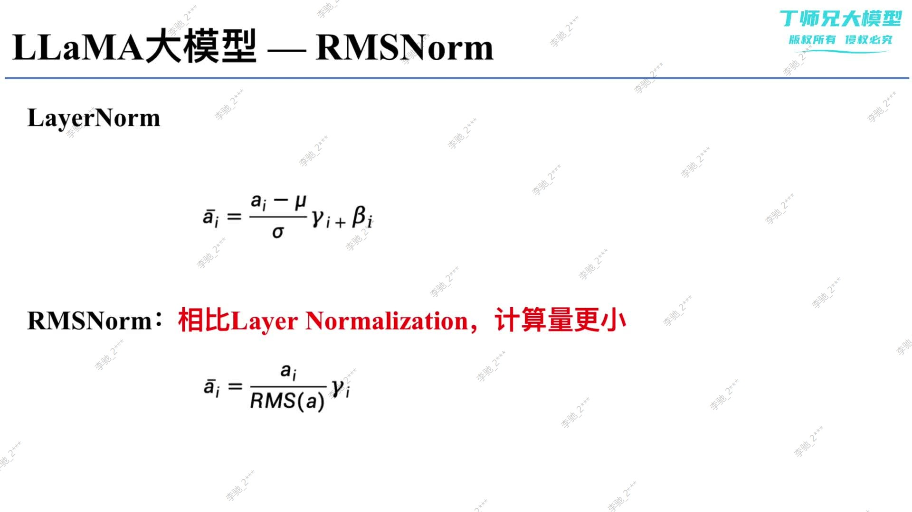

## 学习目标

本文回答“为什么 LLaMA 用 RMSNorm 替代 LayerNorm”。学完后应能推导两种公式，解释 RMSNorm 省略了哪一步、保留了什么不变性，并避免把 RMSNorm 与 Pre-Norm 混为一谈。

## 先修知识

- [LLaMA 1 的整体架构](/notes/transformer-llama1-architecture/)
- [Encoder、LayerNorm、残差与 FFN](/notes/transformer-encoder-block/)
- [标准化与归一化](/notes/deep-learning-normalization-standardization/)

## 1. 问题背景：LayerNorm 做了两件事

对一个 token 的隐藏向量 $x\in\mathbb{R}^{D}$，LayerNorm 同时执行：

1. **中心化**：减去均值，让特征均值接近 0；
2. **尺度归一化**：除以标准差，让特征方差接近 1。

RMSNorm 的出发点是：深层网络稳定训练可能主要依赖尺度控制，而中心化不一定总是必需。于是它去掉均值计算，只根据均方根缩放向量。

## 2. LayerNorm 的公式

对最后一个维度的 $D$ 个元素：

$$
\mu=\frac{1}{D}\sum_{i=1}^{D}x_i
$$

$$
\sigma^2=\frac{1}{D}\sum_{i=1}^{D}(x_i-\mu)^2
$$

$$
y_i=\gamma_i\frac{x_i-\mu}{\sqrt{\sigma^2+\epsilon}}+\beta_i
$$

其中 $\gamma,\beta\in\mathbb{R}^{D}$ 是可学习参数。

LayerNorm 既具有重缩放不变性，也具有重新中心化不变性：对输入整体乘常数或加常数，归一化结果在理想条件下基本不变。

## 3. RMSNorm 的公式

均方根定义为：

$$
\operatorname{RMS}(x)
=
\sqrt{\frac{1}{D}\sum_{i=1}^{D}x_i^2+\epsilon}
$$

RMSNorm 为：

$$
y_i=\gamma_i\frac{x_i}{\operatorname{RMS}(x)}
$$

常见 LLaMA 风格实现只有可学习缩放 $\gamma$，没有偏移 $\beta$。



> 图片来源：本次课程材料。图中的核心意思是 RMSNorm 省略中心化；实现时仍应在根号内加入 $\epsilon$，避免零向量除零。

## 4. 最小数值例子

令：

$$
x=[1,2]
$$

忽略 $\epsilon$，LayerNorm 中：

$$
\mu=1.5,\qquad \sigma=0.5
$$

因此归一化结果为：

$$
[-1,1]
$$

RMSNorm 中：

$$
\operatorname{RMS}(x)=\sqrt{\frac{1^2+2^2}{2}}=\sqrt{2.5}
$$

归一化结果约为：

$$
[0.632,1.265]
$$

可以看到：RMSNorm 后的向量**均值不一定为 0，标准差也不一定为 1**；它保证的是归一化向量的均方值接近 1。

## 5. 为什么计算更简单

LayerNorm 需要计算均值、中心化后的方差以及仿射变换；RMSNorm 只需计算平方均值和缩放。

| 操作 | LayerNorm | RMSNorm |
|---|---:|---:|
| 求均值 | 需要 | 不需要 |
| 减均值 | 需要 | 不需要 |
| 求平方均值/方差 | 需要 | 需要 |
| 可学习缩放 | 通常需要 | 通常需要 |
| 可学习偏移 | 通常需要 | LLaMA 风格通常没有 |

RMSNorm 论文报告其理论与实验计算更简单，但在真实硬件上的加速幅度取决于张量大小、融合内核、内存访问和框架实现，不能仅根据少一次均值就断言固定加速比例。

## 6. 输入输出与 Shape

在 LLaMA 中：

```text
x:       [B, T, D]
mean(x²):[B, T, 1]
rms:     [B, T, 1]
gamma:   [D]
output:  [B, T, D]
```

RMSNorm 对每个 batch、每个 token 独立地沿最后一个隐藏维度 $D$ 计算。`keepdim=True` 保留最后一维为 1，方便除法广播。

## 7. RMSNorm 到底保留了什么性质

若输入整体乘以正数 $c$：

$$
\frac{cx}{\operatorname{RMS}(cx)}
=
\frac{cx}{c\operatorname{RMS}(x)}
=
\frac{x}{\operatorname{RMS}(x)}
$$

所以它对整体重缩放具有不变性。直觉上，无论残差流向量整体变大或变小，进入子层前都被拉回稳定尺度。

但如果输入整体加常数，RMSNorm 不会像 LayerNorm 那样消除该平移，因此不具备重新中心化不变性。

## 8. 为什么 LLaMA 选择 RMSNorm

LLaMA 1 论文给出的动机是提高训练稳定性，并采用 Pre-Norm。RMSNorm 相比 LayerNorm 删除中心化步骤，以更简单的计算控制每个 token 隐藏向量的尺度。

需要谨慎表述：

- 不能说“RMSNorm 假设均值一定为 0”；
- 更准确的是“RMSNorm 主动放弃中心化，只做均方根尺度归一化”；
- 其效果来自训练中网络参数与归一化机制共同适应，不是把 $\mu$ 强行设为 0。

## 9. RMSNorm 与 Pre-Norm 是正交概念

| 问题 | 可选项 |
|---|---|
| 归一化怎么算？ | LayerNorm、RMSNorm 等 |
| 归一化放在哪里？ | Pre-Norm、Post-Norm 等 |

理论上可以组合出 Pre-LayerNorm、Post-LayerNorm、Pre-RMSNorm 或 Post-RMSNorm。LLaMA 采用的是 **Pre-RMSNorm**。

因此“LayerNorm 等于 Post-Norm，RMSNorm 等于 Pre-Norm”是错误说法。

## 10. 优势与局限

### 优势

- 公式更简单，省略均值中心化；
- 保留对整体缩放的不变性；
- 参数更少：常见实现仅有一个 `weight`；
- 已在多种大语言模型架构中得到验证。

### 局限

- 不会让输出均值为 0；
- 不具有平移不变性；
- 是否比高度优化的 LayerNorm 更快取决于具体内核；
- 它只稳定特征尺度，不能独自解决全部训练稳定性问题。

## 11. 常见误区

### 误区一：RMSNorm 输出是标准正态分布

归一化不等于让数据服从正态分布。RMSNorm 只调整均方根尺度。

### 误区二：检查 RMSNorm 应看 `mean≈0, std≈1`

这是 LayerNorm 的典型检查思路。RMSNorm 更合适的检查是：应用可学习缩放前，`mean(output ** 2, dim=-1)≈1`。

### 误区三：$\epsilon$ 可以省略

零向量会导致除零；低精度训练也需要 $\epsilon$ 提高数值稳定性。

### 误区四：RMS 是标准差

标准差先减均值，RMS 直接对原值平方。只有均值为 0 时两者才相同。

## 一句话总结

RMSNorm 的本质是：放弃 LayerNorm 的均值中心化，仅用均方根控制每个 token 隐藏向量的尺度，以更简单的计算获得稳定的 Pre-Norm 输入。

## 复习卡片

- LayerNorm：减均值、除标准差、缩放并平移；
- RMSNorm：除均方根、乘可学习缩放；
- 归一化维度：最后一个隐藏维 $D$；
- RMSNorm 输出均值不必为 0；
- 检查量：归一化后均方值约为 1；
- LLaMA：Pre-RMSNorm；
- norm 类型与 norm 位置是两个问题。

## 自测问题

1. RMS 与标准差在什么条件下相同？
2. RMSNorm 为什么具有重缩放不变性？
3. 为什么不能检查 RMSNorm 输出的均值是否为 0？
4. RMSNorm 相比 LayerNorm 省略了哪些操作？
5. “RMSNorm 就是 Pre-Norm”为什么错误？

## 下一篇

[LLaMA（4）：Pre-Norm 与 Post-Norm 的结构、梯度和取舍](/notes/transformer-pre-norm-post-norm/)

## 参考与推荐阅读

- [Root Mean Square Layer Normalization](https://arxiv.org/abs/1910.07467)：RMSNorm 原论文。
- [LLaMA 1 论文](https://arxiv.org/abs/2302.13971)：LLaMA 使用 Pre-RMSNorm 的出处。
- [PyTorch `RMSNorm`](https://docs.pytorch.org/docs/stable/generated/torch.nn.RMSNorm.html)：官方 API 与参数定义。
