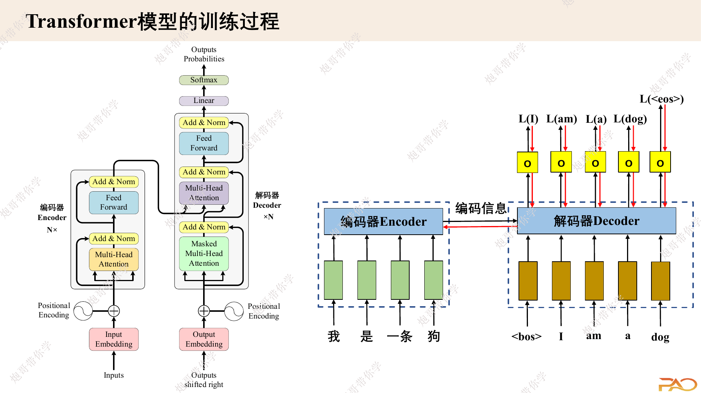

## 学习目标

学完本文后，应该能够：

- 构造源输入、目标输入和目标标签；
- 解释“Outputs shifted right”真正表示什么；
- 写出 token 级交叉熵并忽略 `<pad>`；
- 区分训练阶段的并行前向与推理阶段的自回归循环；
- 说清 Causal Mask、Padding Mask 和 KV Cache 的作用。

## 先修知识

- [Decoder、因果注意力与交叉注意力](/notes/transformer-decoder-cross-attention/)
- [词表、特殊 Token 与 BPE](/notes/deep-learning-vocabulary-bpe/)
- [Token 编码与词嵌入](/notes/deep-learning-token-encoding/)
- [语言模型采样策略](/notes/deep-learning-lm-sampling/)
- [多分类与交叉熵](/notes/deep-learning-multi-class-classification/)

## 代码主线说明

本文的数据构造、整体 `Transformer` 前向和单步 logits 主要对应本地 `Loss.ipynb`，采样策略与分词部分分别对应 `Sampling.ipynb` 和 `Tokenizer.ipynb`。在 Notebook 基础上补充了 `ignore_index=pad_id`、Padding Mask 与完整自回归外层循环，使示例能够自然扩展到变长的真实批数据。

## 1. 训练样本如何构造

假设源句为：

```text
我 是 一 条 狗
```

目标句为：

```text
I am a dog
```

加入特殊 token 后：

```text
src_input:  <bos> 我 是 一 条 狗 <eos>
tgt_input:  <bos> I am a dog
tgt_label:  I am a dog <eos>
```

目标输入和目标标签只相差一个位置，这就是架构图中的 **Outputs shifted right**。

| Decoder 输入位置 | `<bos>` | I | am | a | dog |
|---|---|---|---|---|---|
| 监督标签 | I | am | a | dog | `<eos>` |

模型学习的是：给定左侧前缀，预测当前位置的下一个 token。

## 2. 为什么训练时能一次预测所有位置

训练数据提供了完整目标句，因此可一次把 `tgt_input` 输入 Decoder。Causal Mask 保证：

- `<bos>` 位置只能看到 `<bos>`；
- `I` 位置只能看到 `<bos>, I`；
- `am` 位置只能看到 `<bos>, I, am`；
- 后续位置同理。

所有位置的矩阵运算可以并行，但每个位置的可见范围仍与自回归推理一致。

下面的课件图把源输入、右移目标输入与每个位置的损失放在同一张流程图中。



> 图片来源：课程课件《transformer算法原理-S》第 14 页。

## 3. Teacher Forcing

训练时，第 $t$ 个位置接收真实的前缀 token，而不是模型自己刚刚预测的 token，这称为 Teacher Forcing。

优点：

- 可以并行训练全部位置；
- 训练信号稳定，不会因早期错误让后续输入完全偏离。

局限：

- 推理时只能使用模型自己的历史输出；
- 训练和推理的前缀分布不同，可能产生暴露偏差。

## 4. 从 Decoder 输出到词表 logits

Decoder 输出：

```text
hidden: [B, T, D]
```

词表投影：

$$
Z=HW_{vocab}+b
$$

```text
W_vocab: [D, V]
logits:  [B, T, V]
```

训练交叉熵直接接收 logits，不要先手动 softmax。框架内部会使用数值稳定的 `log_softmax` 计算。

## 5. Token 级交叉熵

对 batch 中所有非填充目标 token 求平均：

$$
\mathcal{L}
=
-\frac{1}{N_{valid}}
\sum_{b,t:y_{b,t}\ne pad}
\log p(y_{b,t}\mid y_{b,<t},x_b)
$$

PyTorch 写法：

```python
import torch.nn.functional as F


def language_model_loss(logits, labels, pad_id):
    # logits: [B, T, V]
    # labels: [B, T]
    return F.cross_entropy(
        logits.reshape(-1, logits.size(-1)),
        labels.reshape(-1),
        ignore_index=pad_id,
    )
```

`Loss.ipynb` 的简化代码没有设置 `ignore_index`。当真实数据经过 padding 后，应忽略 `<pad>` 标签，否则模型会浪费能力学习预测填充符，较长 padding 的样本还会在损失中占据不合理权重。

## 6. 三类 Mask 如何进入训练

### 6.1 源端 Padding Mask

```text
src_is_pad: [B, S]
```

用于 Encoder 自注意力，也用于 Decoder 交叉注意力对 Encoder memory 的读取。

### 6.2 目标端 Padding Mask

```text
tgt_is_pad: [B, T]
```

用于 Decoder 自注意力忽略目标端 `<pad>`，也用于最终损失忽略无效标签。

### 6.3 目标端 Causal Mask

```text
causal: [T, T]
```

用于防止每个位置读取未来 token。

这三者不能因为都叫 Mask 就混成一个概念。

## 7. 一个 batch 的目标右移代码

若原始目标序列已经是：

```text
<bos> I am a dog <eos> <pad>
```

可以直接切片：

```python
target_input = target_ids[:, :-1]
target_label = target_ids[:, 1:]

assert target_input.shape == target_label.shape
```

不要把 `<eos>` 同时从输入和标签中都删除，否则模型学不到何时停止生成。

## 8. 原论文的重要训练设置

原始 Transformer 还使用了以下方法：

- Adam：$\beta_1=0.9$、$\beta_2=0.98$、$\epsilon=10^{-9}$；
- 先 warmup、再按步数平方根倒数衰减的学习率；
- label smoothing，系数为 0.1；
- dropout，Base 模型为 0.1；
- 目标 embedding 与 softmax 前线性变换共享权重。

这些设计不是 Transformer 公式的必要组成部分，却对复现论文结果非常重要。

### 8.1 学习率日程

论文中的学习率与模型维度、训练步数有关：

$$
lr=D^{-1/2}\min(step^{-1/2},step\cdot warmup^{-3/2})
$$

warmup 阶段线性上升，之后按 $step^{-1/2}$ 下降。

## 9. 推理为什么必须循环

推理开始时，只有 `<bos>`：

```text
第 1 步：<bos>             → 预测 I
第 2 步：<bos> I           → 预测 am
第 3 步：<bos> I am        → 预测 a
第 4 步：<bos> I am a      → 预测 dog
第 5 步：<bos> I am a dog  → 预测 <eos>
```

新 token 会成为下一步的输入，所以 token 维度上的生成不可完全并行。

## 10. 最小贪心解码流程

```python
@torch.no_grad()
def greedy_decode(model, src_ids, bos_id, eos_id, max_new_tokens):
    memory, src_is_pad = model.encode(src_ids)
    generated = torch.full(
        (src_ids.size(0), 1),
        bos_id,
        dtype=torch.long,
        device=src_ids.device,
    )

    for _ in range(max_new_tokens):
        logits = model.decode(generated, memory, src_is_pad)
        next_id = logits[:, -1].argmax(dim=-1, keepdim=True)
        generated = torch.cat([generated, next_id], dim=1)

        if torch.all(next_id.squeeze(-1) == eos_id):
            break

    return generated
```

批量生成时，每个样本到达 `<eos>` 的时间可能不同。更完整的实现要维护 `finished` 标记，避免已经结束的样本继续产生有效 token。

## 11. KV Cache 在做什么

朴素推理每一步都会重新计算整个目标前缀的 Key 和 Value。KV Cache 保存之前位置的 $K,V$，新一步只计算当前 token 的投影，再与缓存拼接。

KV Cache：

- 减少重复投影和注意力前缀计算；
- 增加随序列长度增长的缓存显存；
- 不会取消“下一 token 依赖上一个 token”的串行关系。

原始 Encoder-Decoder 模型中，Encoder memory 只需计算一次；Decoder 自注意力的 KV 可逐步缓存，交叉注意力的 Encoder K/V 也可以预计算。

## 12. 解码策略

模型输出的是概率分布，如何选择下一个 token 是独立的解码决策：

- 贪心：每步取概率最大；
- Beam Search：保留多个高分序列，翻译任务常用；
- Temperature：控制分布尖锐程度；
- Top-k：只在概率最高的 $k$ 个 token 中采样；
- Top-p：在累计概率达到阈值的最小集合中采样。

详细内容见[语言模型采样策略](/notes/deep-learning-lm-sampling/)。

## 13. 训练与推理对照

| 对比 | 训练 | 推理 |
|---|---|---|
| 目标端输入 | 真实目标右移 | 模型已生成前缀 |
| 位置计算 | 所有目标位置并行 | 每次新增一个位置 |
| Causal Mask | 必须 | 朴素整段解码仍需要；增量缓存按构造保证因果 |
| Dropout | 开启 | 关闭 |
| 损失 | 计算交叉熵 | 不计算 |
| 终止 | 固定标签长度 | `<eos>` 或最大长度 |

## 14. 常见误区

### 误区一：目标右移是在 embedding 后移动

通常先在 token id 序列上构造 `tgt_input` 和 `tgt_label`，再分别进入模型与损失。

### 误区二：训练时完整输入目标句会泄漏答案

正确的 Causal Mask 会阻断未来信息。

### 误区三：交叉熵前需要手动 softmax

`F.cross_entropy` 直接接收 logits。

### 误区四：所有 `<pad>` 都会被注意力 Mask 自动处理

注意力 Mask 和损失 `ignore_index` 是两个位置，二者都要处理。

## 一句话总结

Transformer 训练的本质是：用真实目标右移作为 Decoder 输入，在因果约束下并行预测所有下一个 token；推理时则把自身预测不断接回输入，逐 token 生成直到 `<eos>`。

## 复习卡片

- `tgt_input`：去掉最后一个 token；
- `tgt_label`：去掉第一个 token；
- logits：`[B,T,V]`；
- 损失：交叉熵并忽略 `<pad>`；
- 训练：Teacher Forcing、位置并行；
- 推理：自回归循环；
- KV Cache：减少重复计算，不取消串行依赖。

## 自测问题

1. 为什么目标输入必须右移一位？
2. `<eos>` 应该出现在哪个监督位置？
3. 为什么 Causal Mask 与 `ignore_index` 都需要？
4. Teacher Forcing 的优点和训练—推理差异是什么？
5. KV Cache 缓存了什么，又没有解决什么？

## 参考与推荐阅读

- [Attention Is All You Need](https://arxiv.org/abs/1706.03762)：3.1、5.3 和 5.4 节。
- [利用 Transformer 实现翻译模型](https://www.rethink.fun/chapter15/%E5%88%A9%E7%94%A8Transformer%E5%AE%9E%E7%8E%B0%E7%BF%BB%E8%AF%91%E6%A8%A1%E5%9E%8B.html)：适合对照数据准备、padding 与训练循环。
- [PyTorch `nn.Transformer`](https://docs.pytorch.org/docs/stable/generated/torch.nn.Transformer.html)：核对各种 Mask 参数。
- 本地学习代码：`Loss.ipynb`、`Sampling.ipynb`、`Tokenizer.ipynb`。
