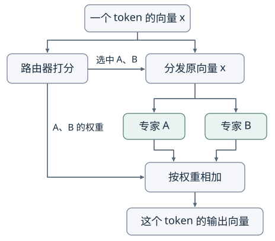

这份讲义从一个 token 怎么选专家讲起。你会亲手把几个专家的结果合回来，再用两批输入解释为什么 GPU 要做不同形状的矩阵乘。手算和代码使用同一个二维例子，实验只用 Python 3 标准库，在个人电脑的 CPU 上就能运行。

## 这份讲义怎么学

| 学习安排 | 具体要做什么 | 达到什么程度就可以继续 |
|---|---|---|
| 第一次，读第一、二讲 | 在纸上画路由图，拿计算器跟着一个 token 算完，再独立做自测 2 | 给你新的输入，你能选对专家，并算出一个合并后的向量 |
| 第二次，读第三、四讲 | 看一次训练误差怎样影响路由，再手工把三个 token 填进各专家的名单 | 你能解释为什么一个专家拿到三行输入，另一个可能一行也拿不到 |
| 第三次，做第五讲 | 先预测输出，再运行 Python。改变 `k`、调换 token 顺序，各做一次对照 | 你能在自己的代码里指出打分、分发、专家计算、合并分别发生在哪里 |

如果今天只学一段，就学到第二讲末尾。把纸上的计算保留下来，第三次学习时拿它和程序对照。自测答案放在文末。

## 第一讲　专家到底是什么

模型先把文本切成 token，再用向量表示每个 token。你可以把一个向量想成表格里的一行数字。到达 Transformer 的某一层时，这一行已经带有前面网络算出的上下文信息。

在普通前馈层（FFN）中，所有行都用同一套网络参数做计算。在稀疏混合专家层（Mixture of Experts，MoE）中，有多套独立的前馈网络，每套叫一个**专家**。同一层中的专家通常接受相同宽度的输入，返回相同宽度的输出，但每个专家有自己的权重。另一个小网络叫**路由器**，它读入当前 token 的向量，给各个专家打分。

下面画的是某个 token 恰好选中 A 和 B 时的数据流。A、B 看到同一份原始向量，路由器还要把合并权重交给汇总步骤。



**为什么值得准备多个专家？** 假设一层有 8 位同样大小的专家，每位含有 $P$ 个参数。仅计这些独立专家，模型拥有 $8P$ 个参数。每个 token 如果只选 2 位，它在这一层执行的是 2 位专家的前向计算。这样可以增加模型可学习的参数，同时控制单个 token 的专家计算量。路由、数据搬运和其他网络层也需要计算，实际速度仍要测量。[Mixtral 原文第 2.1 节与图 1](https://arxiv.org/html/2401.04088#S2.SS1)

**自测 1**　一句话被切成 5 个 token，一层有 8 位专家，每个 token 各选 2 位。所有分配都被接收时，这层发生几次 token–专家分配？最后返回几个 token 向量？

## 第二讲　亲手算完一个 token 的前向

用 $x=(u,v)$ 表示一个 token 的两个特征。给教学模型设定一个路由器，它对 A、B、C 的打分依次为 $(u,v,-u-v)$。这相当于一组固定的线性层权重，方便手算。真实模型在训练中学习这些权重。

三个专家的规则也故意写得很简单。实际专家一般包含矩阵乘和非线性激活，这里只保留“同一输入经过不同参数得到不同输出”这一点。

| 专家 | 收到 $(u,v)$ 后返回 |
|---|---|
| A | $(2u,v)$ |
| B | $(u,2v)$ |
| C | $(u+v,u-v)$ |

**第一步，打分和选择。** 输入 $x=(2,1)$，路由分数是 $(2,1,-3)$。top-2 表示取分数最高的两位，所以本次选 A 和 B。打分可以是负数，它和合并权重是两个量。

**第二步，算合并权重。** 本例采用 Mixtral 的做法，让选中的两个权重加起来等于 1。softmax 先对分数取指数，再除以指数之和。用计算器可得

$$
w_A=\frac{e^2}{e^2+e^1}\approx 0.7311,\qquad
w_B=\frac{e^1}{e^2+e^1}\approx 0.2689.
$$

**第三步，让两个专家各算一次。** A 收到 $(2,1)$，返回 $(4,1)$。B 也收到 $(2,1)$，返回 $(2,2)$。C 在这个 token 上跳过。

**第四步，按原 token 合并。** 对两个坐标分别做加权求和。

$$
y=w_A(4,1)+w_B(2,2)=(4w_A+2w_B,\,w_A+2w_B)\approx(3.4621,1.2689).
$$

这里的输出用未舍入的权重计算，再保留四位小数。一个二维向量进来，经过两条计算路径，最后仍返回一个二维向量。写成论文里的通用记号，就是 $y=\sum_{e\in S}w_eF_e(x)$。其中 $S$ 是选中的专家集合，$F_e(x)$ 是该专家处理原输入的结果。[Mixtral 的路由公式](https://arxiv.org/html/2401.04088#S2.SS1)

**自测 2**　把输入换成 $(1,2)$。保持同一套路由器和专家权重，先写出排名第一和第二的专家，再计算输出。手算时可直接沿用上面的近似权重，输出保留两位小数即可。

## 第三讲　路由器和专家怎样学出分工

真实模型没有人为指定“A 负责数学，B 负责语言”。训练时，同一个任务损失会给路由器和专家提供学习信号。以预测下一个 token 为例，模型先完成前向计算，再根据预测与真实 token 之间的差距计算损失，最后反向传播。每次被选中的专家，会从处理过的 token 收到主任务的梯度。

沿用刚才的例子。假设 A 和 B 保持入选，A 的合并权重为 $p$，B 的就是 $1-p$。把两个专家的输出代进去，就能看到 $p$ 怎样改变两个坐标。

$$
y(p)=p(4,1)+(1-p)(2,2)=(2+2p,\,2-p).
$$

为了单独观察路由的作用，给这道教学题设一个目标向量 $(4,1)$。让 A 的份额从约 0.731 增到 0.8，预测就从约 $(3.462,1.269)$ 移到了 $(3.6,1.2)$，两个坐标都更接近目标。**这就是路由器能学到东西的原因之一。** 在入选的专家集合暂时不变时，它给各专家分多少权重，会连续地影响损失。专家网络自己的权重也会被更新。语言模型在实际训练中使用后续预测产生的损失，这里的目标向量专门用来演示这一小段。

如果很多批次都偏向相同的少数专家，热门专家的任务会积压，冷门专家得到的训练样本也会少。Switch Transformer 给出了一种做法，在主任务之外加入负载均衡损失，鼓励更均衡的使用。在有专家容量上限的实现中，特别拥挤还可能导致部分分配溢出。[Switch 论文图 2、图 3 及负载均衡讨论](https://www.jmlr.org/papers/volume23/21-0998/21-0998.pdf#page=4)

**自测 3**　假如一个批次中的每个 token 都给 A、B 分别分配 70% 和 30% 的权重，C 始终没有入选。每个 token 的合并权重都加到了 1，这个批次的专家负载均衡吗？A 和 B 收到的行数又是否相同？

## 第四讲　从一个 token 走到一批，动态形状就出现了

仍用同一套路由器和 top-2 规则。把三个 token 放在一起，依次叫 $t_1,t_2,t_3$。

| token | 输入 $(u,v)$ | 对 A、B、C 的分数 | 入选专家，按分数排序 |
|---|---|---|---|
| $t_1$ | $(2,1)$ | $(2,1,-3)$ | A、B |
| $t_2$ | $(-3,2)$ | $(-3,2,1)$ | B、C |
| $t_3$ | $(1,-3)$ | $(1,-3,2)$ | C、A |

现在换到 GPU 算子的视角。属于 A 的输入行是 $t_1,t_3$，属于 B 的是 $t_1,t_2$，属于 C 的是 $t_2,t_3$。把原始输入行按这个名单取出来，就是 **gather**。等专家算完，要按照原 token 的编号把加权结果累加回去。例如 $t_1$ 的输出位置会被 A 和 B 各加一次。这就是这里的 **combine**。

换一个批次，输入改为 $(2,1),(3,2),(1,2)$。三个 token 都选 A、B，各专家收到的行数就从 **[2, 2, 2]** 变为 **[3, 3, 0]**。两批都只做了 $3\times2=6$ 次分配，用的也是完全相同的模型参数。

一般地，一批有 $T$ 个 token，每个各选 $k$ 位路由专家。完整接收这些分配时，各专家行数之和为 $\sum_e T_e=Tk$。设输入特征宽度为 $d$，那么收到 $T_e$ 行的专家拿到的矩阵形状就是 $T_e\times d$。**变化的是这一批送来的行数 $T_e$。** 以混合专家模型常用的 SwiGLU 前馈网络为例，$n$ 表示单个专家的中间宽度。第一次矩阵乘把行宽从 $d$ 变到 $2n$，门控把两组各 $n$ 个特征逐元素相乘得到 $n$ 个数，第二次矩阵乘再把行宽变回 $d$。把多位专家各自的矩阵乘放在一起执行，就是分组矩阵乘（Grouped GEMM）。[PyTorch 的三专家分组矩阵乘示意图](https://pytorch.org/blog/accelerating-moes-with-a-triton-persistent-cache-aware-grouped-gemm-kernel/)

**读 SonicMoE 时会遇到的两个词。** “细粒度”关注单个专家的中间宽度 $n$。把专家拆窄、每个 token 多选几位，可以在主要矩阵乘的理论算量接近时形成更多份专家输出。“稀疏度”关注被激活的比例 $k/E$，其中 $E$ 是可选专家总数。固定 $T,k$ 增加 $E$ 时，每位专家平均拿到的行数 $Tk/E$ 会减少。[DeepSeekMoE 图 1 的专家拆分示意](https://aclanthology.org/2024.acl-long.70.pdf#page=3) · [SonicMoE 的研究动机](https://proceedings.iclr.cc/paper_files/paper/2026/hash/6ed5bf446f59e2c6646d23058c86424b-Abstract-Conference.html)

**自测 4**　只考虑行方向，假设一个 GPU 计算块（tile）最多处理同一专家的 2 行，而且不同专家不能共用这个块。两批分别需要几个块？这个结果能否直接当作实际耗时比？

## 第五讲　在个人电脑上实现这一层

把下面的完整代码复制到 `moe_lesson.py`，用 `python moe_lesson.py` 运行。先拿一张纸写下两批的专家行数，以及第一行输入的输出，再对照程序。代码中 `groups[e]` 是专家的工作名单，每一项都保留**原 token 编号**和**合并权重**。

```python
from math import exp


def expert_a(x):
    u, v = x
    return 2 * u, v


def expert_b(x):
    u, v = x
    return u, 2 * v


def expert_c(x):
    u, v = x
    return u + v, u - v


experts = [expert_a, expert_b, expert_c]
names = ["A", "B", "C"]


def route(x, k):
    u, v = x
    scores = [u, v, -u - v]
    if not 1 <= k <= len(scores):
        raise ValueError("k must be between 1 and the number of experts")

    chosen = sorted(range(len(scores)), key=lambda e: scores[e], reverse=True)[:k]
    # 减去最大值后再取指数，归一化的结果相同，数值更稳定。
    largest = scores[chosen[0]]
    values = [exp(scores[e] - largest) for e in chosen]
    total = sum(values)
    return [(e, value / total) for e, value in zip(chosen, values)]


def moe_layer(tokens, k):
    # 分发。给每位专家登记需要处理的 token。
    groups = [[] for _ in experts]
    for token_id, x in enumerate(tokens):
        for e, weight in route(x, k):
            groups[e].append((token_id, weight))

    # 按专家处理，再按原 token 编号累加。
    outputs = [[0.0, 0.0] for _ in tokens]
    for e, group in enumerate(groups):
        for token_id, weight in group:
            first, second = experts[e](tokens[token_id])
            outputs[token_id][0] += weight * first
            outputs[token_id][1] += weight * second

    counts = [len(group) for group in groups]
    return outputs, counts


spread = [(2, 1), (-3, 2), (1, -3)]
focused = [(2, 1), (3, 2), (1, 2)]
k = 2

print("首个 token 的路由", [(names[e], round(w, 4)) for e, w in route(spread[0], k)])
for label, batch in [("分散批次", spread), ("集中批次", focused)]:
    outputs, counts = moe_layer(batch, k)
    print(label, "专家行数", counts, "首个输出", [round(v, 4) for v in outputs[0]])
```

将实际输出与下面三行对照，先看专家行数，再看首个 token 的结果。

```text
首个 token 的路由 [('A', 0.7311), ('B', 0.2689)]
分散批次 专家行数 [2, 2, 2] 首个输出 [3.4621, 1.2689]
集中批次 专家行数 [3, 3, 0] 首个输出 [3.4621, 1.2689]
```

两批的第一个输入相同，路由器和专家参数也相同。这个例子逐 token 打分，没有容量裁剪，所以改变其他两行只改变专家总负载，首个 token 的结果应当保持一致。

**自测 5**　把最后的 `k = 2` 改为 `k = 1`。先预测两批的专家行数和首个输出，再运行。然后恢复 `k = 2`，将 `spread` 中的三个输入倒过来，观察行数以及整份 `outputs` 的顺序。想打印整个批次时，在循环中加一行 `print(outputs)`。

## 核对自测答案

| 题目 | 核对结果 |
|---|---|
| 1 | 5 个 token 各选 2 位，发生 **10 次分配**。合并后仍是 **5 个输出向量**，每个 token 对应一个。 |
| 2 | 输入 $(1,2)$ 的分数是 $(1,2,-3)$。B 第一，A 第二。B 输出 $(1,4)$，A 输出 $(2,2)$，合并后约为 **$(1.2689,3.4621)$**。 |
| 3 | A、B **收到相同的行数**，每个 token 都给了它们一行。70% 和 30% 表示各自输出的合并权重。C 收到零行，因此在三个专家之间负载不均。 |
| 4 | 第一批需 $1+1+1=3$ 块。第二批需 $2+2+0=4$ 块。这个简化模型揭示了尾块浪费。实际耗时还取决于矩阵的其他维度、内存访问和 GPU 并行度。 |
| 5 | top-1 时，分散批次行数为 **[1, 1, 1]**，集中批次为 **[2, 1, 0]**。本例对选中权重重新归一化，因此首个 token 只用 A，输出 **[4.0, 1.0]**。恢复 top-2 并倒序输入，行数仍为 **[2, 2, 2]**，对应的输出也跟着倒序。 |

有个细节读论文时值得标记。这里的 top-1 来自**对入选权重重新归一化**的教学程序。Switch Transformer 在图 2 中保留被选专家在全部专家 softmax 中的概率来缩放输出。读一个新实现时，可以分开记录它“选几位专家”和“用什么权重合并”。[Switch 正式论文图 2](https://www.jmlr.org/papers/volume23/21-0998/21-0998.pdf#page=4)

## 学到哪一步可以开始读论文

1. **能完成自测 1、2，就读 Mixtral。** 先看第 2.1 节图 1，指出路由器、两个专家和汇总在哪里。跟读 `MixtralSparseMoeBlock.forward` 时，用笔标出 `self.gate` 的打分、`torch.topk` 的选择、`expert_layer` 的专家计算以及 `index_add_` 按原 token 累加的位置。先把自己程序里的四个动作一一对应上。[Mixtral 图 1](https://arxiv.org/html/2401.04088#S2.SS1) · [固定版本的 PyTorch 源码](https://github.com/huggingface/transformers/blob/v4.46.3/src/transformers/models/mixtral/modeling_mixtral.py#L637-L675)
2. **能完成自测 3、4、5，就读 SonicMoE 的问题背景。** 第一次阅读时，在图里标出每个专家拿到的行数，再数一数中间结果需要读写几次。看懂第 2 节后，再读第 3 节的激活缓存和第 5 节的 token rounding。后者会改变训练期间的实际分配，所以除了速度还要评估模型质量。[SonicMoE 正式论文](https://proceedings.iclr.cc/paper_files/paper/2026/file/6ed5bf446f59e2c6646d23058c86424b-Paper-Conference.pdf) · [SonicMoE 精读](/research/sonicmoe-training-kernels/)
3. **给导师复述时，拿第四讲的两组行数做例子。** 先说明为什么每批都是 6 次分配，再解释为什么需要 3 块或 4 块，最后指出接下来能测的是同一块 GPU 上两种负载的实际耗时。这就把 MoE 的模型原理连到了你想做的算子开发。[MoE 教学资料与论文阅读指南](/research/moe-reading-guide/)
